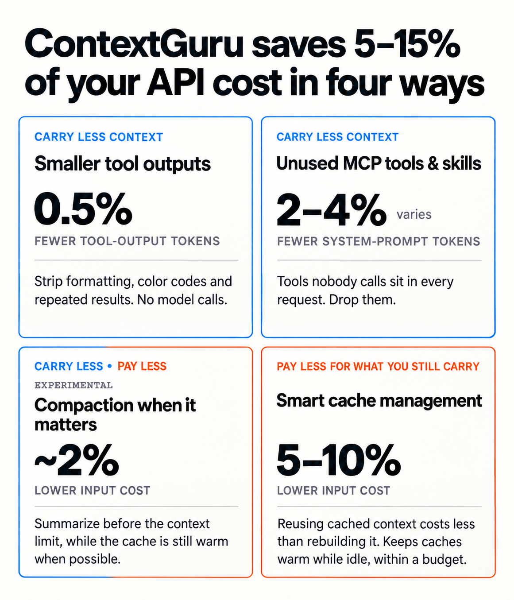

<div align="center">


# context-guru

**Provider-agnostic context engineering for LLM agents.**

**[▶ Watch the demo](https://rossoctl.github.io/context-guru/#demo)**

[](https://rossoctl.github.io/context-guru/)
[](https://pkg.go.dev/github.com/rossoctl/context-guru)
[](LICENSE)
[](go.mod)

</div>

---

context-guru cuts the token cost of your agent's traffic in two ways: **carry less context**
(drop redundant tool output, collapse superseded runs, summarize before you hit the limit), and
**pay less for what you still carry** (keep your prompt cache warm, split the volatile tail off
the system prompt so the rest stays cacheable). Paying less is the **default** — it's on out of
the box, before you opt into anything that trims content.

Full docs: **[rossoctl.github.io/context-guru](https://rossoctl.github.io/context-guru/)**.

<p align="center">

</p>

## Install

Choose your setup. Each button opens only the instructions for that path.

<table>
  <thead>
    <tr>
      <th></th>
      <th>Personal use</th>
      <th>Enterprise use</th>
    </tr>
  </thead>
  <tbody>
    <tr>
      <th>Claude Code</th>
      <td align="center">
        <a href="docs/how-to/install-plugin.md"></a>
      </td>
      <td align="center" rowspan="2">
        <a href="docs/hosted.md#user-setup"></a><br>
        <sub>Claude Code or Codex</sub>
      </td>
    </tr>
    <tr>
      <th>Codex (experimental)</th>
      <td align="center">
        <a href="codex-marketplace/plugins/context-guru/README.md"></a>
      </td>
    </tr>
  </tbody>
</table>

For local Codex use, register only the marketplace paths Codex needs; cloning the whole monorepo
can exceed Codex's marketplace timeout:

```sh
codex plugin marketplace add rossoctl/context-guru --sparse .agents --sparse codex-marketplace
codex plugin add context-guru@context-guru
```

## Claude Code plugin

The plugin answers three questions in the terminal: **how much am I saving, is my cache about to cost me, what should I do?**

```
/plugin marketplace add rossoctl/context-guru
/plugin install context-guru@context-guru
```

<p align="center">
<picture>
<source media="(prefers-color-scheme: dark)" srcset="docs/statusline-live/warm-dark.svg">

</picture>
</p>

Each command opens with one line that answers its question, then a small picture; add `details` for the tables.

| Command | The question | Example first line |
|---|---|---|
| `/context-guru:status` | Is it working, how am I doing, what next? | Saved $41.20 in 7 days (4.6% of what the same work would have cost). |
| `/context-guru:savings` | How much did it save? | Saved $41.20 in 7 days, net of Context Guru's own spend (4.6% of the $898.05 the same work would have cost). |
| `/context-guru:cache` | Is my cache about to cost me? | Cache is warm for 2:41 more. If it lapses, the next message costs $1.91 extra. |
| `/context-guru:waste` | What do I carry and never use? | 6 things you carry were never used: $37.70 in 7 days, about $161.57 a month. |
| `/context-guru:session` | What happened in this session? | In the last 4 hours of this session (9h20m long), cache misses cost you about $4.20 of the $13.50 billed (2 misses in 31 messages). |
| `/context-guru:doctor` | Is it set up right? | All 7 checks pass. |
| `/context-guru:adapt` | Which setting would have cost least on my history? | The best single change would have saved $12.40 over the last 30 days. |

### Adapt the settings to how you work

`/context-guru:adapt` replays your own past sessions under each setting, shows the current, default and best
side by side (saved, spent and net dollars), and offers one change, which it makes only after you say yes:

| Subcommand | Tunes |
|---|---|
| `/context-guru:adapt cache` | the cache keep-alive strategy |
| `/context-guru:adapt compaction` | the tail-compaction configuration |
| `/context-guru:adapt tools` | MCP servers, skills and tools you carry but never use |

```
Cache: switch to adaptive keep-alive to save about $12.40 more over the last 30 days.

                           saved  spent     net
  ▸  Ping every 5 min     $40.10  $9.00  $31.10  █████████░░░  current, default
  ★  Adaptive keep-alive  $51.20  $7.70  $43.50  ████████████  best
     No pings                 $0     $0      $0  ░░░░░░░░░░░░
```

(Illustrative numbers.) Codex: `$context-guru-adapt cache`. Reference: [docs/plugin/adapt.md](docs/plugin/adapt.md).

Five more views draw in the terminal (`watch`, `timeline`, `chart`, `heatmap`, `fill`).

Full guide, every status line state and troubleshooting: **[rossoctl.github.io/context-guru/plugin](https://rossoctl.github.io/context-guru/plugin/)**.

## Presets

It's an effort ladder — each tier is everything in the one before it, plus more:

| Preset | What it adds | Spends on its own |
|---|---|---|
| `off` | nothing — requests forwarded untouched (the default; only keep-alive spends, if that's on) | no |
| `conservative` | deterministic trimming of tool output (repeats, dead runs) — no model calls | no |
| `medium` | `conservative` plus a cheap model that keeps only what looks relevant in recent tool output, and a summary prepared in the background that is used only if you come back after the cache expired | yes |
| `high` | `medium`, but the summary of older turns is used as soon as the context window is nearly full | yes |
| `xhigh` | `high` plus a periodic deep-adjudication sweep over turns whose prompt cache has gone cold — the deepest cut | yes |

Run the picker any time to switch tiers—it explains each one before asking which to set:

| Claude Code | Codex (experimental) |
|---|---|
| `/context-guru:preset-picker` | `$context-guru-preset-picker` |

Claude Code applies the change at the next proxy start; Codex restarts its owned proxy after the
selection. Confirm the result with `/context-guru:status` on Claude Code or
`$context-guru-status` on Codex. Full pipelines:
[docs/reference/presets.md](docs/reference/presets.md).

Everything else — architecture, the full benchmark, every component, the proxy/gateway path,
config reference — is in **[docs/design.md](docs/design.md)** and
**[docs/get-started/how-it-saves.md](docs/get-started/how-it-saves.md)**.

## Updating

The proxy **binary** is what matters and what changes often. Claude Code checks for a newer release
in routed sessions and offers update choices; Codex checks when you invoke its update skill. Update
it any time with the command for your client:

| Claude Code | Codex (experimental) |
|---|---|
| `/context-guru:update` | `$context-guru-update` |

Codex does **not** check or install proxy updates automatically. Codex users should run
`$context-guru-update` periodically. It checks only; when an update is available, exit Codex and
run `~/.local/state/context-guru-codex/context-guru-update` in an ordinary shell, then start a new
session.

**The plugin itself** (skills, hooks, scripts) rarely needs updating — most releases only touch the
proxy binary, which the update command above already covers. To refresh the plugin itself:

| Claude Code | Codex (experimental) |
|---|---|
| `/plugin marketplace update rossoctl/context-guru`<br>`/reload-plugins` | `codex plugin marketplace upgrade context-guru`<br>Then restart Codex. |

Codex remembers the sparse paths from marketplace registration and reuses them during upgrade;
the `upgrade` command does not take separate `--sparse` flags. For an older registration that was
created without sparse paths and now times out, follow the one-time re-registration steps in the
[Codex troubleshooting guide](codex-marketplace/plugins/context-guru/README.md#operations-and-troubleshooting).

More: [docs/how-to/install-plugin.md](docs/how-to/install-plugin.md#upgrading).

## Troubleshooting

**If a routed session cannot start or answer**, run the client-specific recovery script from an
ordinary shell. It needs no working agent session, proxy, or network:

| Claude Code | Codex (experimental) |
|---|---|
| `~/.local/state/context-guru/context-guru-reset` | `~/.local/state/context-guru-codex/context-guru-reset` |

Prefer recovery over an in-session uninstall when the session is stuck: a dead proxy prevents the
request that would invoke the uninstall skill. More troubleshooting: [Claude Code](docs/how-to/install-plugin.md#troubleshooting)
or [Codex](codex-marketplace/plugins/context-guru/README.md#operations-and-troubleshooting).

Remove context-guru routing with:

| Claude Code | Codex (experimental) |
|---|---|
| `/context-guru:uninstall` | Exit Codex, then run `~/.local/state/context-guru-codex/context-guru-reset --yes` in an ordinary shell. |

On Claude Code, uninstall affects the install routing the current project, while the recovery
script un-routes every settings file the plugin edited. Codex routing is user-wide, so its
standalone reset restores the previously selected default provider. Do not stop the proxy from a
routed Codex session: that session cannot change transport and its remaining turns will be
stranded. `$context-guru-uninstall` only plans the removal and shows the shell command. Neither
client's removal flow removes the marketplace registration or plugin package itself. Codex reset
does remove a proxy binary downloaded into its private state directory; it never removes a binary
that setup reused from `PATH`.

More:
[docs/how-to/install-plugin.md](docs/how-to/install-plugin.md#removing-it-uninstall-or-reset).

## Upgrading Claude Code from project level to user level

Installed in one project and now want it everywhere? Install again with `--global` and keep both —
each gets its own port, and a project you later reset falls back to the machine-wide one.

```
/context-guru:install --global
```

More:
[docs/how-to/install-plugin.md](docs/how-to/install-plugin.md#upgrading-from-project-level-to-user-level).

Codex does not have this project/user routing split: `$context-guru-setup` configures the user's
default provider for ordinary Codex sessions.

## License

Apache-2.0. See [LICENSE](LICENSE). A [Rossoctl](https://github.com/rossoctl) platform component.
