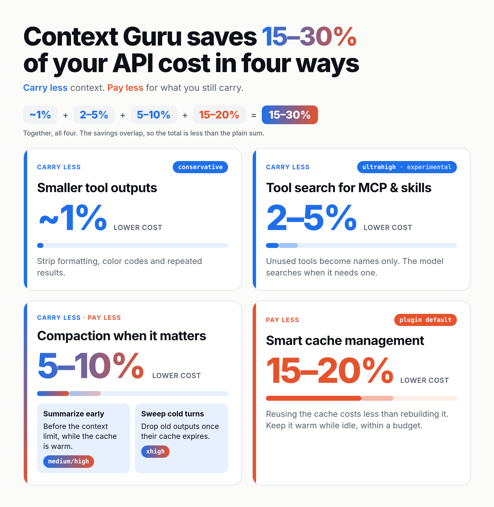
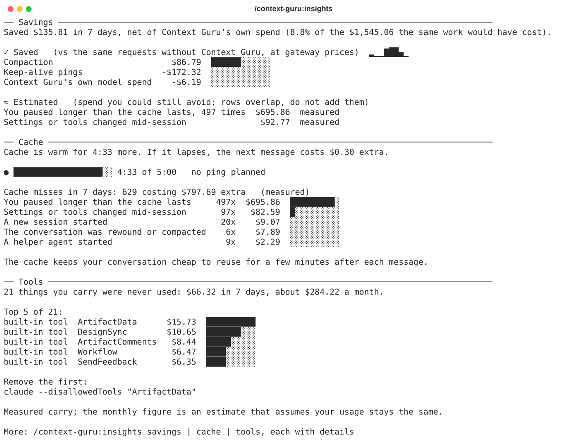

<div align="center">


# context-guru

**Provider-agnostic context engineering for LLM agents.**

**[▶ Watch the demo](https://rossoctl.github.io/context-guru/#demo)** · **[📝 Read the blog](https://medium.com/@osherelhadad/contextguru-carry-less-pay-less-cutting-the-cost-of-ai-agents-770f099aedd2)**

[](https://rossoctl.github.io/context-guru/)
[](https://pkg.go.dev/github.com/rossoctl/context-guru)
[](LICENSE)
[](go.mod)

</div>

---

context-guru cuts the token cost of your agent's traffic in two ways: **carry less context**
(drop redundant tool output, collapse superseded runs, summarize before you hit the limit), and
**pay less for what you still carry** (keep your prompt cache warm, split the volatile tail off
the system prompt so the rest stays cacheable). Paying less is the **default** — it's on out of
the box, before you opt into anything that trims content.

Full docs: **[rossoctl.github.io/context-guru](https://rossoctl.github.io/context-guru/)**.
How and why it works, with real numbers: **[ContextGuru: Carry Less, Pay Less](https://medium.com/@osherelhadad/contextguru-carry-less-pay-less-cutting-the-cost-of-ai-agents-770f099aedd2)**.

<p align="center">
<picture>
<source media="(prefers-color-scheme: dark)" srcset="docs/img/readme/savings-dark.png">

</picture>
</p>

## Install

Choose your setup. Each button opens only the instructions for that path.

<table>
  <thead>
    <tr>
      <th></th>
      <th>Personal use</th>
      <th>Enterprise use</th>
    </tr>
  </thead>
  <tbody>
    <tr>
      <th>Claude Code</th>
      <td align="center">
        <a href="docs/how-to/install-plugin.md"></a>
      </td>
      <td align="center" rowspan="2">
        <a href="docs/hosted.md#user-setup"></a><br>
        <sub>Claude Code or Codex</sub>
      </td>
    </tr>
    <tr>
      <th>Codex (experimental)</th>
      <td align="center">
        <a href="codex-marketplace/plugins/context-guru/README.md"></a>
      </td>
    </tr>
    <tr>
      <th>Pi (experimental)</th>
      <td align="center">
        <a href="#pi-experimental"></a>
      </td>
      <td align="center">Not yet</td>
    </tr>
  </tbody>
</table>

### Pi (experimental)

The [Pi](https://pi.dev) package routes Pi's `anthropic` and `openai` providers through a local
proxy. It is experimental: it is tested with fake keys in a sandbox, but not yet with a real login.

You need:

- Pi 1.5.0 or later, which needs Node.js 22.19 or later.
- `python3`.
- macOS or Linux.

Install it:

1. Clone this repository:
   ```sh
   git clone https://github.com/rossoctl/context-guru.git
   ```
2. Install the package into Pi:
   ```sh
   pi install ./context-guru/pi-package
   ```
3. Start Pi and run:
   ```text
   /context-guru setup
   ```
   Setup asks one question and changes nothing until you answer yes. On yes, it installs the proxy
   as a user service that starts at login. Then it points Pi's `anthropic` and `openai` providers at
   the proxy, in `~/.pi/agent/models.json`.
4. Select the model again with `/model`, or restart Pi.

Check it with `/context-guru status`. Undo it with `/context-guru uninstall`. If Pi cannot talk after
setup, run `~/.local/state/context-guru-pi/context-guru-reset`.

The default cache strategy, `auto`, sends small keep-alive requests while you are idle. They use your
own quota. To turn them off, run `/context-guru cache-strategy none`.

Details and limits: [pi-package/README.md](pi-package/README.md). How it differs from the Claude Code
plugin: [Pi package and Claude Code plugin compared](docs/reference/pi-vs-claude-code.md).

## What's cool

**The status line shows your savings live, for the main session and for every subagent.** It also shows the cache
clock, the context fill and the keep-alive pings. This frame comes from a real, week-long release session:

<p align="center">
<picture>
<source media="(prefers-color-scheme: dark)" srcset="docs/img/readme/statusline-subagents-dark.svg">

</picture>
</p>

**`/context-guru:insights` tells you what you saved, what your cache costs you, and what you carry and never use.**
Real output, 7 days of one developer's work:

<p align="center">
<picture>
<source media="(prefers-color-scheme: dark)" srcset="docs/img/readme/insights-dark.svg">

</picture>
</p>

More:

- **[Save more](docs/plugin/save-more.md)**: replay your own history and find the config that costs least.
- **[Remove tools](docs/plugin/remove-mcp-and-skills.md)**: find the MCP servers and skills you never use, and remove them.
- **[Dashboard](docs/dashboard.md)**: every request, every saving, in your browser.

Every command: **[docs/plugin/commands.md](docs/plugin/commands.md)**. Full guide, every status line state and
troubleshooting: **[rossoctl.github.io/context-guru/plugin](https://rossoctl.github.io/context-guru/plugin/)**.

## Presets

It's an effort ladder — each tier is everything in the one before it, plus more:

| Preset | What it adds | Spends on its own |
|---|---|---|
| `off` | nothing — requests forwarded untouched (the default; only keep-alive spends, if that's on) | no |
| `conservative` | deterministic trimming of tool output (repeats, dead runs) — no model calls | no |
| `medium` | `conservative` plus a cheap model that keeps only what looks relevant in recent tool output, and a summary prepared in the background that is used only if you come back after the cache expired | yes |
| `high` | `medium`, but the summary of older turns is used as soon as the context window is nearly full | yes |
| `xhigh` | `high` plus a periodic deep-adjudication sweep over turns whose prompt cache has gone cold — the deepest cut | yes |
| `ultrahigh` | **Experimental.** `xhigh` plus tool deferral: tools your own history shows you do not use are sent as names only, and the model loads one through search when it needs it. Opt-in. On Claude models it uses the API's tool search; on GPT, GLM and Kimi it uses Context Guru's own search tool. See [Experimental: ultrahigh](#experimental-ultrahigh) | yes |

Run the picker any time to switch tiers—it explains each one before asking which to set:

| Claude Code | Codex (experimental) |
|---|---|
| `/context-guru:preset-picker` | `$context-guru-preset-picker` |

Claude Code applies the change at the next proxy start; Codex restarts its owned proxy after the
selection. Confirm the result with `/context-guru:status` on Claude Code or
`$context-guru-status` on Codex. Full pipelines:
[docs/reference/presets.md](docs/reference/presets.md).

### Experimental: ultrahigh

`ultrahigh` is experimental. Use it to try tool deferral, not as a default.

- **Accuracy:** on Sonnet 5.5 it picks the right tool as often as `xhigh`. On Opus 5.5 it is worse on vague tasks: 66 of 80 against 72 of 80 with no deferral, in the last run of the shipped setup (2026-11-03). The model sometimes uses Bash when the right tool is deferred.
- **Measured before each release:** the result of each run is posted on [#871](https://github.com/rossoctl/context-guru/issues/871). `ultrahigh` stays experimental until 3 releases in a row pass.
- **Known limits:** on GPT, GLM and Kimi, answers in a session with deferred tools arrive all at once, not word by word, on both Chat Completions and Responses ([#879](https://github.com/rossoctl/context-guru/issues/879) for Chat Completions). The provider's native tool search for newer GPT models is not used yet ([#876](https://github.com/rossoctl/context-guru/issues/876)).
- **To turn it off:** pick another preset, or set `toolfilter: {defer: off}`. In Claude Code you can also set `ENABLE_TOOL_SEARCH=false` (the plugin's session-start hook sends it to the proxy; the Codex plugin has no such hook).

Everything else — architecture, the full benchmark, every component, the proxy/gateway path,
config reference — is in **[docs/design.md](docs/design.md)** and
**[docs/get-started/how-it-saves.md](docs/get-started/how-it-saves.md)**.

## Updating

The proxy **binary** is what matters and what changes often. Claude Code checks for a newer release
in routed sessions and offers update choices; Codex checks when you invoke its update skill. Update
it any time with the command for your client:

| Claude Code | Codex (experimental) |
|---|---|
| `/context-guru:update` | `$context-guru-update` |

Codex does **not** check or install proxy updates automatically. Codex users should run
`$context-guru-update` periodically. It checks only; when an update is available, exit Codex and
run `~/.local/state/context-guru-codex/context-guru-update` in an ordinary shell, then start a new
session.

**The plugin itself** (skills, hooks, scripts) rarely needs updating — most releases only touch the
proxy binary, which the update command above already covers. To refresh the plugin itself:

| Claude Code | Codex (experimental) |
|---|---|
| `/plugin marketplace update rossoctl/context-guru`<br>`/reload-plugins` | `codex plugin marketplace upgrade context-guru`<br>Then restart Codex. |

Codex remembers the sparse paths from marketplace registration and reuses them during upgrade;
the `upgrade` command does not take separate `--sparse` flags. For an older registration that was
created without sparse paths and now times out, follow the one-time re-registration steps in the
[Codex troubleshooting guide](codex-marketplace/plugins/context-guru/README.md#operations-and-troubleshooting).

More: [docs/how-to/install-plugin.md](docs/how-to/install-plugin.md#upgrading).

## Troubleshooting

**If a routed session cannot start or answer**, run the client-specific recovery script from an
ordinary shell. It needs no working agent session, proxy, or network:

| Claude Code | Codex (experimental) |
|---|---|
| `~/.local/state/context-guru/context-guru-reset` | `~/.local/state/context-guru-codex/context-guru-reset` |

Prefer recovery over an in-session uninstall when the session is stuck: a dead proxy prevents the
request that would invoke the uninstall skill. More troubleshooting: [Claude Code](docs/how-to/install-plugin.md#troubleshooting)
or [Codex](codex-marketplace/plugins/context-guru/README.md#operations-and-troubleshooting).

Remove context-guru routing with:

| Claude Code | Codex (experimental) |
|---|---|
| `/context-guru:uninstall` | Exit Codex, then run `~/.local/state/context-guru-codex/context-guru-reset --yes` in an ordinary shell. |

On Claude Code, uninstall affects the install routing the current project, while the recovery
script un-routes every settings file the plugin edited. Codex routing is user-wide, so its
standalone reset restores the previously selected default provider. Do not stop the proxy from a
routed Codex session: that session cannot change transport and its remaining turns will be
stranded. `$context-guru-uninstall` only plans the removal and shows the shell command. Neither
client's removal flow removes the marketplace registration or plugin package itself. Codex reset
does remove a proxy binary downloaded into its private state directory; it never removes a binary
that setup reused from `PATH`.

More:
[docs/how-to/install-plugin.md](docs/how-to/install-plugin.md#removing-it-uninstall-or-reset).

## Upgrading Claude Code from project level to user level

Installed in one project and now want it everywhere? Install again with `--global` and keep both —
each gets its own port, and a project you later reset falls back to the machine-wide one.

```
/context-guru:install --global
```

More:
[docs/how-to/install-plugin.md](docs/how-to/install-plugin.md#upgrading-from-project-level-to-user-level).

Codex does not have this project/user routing split: `$context-guru-setup` configures the user's
default provider for ordinary Codex sessions.

## Cite

If you use context-guru in your work, please cite the blog post:

> Osher Elhadad. *ContextGuru: Carry Less, Pay Less — Cutting the Cost of AI Agents.* Medium, 2026.
> https://medium.com/@osherelhadad/contextguru-carry-less-pay-less-cutting-the-cost-of-ai-agents-770f099aedd2

```bibtex
@misc{elhadad2026contextguru,
  author       = {Osher Elhadad},
  title        = {ContextGuru: Carry Less, Pay Less --- Cutting the Cost of AI Agents},
  year         = {2026},
  howpublished = {Medium},
  url          = {https://medium.com/@osherelhadad/contextguru-carry-less-pay-less-cutting-the-cost-of-ai-agents-770f099aedd2}
}
```

## License

Apache-2.0. See [LICENSE](LICENSE). A [Rossoctl](https://github.com/rossoctl) platform component.
