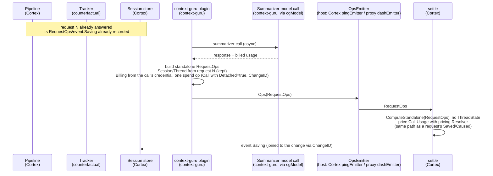
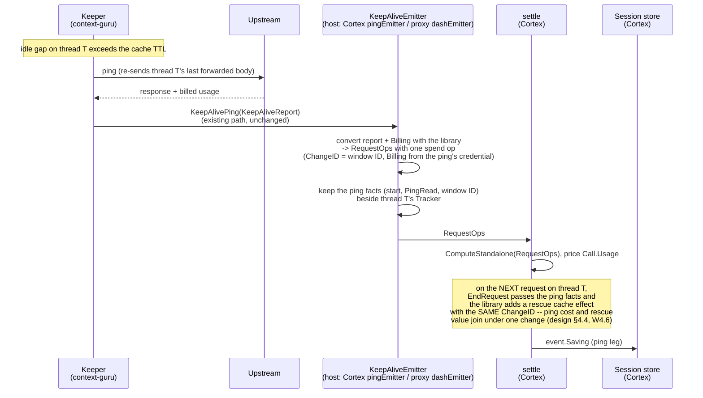

# Context operations: wiring in Cortex and the context-guru proxy

**Status:** proposed. Split out of the context operations design after review of
rossoctl/context-guru#592.
**Companion:** `design.md` in `rossoctl/context-guru` defines the
method (the context operation model, the counterfactual, the tiers). This document says how Cortex and the
context-guru proxy connect to it. Text below is moved from that design. A plain `§N` reference points at the method document, in its
current numbering. Sections that start with `W` are this document's own.

**Problem statement:** [rossoctl/cortex#1417](https://github.com/rossoctl/cortex/issues/1417).
**Roll-up:** [rossoctl/rossoctl#2649](https://github.com/rossoctl/rossoctl/issues/2649), "Cortex Local:
Context Guru integration with Cortex". It asks that the accounting of context-guru match the pattern of
tool-prune, [rossoctl/cortex#952](https://github.com/rossoctl/cortex/issues/952) (closed). W7.4 compares
the two.

**Open.**
- **Push or fingerprint (design §11, question 4).** This document and the migration steps assume a
  Tracker that keeps the state of each thread. A push model, where components push facts
  with an identity and the receiver keeps no state, is under review. Until it is decided, the
  fingerprint design below is the current one.
- `pctx.ReportOps` and the Cortex name for the component that writes to the cost ledger have no
  chosen name (design §11, question 8).
- **The Tracker's state (design §11, questions 11 to 14).** A context operation is now reported
  once, on the first request of its change, and `Compute` applies it again on later requests. The
  Tracker in the library keeps the active context operations, the previous fingerprint and the cache
  state for each thread. The host calls `BeginRequest`, `Add`, `EndRequest` and `Compute`
  (design §6.1). `Compute` stores the new `ThreadState`; `Preview` stores nothing. A ping or a
  detached call is priced with `ComputeStandalone` and changes no `ThreadState`. Where the cache
  state lives, how `Compute` finds that a context operation has ended, and how the state recovers,
  are not decided.

## W0. Overview: from a request to the savings


The request (black line) goes from the agent through the plugins to the upstream LLM. Each plugin
reports the context operations it made (circles). Cortex adds them to the request record, in pipeline
order. The record holds the client and forwarded bodies; the thread's Tracker holds its previous
fingerprint and its active context operations. `Compute` compares the two, applies the active
operations again, and returns tokens per tier. Cortex prices them with its own rates (W7.1). The sections below
give the details of each step.

### W0.1 The questions in cortex#1417

[cortex#1417](https://github.com/rossoctl/cortex/issues/1417) lists the open questions from the
Cortex side. This spec answers them as follows.

| # | Question in the issue | Answer in this spec |
|---|---|---|
| 1 | One set of numbers: spend and savings priced from different rate tables | Inside one host, spend and savings use one resolver (D3, D4, W4.6). The tier logic is in one library. The rates stay host-local by design (§1). |
| 2 | A figure deployers can trust: how it was computed, and who stands behind it | Each recorded figure names its context operator, its component, `Estimated` and `DryRun` (W7.1), and the `counterfactual` version that computed it (R46). The rules are reviewed in context-guru through the case list and `differences.json` (design §10.4). |
| 3a | Cache effects: a saving priced at the tier the rewritten request landed in | Saved tokens are priced at the tier they would have had without the change: B\* and the breakpoints (§5.1, R36, R37). A break that a change caused is a separate cache effect, a cost linked to that change (R23). |
| 3b | The plugin's own LLM calls through `core/llmclient`, not in the ledger; the `ibac` judge too | `spend` context operations with the call's billed usage (D4, W4.6). This applies to every plugin that calls a model, not only context-guru (R47). |
| 3c | Keep-alive: the cost and the benefit land on different requests | a `spend` per ping, a `rescue` cache effect, one `ChangeID` (design §4.4, W4.6). |
| 4 | Content re-sent every turn: overcount for compaction, correct for tool-prune | `ChangeID` (R22, D1); the tier comes from the position, so tool-prune is priced on every turn and a compaction is not counted again at the full rate (design §4.6). |
| 5 | Two ways of counting tokens | None: a context operator reports bytes only, the library converts them with the request's ratio and marks the result `Estimated` (R8, design §4.2 rule 7); the accuracy of the ratio is open (design §11, question 3). |
| 6 | Credit across several plugins | Each context operator is measured against its own input (R29), and R25 for the same content. |
| 7 | Observe mode | `DryRun` (R12), never counted in totals. |
| — | Where the baseline lives, and how changes to it are reviewed | In the `counterfactual` library in context-guru (D2). A change to it changes the case list, and every intended difference is in `differences.json` (design §10.2, §10.4). |

### W4.6 How context operations reach the host

There are three kinds of context operator, and each reaches the host through a path that already exists.
The design adds no new reporting interface for the engine or the keeper.

| Context operator | When it runs | How its context operations reach the host |
|---|---|---|
| **The context-guru engine** (every component, including the ones whose bytes `apply` writes, §4.2 rule 8) | inside a request | **`apply.Result.Ops`**: the engine returns its context operations with the rewritten body, in both hosts. In Cortex the context-guru plugin passes them to `pctx.ReportOps(result.Ops...)`. In the proxy there is no other context operator, so the proxy reads `result.Ops` directly. |
| **Another Cortex plugin** (tool-prune, cpex) | inside a request | `pctx.ReportOps(ops...)`, during its own pass. Cortex only. |
| **The keeper**, and a **detached** engine model call | between requests, or after the response | the host's `components.Emitter`, through its optional capabilities: `KeepAliveEmitter.KeepAlivePing(KeepAliveReport)` for a ping (exists today), and `OpsEmitter.Ops(RequestOps)` for a detached call (new, same pattern). |

**Why not a new `Sink`.** A `Sink` interface for pings would duplicate what exists. The keeper already
has a host-agnostic report path: `components.KeepAliveEmitter`, added so the keeper could be
exported from the proxy without a direct call into `dash` (issue #382, PR #591). The proxy wires
it to its `dashEmitter`; Cortex wires it to `pingEmitter` (`core/plugins/contextguru/spend.go`). A
second interface would make the keeper report each ping twice, or retire `KeepAliveReport` and lose
the fields the dashboard groups by (`Strategy`, `Preset`, `StopReason`, `MaxTokens`,
`FreshInput`). So the keeper keeps reporting `KeepAliveReport`, and **each host converts it** to a
`RequestOps` with one `spend` context operation:

| `KeepAliveReport` | `spend` context operation |
|---|---|
| `Session`, `Thread` | `RequestOps.Session`, `RequestOps.Thread` (`""`, the primary thread in `internal/thread`, becomes `"main"`) |
| `Window` (new, additive: the start of the idle gap the ping served) | `ChangeID = "ka:" + Thread + ":" + Window`, with the mapped thread ID |
| `Model` | `Call.Model` |
| `Route` (the upstream the ping was sent to) | `Call.Host` |
| `Provider` | not on the context operation; the host uses it to choose the lifetime kind (design §5.2) |
| `CacheRead`, `CacheWrite`, `CacheWrite1h`, `FreshInput`, `Output` | `Call.Usage` (its prompt fields and `Output`) |
| `TS` | `RequestOps.At` |
| `Strategy`, `Preset`, `StopReason`, `MaxTokens`, `Agent` | not on the context operation; the dashboard keeps reading them from `KeepAliveReport` (design §9.1) |
| `CostUSD` | not used: the host prices `Call.Usage` with its own rates, like every other call |

The conversion is a pure function in `counterfactual` that turns a `KeepAliveReport` and a `Billing` into a `RequestOps` with one `spend` context operation, so both
hosts build the same context operation. The host supplies `Billing`, because only it knows which credential
the ping used. The host prices the result with `ComputeStandalone` (design §6.1).

**The ping facts for the next request.** The same conversion returns the facts the next real
request of the thread needs: the ping's start time, the extent it read, and its `ChangeID`. The host
keeps the last of them beside the thread's Tracker, and passes them in `EntryFacts.LastPing`,
`PingRead` and `PingWindow` at that request's `EndRequest`. Then it clears them. A ping does not move
the thread's `ThreadState`.

```go
// OpsEmitter is an optional Emitter capability, the same pattern as KeepAliveEmitter: the engine
// type-asserts for it and does nothing if it is absent. It carries a RequestOps that has no
// request to travel with: today, only a detached model call.
type OpsEmitter interface {
    Ops(RequestOps)
}
```

The contract of both capabilities: safe for concurrent use; no
blocking I/O; never makes the session active (a ping is not agent activity); may drop a report for
a session that no longer exists.

**Who builds a standalone `RequestOps`.** No request record is open, so the caller fills it from what it
knows about the thread it acts on: `Session` and `Thread`. It sets `Billing` from the credential its
call used (R41, design §7.1).

**Where the usage comes from.** The host gives the engine its model client (`components.Model`;
in Cortex, `cgModel`). The client reads the usage from each response, and fills `ModelCall`. The
engine's own usage accounting is not used, because under Cortex it is zero (2026-10-14 spec, §0).

**A detached call.** A summarizer call can finish after its request was answered. Its `spend`
context operation then cannot travel in that request's `apply.Result`. The engine sends it through
`OpsEmitter`, as a standalone `RequestOps` with `Detached = true` on the call, and
`Session`/`Thread` from the request that caused the call. Its `ChangeID` is the change it made,
so the cost is still joined to that change.

**A prefix ask.** `extract_llm_sweep` asks the request's own model a question, as a separate
upstream call whose body is the previous turn's forwarded bytes plus one trailing user message
(`PrefixAsker`). That is an ordinary `spend` context operation: its `Call.Usage` shows the cache read it
was designed for (measured 19,595 read, 0 written). When the sweep falls back to a call without the
cached prefix, the same context operation shows fresh input instead. No new kind is needed; the test cases
cover both (design §10.3).

**How the host records it.** The host handles context operations from `apply.Result`, from `ReportOps`,
and from either Emitter capability the same way. It prices `Saved`, `Caused` and `Call.Usage` with
one resolver. So spend has the same rates, provenance, currency and billing basis (design §7.1) as the
savings.

**What it replaces.** `core/cost/spend` (`Charge`, `CostRecorder`, `RecorderConsumer`) is removed.
Today both Cortex wirings inject `spend.LogRecorder{}`, which only logs, and the recorder that would
write the ledger was never built. So no recorded figure changes. Cortex's `pingEmitter` keeps
implementing `KeepAliveEmitter`, and converts each `KeepAliveReport` into a `spend` context operation with the library, instead of building a `spend.Charge`.

### W4.8 Sequence: three flows, and which repo each step is in

`participant` labels mark which repo owns each piece: Cortex (the pipeline, the Tracker,
`settle`) or context-guru (a plugin, the keeper, `counterfactual`). `counterfactual` is a library import in both; it
runs in-process in whichever repo calls it, never as its own service.

**A. A normal request.** A plugin reduces a tool output; `Compute` finds no break; `settle`
prices and records.

```mermaid
sequenceDiagram
    participant Client
    participant Pipeline as Pipeline<br/>(Cortex)
    participant Tracker as Tracker<br/>(counterfactual, imported)
    participant Plugin as context-guru plugin<br/>(context-guru)
    participant Ops as request.Compute<br/>(counterfactual)
    participant Settle as settle<br/>(Cortex)
    participant Store as Session store<br/>(Cortex)
    participant Upstream

    Client->>Pipeline: request
    Pipeline->>Tracker: BeginRequest(meta, client body, client breakpoints)<br/>(Session, Model, Billing from credential; no thread yet)
    Pipeline->>Plugin: OnRequest(pctx)
    Plugin->>Plugin: apply.Apply: resolve thread,<br/>rewrite a tool output (mask/cmdfilter/coref/...)
    Plugin->>Pipeline: pctx.ReportOps(result.Ops...)<br/>+ result.Thread
    Pipeline->>Tracker: Add(op) for each<br/>stamps Operator and DryRun
    Pipeline->>Tracker: EndRequest(thread, forwarded, breakpoints, facts)<br/>copies that thread's ThreadState
    Pipeline->>Upstream: forward (smaller) body
    Upstream-->>Pipeline: response + usage
    Pipeline->>Ops: request.Compute(usage)<br/>compares inside: B*, cache effects, phase
    Ops-->>Pipeline: Result (PricedOp[], Boundary, Phase)<br/>and the new ThreadState is stored
    Pipeline->>Settle: Result
    Settle->>Settle: price Saved/Caused with pricing.Resolver
    Settle->>Settle: discard RequestOps/Operation (R20)
    Settle->>Store: event.Saving{Changes: []ChangeSaving, ...}
    Pipeline-->>Client: response
```

**B. A detached call.** The request has already been answered; its `RequestOps` may already be
closed and recorded. The summarizer call finishes afterward and reports through the host's
`OpsEmitter`.



**C. A standalone keep-alive ping.** No request is open at all; the keeper acts between turns.



## 5. The Tracker and the host

**Current design.** The Tracker in the library keeps the state of each thread: the active context
operations, the previous fingerprint and the cache state. The host owns one Tracker for each thread,
and calls it (design §6.1). The alternative, a push model, is open (design §11, questions 4 and 5).

Each host does the same: Cortex, and the context-guru proxy. The parts are split this way. The parts that live in the library are in the method document (design §5).

| Part | Where | Cortex | Proxy |
|---|---|---|---|
| Resolve the thread | `internal/thread` (engine) | the engine resolves it inside `apply`, as today, and returns it in `apply.Result.Thread`. If the context-guru plugin is not in the pipeline, the host calls `internal/thread` itself on the client body | the same |
| Collect the context operations | host | `pctx.ReportOps`, from every plugin, in pipeline order (W5.1) | `apply.Result.Ops`: the engine is the only context operator |
| Keep the thread's state: active context operations, previous fingerprint, cache state | the Tracker (library); the host holds one Tracker for each thread | a map from `thread.Key(session, thread)` to its Tracker | the same map, beside `dash.Recorder`'s `lastTail` (W5.2) |
| Find B\*, the break and the cache state | inside `Compute` (deterministic; the comparison is not public) | calls `BeginRequest` before the plugins and `EndRequest` with the resolved thread after them, then `request.Compute(usage)` after the response, which stores the new `ThreadState` | the same calls |
| Keep the last ping facts of each thread | host, beside the Tracker | in `pingEmitter` | in `dashEmitter` |
| Convert keep-alive reports | the library's keep-alive conversion (pure) | in `pingEmitter` | in `dashEmitter` |


### W5.1 Collecting

- Each plugin calls `pctx.ReportOps(ops...)` during its pass. The pipeline runs in sequence, so the
  list is in order.
- The framework sets `Operator`. A plugin cannot report under another plugin's name.
- The framework sets `DryRun = true` on every context operation of a plugin whose `SetBody` returned
  false (`on_error: observe`).
- A context operator reports only changes that are in the forwarded body, or that would be there for a
  `DryRun` context operation. A change the pipeline reverted (an error, a panic, the never-worse guard) is
  not reported. It saves nothing, as a change that ended (§4.5). Its model call, if any, is still a
  `spend` context operation, so the money it cost is counted.
- The host keeps an explicit allow-list of context operators, for the reason `savingComponents` has today:
  a plugin must not add itself to the money record only by reporting context operations. Context operations from
  a context operator that is not on the list are kept on the event and marked unpriced. The library
  does not see the list. So the host, not the library, writes the reason `operator_not_allowed`:
  it drops those `PricedOp`s from the money record after `Compute`. They still go to `Add`, because
  the sum check needs every change in the body.

### W5.2 The thread, and the previous request

**The thread comes from `internal/thread`, not from the Tracker.** The engine already resolves
each request's thread (`thread.Result`): the agent's header first, then prefix continuity, then the
session as a last resort. It also returns two signals that a weaker rule would lose:

- `Disagree`: the header named a known thread, but prefix continuity matched a different one. The
  header wins; the host logs the drift.
- `Inherits`: a new thread whose content is mostly an existing thread's — a rewind, an edited
  earlier message, a fork. Its first request is that thread's next turn, not a cold start.

The engine runs inside both hosts, so both get the same `thread.Result` for the same traffic. `RequestOps.Thread` carries
`ID` and `Parent` (`Parent = Inherits`).

**The previous request is this thread's previous request.** The host keeps one Tracker per
thread, keyed by `thread.Key(session, thread)` — the key `dash.Recorder` already uses for
`lastTail` and `lastSeen`. A new thread with `Inherits` set starts from a copy of the inherited
thread's `ThreadState`: its fingerprint, so a fork reads its parent's cache instead of scoring cold,
and its active context operations, because the fork carries the parent's content and the changes on
it. From then on the two threads are separate. A change that ends in one does not end in the other.

An earlier draft matched each request against the last 4 fingerprints of the session by longest
common prefix. That answered a weaker question. After interleaved subagent requests the best prefix
match can be an older request, and a main thread whose previous turn is more than 4 requests back
drops out of the window. `cachesplit`'s saving depends on comparing the volatile tail with **this
thread's immediately previous request** (`cachesplitSavedUSD`, `TailChanged`), so a stale match
would misattribute it. Keying by thread gives the right baseline for every rule that needs one.

### W5.3 Limits

- **Memory:** 16 bytes for each position (`PosHash`, design §5.1). 2 bodies × 2,000 positions is about
  64 KB for each thread. `internal/thread` caps threads at 64 for each session; a typical session
  has 1 to 5. `session.max_sessions` (100) bounds the total.
- **What is kept:** one fingerprint for each thread, the last one, overwritten after each request. B\*
  needs only the previous request of the same thread, so the store does not grow with the length of a
  session. The active context operations of a thread are also kept, because `Compute` applies them
  again. They grow with the number of live changes, not with the number of requests, and a change that
  ends is removed. That bound holds only if the end rule works (design §11, question 12). If it does
  not, the list can grow without limit.
- **Restart:** the whole `ThreadState` is lost. The fingerprint heals on the next request: only that
  request gets `penalty_unknown`. The active context operations do not heal: the context operators
  do not report them again, so every later request of the thread misses their saving and fails the
  sum check, until each change ends (design §4.6). Nothing is persisted (design §9). How the state
  recovers is open (design §11, question 13).
- context-guru keeps its own `MaxCachedIdx` for its own decisions. For pricing, the library's B\*
  is the only authority (R30), because it is computed from the forwarded body after every plugin
  ran. In the proxy there is no later plugin, so the two must agree: the proxy checks
  `MaxCachedIdx` against B\* and counts a disagreement (a bug in one of them), at no extra cost.

### W7.1 From `Result` to `event.Saving`

`settle` calls `counterfactual.Compute` once for each request, over the in-process `RequestOps`/`Operation`
list (R20): that list is never recorded. `settle` prices `Saved` and `Caused` with its
`pricing.Resolver`, at the same model and long-context tier as the request itself, then discards
the context operations and writes one `event.Saving` for each (context operator, component) — the only form that
reaches the session store, `:9094`, and the archive.

A cache effect (`Result.CacheEffects`, design §4.4) is not an operation and has no `Operator`. `settle`
settles it by its `Kind`. A `break` with a `ChangeID` goes to the operator of the `rewrite` or `setting`
with the same `ChangeID` in the result, reported or active. A `rescue` goes to the keeper, by its window.
A `ttlPremium` and a `ttlRescue` go to the head entry named by their `ChangeID`. A `break` with no
`ChangeID` goes to `Event.UnattributedBreakUSD`.

A `break` cache effect has both sides (design §6.3): `Saved.CacheRead` is the read that did not happen,
and `Caused.CacheWrite5m` is the write that happened instead. They are one fact, the rate
difference. So `settle` prices a break as **one net cost**, `Caused` priced minus `Saved` priced,
and puts it in `PenaltyUSD`. It never adds a break's `Saved` to `USD`, which would inflate the
saving by the read.

| `event.Saving` field | Source |
|---|---|
| `Component` | the context operator name, for example `context-guru.mask` |
| `TokensAvoided` | the prompt-token reduction, as today: `SizeBefore.Tokens − SizeAfter.Tokens` of the operator's content changes. It is a size, not a price, so it is not the cross-tier total that R52 forbids. A reader must not price it at one rate: `USD` is the price |
| `USD` | `Saved` of the content changes and rescues, priced |
| `PenaltyUSD` | `Caused` of the content changes, priced, plus the net cost of each attributed break |
| `Tier` | the tier with the largest `Saved` |
| `Projected` | `DryRun` (the existing field: "would have saved", never in a total) |
| `Estimated` | any context operation `Estimated` |
| `OpsVersion` (new, additive) | `Result.Version`, the version of the `counterfactual` rules (R46) |

New fields, all additive (the ledger rule is "add, never rename"):

| Field | Where | Why |
|---|---|---|
| `Saving.Operator` | event and ledger | group `context-guru/*` in the per-plugin breakdown |
| `Saving.Changes []ChangeSaving` | event only | `{changeId, savedUSD, causedUSD}`, for totals and payback for each change. Not in the ledger, which keys by minute. |
| `Event.UnattributedBreakUSD` | event | client edits and expired caches. Shown, never charged to a plugin. |
| `Event.InteractionUSD` | event | the interaction on a rescued request (§6.2). Counted in the session total, never charged to a plugin. |
| `Saving.Thread`, `ChangeSaving.Thread` | event and ledger | sum for each thread; a subagent's saving is separate from the main thread's |
| `Saving.Basis` | event and ledger | `usd`, `subscriptionEquivalent` or `unknown` (design §7.1). Only `usd` goes in a money total. |
| `Event.Spends []SpendRecord` | event only | `{changeId, thread, costUSD, basis}`: one for each `spend` context operation of the request, priced from its `Call.Usage`. `basis` follows the same rule as `Saving.Basis`, so a ping on a subscription is not counted as money. A ping is its own `RequestOps`, so its event holds one record. |

`TotalAvoidedUSD` does not change: `max(0, USD − PenaltyUSD)` for each saving, floored at zero.

**No single token total.** The library returns tokens for each tier, and a host never adds the tiers
into one number. A token count summed across tiers that differ in price by up to 12.5 times is not an
invariant worth publishing. This is the rule of tool-prune (cortex#952, `usage.go`), and it holds here.
Tokens appear for each tier, and dollars appear in a total (W7.2).

**Zero is not "no data".** A request whose agent has no changes records an explicit `Saving` with
zero, or no `Saving` and a reason. A field that is absent must mean "not measured", never zero.
`event.Saving` fields that carry `omitempty` today do not meet this: a true zero is absent on the wire.
The display layer must be able to tell the two apart (open: W7.4).
That floor applies to the existing ledger total only. The totals of W7.2 are signed and are folded
from the recorded events, so a window that cost more than it saved shows as negative.

**Size.** `Saving.Changes` is already small per request — one `ChangeSaving` per change touched,
not per context operation — but a request can still touch many changes (a `coref` batch cut, a wide
`mask`/`cmdfilter` pass). So `Saving.Changes` has a size limit, with aggregation above it:

```go
// Aggregate replaces entries past the limit. One bucket per key, so a thread/session total is
// still exact; only each individual change's own cross-request total is lost for entries folded
// in here.
type Aggregate struct {
    Limit   int
    Dropped int // ChangeSaving entries folded into Entries
    Entries []AggregateEntry
}

type AggregateEntry struct {
    Operator            string
    SavedUSD, CausedUSD float64 // summed
}
```

### W7.2 Totals for each change across requests

A total for one `changeId` is a fold over the session's events: add `Changes[i]` where the
`changeId` matches. The session archive holds each request's event for the whole session, so agentop
can compute the fold when it opens a session. There is no ledger column for each change.

Without an archive (a cluster sidecar), totals for each change cover only the events in memory. The
per-request savings and the ledger totals are correct either way.

**Totals for a session and for a thread.** `Saving.Thread`/`ChangeSaving.Thread` carry the thread
(W7.1), so the same fold over recorded events gives:

| Total | Sum of |
|---|---|
| A change | `ChangeSaving`s with one `changeId` in one thread |
| A thread | every `Saving` of one `Thread`, plus its `Event.Spends` and `Event.InteractionUSD` |
| A session | every thread of the session |
| A subagent | the threads whose `Parent` chain leads to the main thread, one at a time |

A `spend` is shown beside the savings, never inside them, as today.

### W7.3 The context-guru proxy

The proxy computes its dollar savings from `counterfactual.Compute`, as Cortex does:

1. The engine returns the request's context operations (migration step 3).
2. The proxy calls `BeginRequest`, `Add` for each context operation, and `EndRequest` with `apply.Result.Thread`.
3. The proxy calls `request.Compute(usage)`, which finds the cache effects itself (one call; there is no separate comparison step). `Compute` stores the new `ThreadState`. A shadow run still calls `Compute`: only the use of the figure is shadowed, and the `ThreadState` must advance. The proxy calls `Preview` only to price an old request again, or to look without changing anything.
4. The proxy converts each `PricedOp` to dollars with `internal/modelinfo.Price` for the request's
   model.
5. The proxy stores the dollars in the columns its dashboard reads today: the saving of each
   component (`ComponentSavedUSD`) and the baseline delta (`baselineDeltaUSD`).

The `cachesplit` and keep-alive savings are cache effects now (§4.4), found by the library, so the proxy
prices them through `counterfactual.Compute` too. Their current rules (`cachesplitSavedUSD`,
`keepaliveSavedUSD`) are the source of their test cases (design §10), and are removed at step 10.

**Agreement between hosts.** For the same request, `counterfactual.Compute` returns the same tokens for each
tier in both hosts. The dollars are equal only when the two rate tables are equal (§1). The test
cases use one fixed rate table, so they can compare dollars (design §10.2). A drift between the tables —
a model priced in one and not the other — shows as a dollar difference on identical tokens, which
the cross-host comparison test (W9 step 8) reports.

### W7.4 Comparison with the tool-prune accounting (cortex#952)

cortex#952 delivered the savings of tool-prune. The roll-up (rossoctl#2649) asks that the context-guru
accounting match it and not diverge. This is how the two compare.

| Point | tool-prune today (#952, #1050) | This design |
|---|---|---|
| Where the avoided cost lives | `Counts.AvoidedMicros`, a column **beside** spend, never inside it | `event.Saving`, beside `Event.Spends`. A `spend` is never inside a saving (W7.1) |
| Counterfactual and spend | Kept apart by construction. A test, `TestAggregator_TotalsAreInvariantToAvoidedCost`, holds that line | The same rule. The test must also cover savings that come from `Compute` |
| Applied or projected | Applied savings only. A projected (observe-mode) saving is excluded | The same: `DryRun` is never counted in totals (R12) |
| Gross or net | Gross. Nothing subtracts the cache re-warm a list change costs | **Different.** Net of the cache break, because `PenaltyUSD` and the cache effects are priced. The floor at zero in `TotalAvoidedUSD` stays |
| Unit | Dollars only (micros), no tokens total | Tokens for each tier from the library, dollars in the host. No single token total |
| Cache effects | Not double-counted, because avoided rides beside the measured cost | Counted once: `Compute` keeps the cache break apart from the content change (R23, R31) |
| Per agent | Folds into every marginal, `byAgent` included | Same, through `Saving.Operator` and `Saving.Thread` (W7.1) |
| Zero or no data | `avoidedMicros` is `omitempty`, so a true zero is absent. This is a known deviation | Open. See W7.1 and the decision below |
| Per session | Computed from the events, not the ledger (the ledger has no session key) | The same fold over events (W7.2) |

**What changes for the tool-prune figure.** At migration step 9 (W9) tool-prune is one of the context
operators. Its figure then comes from `Compute` and is net of the cache break. So the number for the same
request goes down, and the difference is the re-warm cost that #1050 documents as not subtracted. This
is one of the expected differences at step 9.

**Decision needed.** Does `AvoidedMicros` stay as the column that the display reads, with `Compute`
as its source? Or does `event.Saving` replace it? Keeping the column keeps every consumer working
(the `SAVED` column, the spend strip, the drawer). The recommendation is to keep it, and to fix the
`omitempty` gap at the same time.

## W9. Migration

Each step merges alone and leaves the totals correct.

| Step | Repo | Change | Verification |
|---|---|---|---|
| 1 | context-guru | **Make the test-case list** (design §10), with the current computation. No `counterfactual` code yet. | The list is reviewed. Each `differs` entry cites a spec section. Each `notCovered` entry is in design §11. |
| 2 | context-guru | Create the `counterfactual` module: types, `Trackers`, `Compute` and `ComputeStandalone` (with the comparison inside them, not public), `NewBody`, checks. No callers. | Every case in the list passes (design §10.4). |
| 3 | context-guru | The engine builds `[]counterfactual.Operation` from `Trace` and the reports, and returns them in `apply.Result.Ops` with `apply.Result.Thread`. Marker and apply-only changes are built by `apply` (§4.2 rule 8). **This is new work for each change, not a read of existing fields.** The frozen state is keyed by content hash (`components/offload/state.go`), so `ChangeID` can be derived. But replays are counted only for each component today (`Report.Replays`), and `apply.Trace` records no ID for each change. Each offloader must record, for each change, its `ChangeID`. | Replay tests: the same `ChangeID` on each turn. |
| 4 | context-guru | **The proxy's use of the Tracker.** It reads `apply.Result.Ops`; keeps one Tracker per `thread.Key` beside `dash.Recorder`; calls `BeginRequest`, `Add`, `EndRequest` and `Compute`; sets `Billing` with `counterfactual.BillingFrom`; implements `OpsEmitter` on `dashEmitter`; and converts each `KeepAliveReport` into a `spend` context operation with the library. Nothing reads its output yet. This is the largest proxy step, and it uses only engine types: none of it depends on Cortex. | The cache cases (design §5.2) pass through the proxy's use of the Tracker. The `MaxCachedIdx`/B\* agreement counter is zero on captured sessions (W5.3). |
| 5 | context-guru | The proxy computes dollars from `counterfactual` **in shadow** (W7.3), with `Compute`, so that the `ThreadState` still advances on every request: it stores its current figure, and logs the `counterfactual` figure and the difference. | Each logged difference matches a `differs` entry (design §10.4). |
| 6 | context-guru | The proxy **switches** to the `counterfactual` figure. `dash.Recorder`'s `TailChanged` and cold-start attribution read `Result.Boundary` and `Result.Phase` from `counterfactual.Compute` instead of their own copy, so the proxy has one cache-state rule, not two. | Dashboard totals before and after on the same captured sessions. |
| 7 | Cortex | **The Cortex use of the Tracker.** `pctx.ReportOps` calls `Add`; the context-guru plugin passes `apply.Result.Ops` through it; one Tracker per `thread.Key`; `cgModel` fills `ModelCall`; `pingEmitter` converts each `KeepAliveReport` with the library and implements `OpsEmitter`. `plugins.Deps.Costs` and `core/cost/spend` are removed. No pricing change. | The cache cases (design §5.2) pass through the Cortex Tracker. |
| 8 | Cortex | tool-prune and context-guru report context operations beside their current events. `settle` computes both figures, writes the current one, logs the difference. | Each logged difference matches a `differs` entry; also the Cortex / cg proxy / control comparison test (`62333ee9` on `feat/contextguru-keepalive`). |
| 9 | Cortex | `settle` switches to `counterfactual.Compute`. The new event fields. | Ledger totals before and after on the same replay. |
| 10 | both | Remove the current events, `saving.go`, `unique.go`, the per-operator draft functions, and the proxy's rules that `counterfactual` replaced (`uniqueRate`, `repeatRate`, the reduction part of `baselineDeltaUSD`, `cachesplitSavedUSD`, `keepaliveSavedUSD`). **Do not remove a rule that a `notCovered` entry still uses, nor any path design §9.1 keeps** (gates, events, tool inventory, holdout replay, `KeepAliveReport`). | `go mod tidy -diff` in every module. All cases pass in both repos. |
| 11 | Cortex | agentop's per-change view. | TUI tests. |

Expected differences at step 9 (and, for the proxy, at step 6). Each one corrects a known error, so none is a regression:

- The penalty is lower. The current one uses the whole `cache_write` as an upper bound.
- The tier for each change comes from its position, not from a unique fraction for the request.
- The `context_guru_expand` declaration becomes a cost. The current figure does not count it.
- A cache-break penalty starts at the read extent, not at the break (§6.2). With few breakpoints it
  is larger than a count from the break.
- A keep-alive window whose pings rescued nothing is a negative figure for its thread. Today the
  ping cost and the saving are in separate columns.

