# Context operations: examples

**Status:** proposed.

The examples are a sequence, from the simplest to the most complex. Each one adds one idea to the
ones before it. Examples 1 to 5 and 8 are small and self-contained. Examples 6 and 7 follow one session, turn 5
and turn 7.

**Index**

- [Setup](#setup): rates, cache state, breakpoints, session and pipeline
1. [The idea in one change](#1-the-idea-in-one-change): one change, priced on one request
2. [The same change on hot and cold requests](#2-the-same-change-on-hot-and-cold-requests): one context operation, three requests, three prices
3. [A rewrite of the tools](#3-a-rewrite-of-the-tools): a change to the tools section; `spans`
4. [A change that costs money first: summarization](#4-a-change-that-costs-money-first-summarization): a model call that costs money first; `spend` and `rewrite`
5. [A change of settings](#5-a-change-of-settings): a model change (5a) and an effort change (5b); the cache break and its position
6. [One request in detail](#6-one-request-in-detail): the full flow: context, cache state, context operations, tiers, price
7. [A change inside the cached prefix](#7-a-change-inside-the-cached-prefix): a cache break and why the breakpoints matter
8. [A keep-alive ping](#8-a-keep-alive-ping): a ping and the request it rescues

---

## Setup

Every example uses these values. The numbers are made up for the examples.

**Rates** (per million tokens):

| Tier | Agent model | Summarizer model |
|---|---|---|
| input | $3.00 | $1.00 |
| cache write (5m) | $3.75 | $1.25 |
| cache read | $0.30 | $0.10 |
| output | $15.00 | $5.00 |

The agent model prices the savings, because the removed tokens would have been billed to the agent's
requests. The summarizer model prices the summarizer call. Example 5a adds a second pair of models.

**Rounding.** Each figure is rounded to $0.00001, half up ($0.0000050 becomes $0.00001). A total
adds the exact amounts, then rounds. It can differ by $0.00001 from the sum of the rounded figures.

**Cache state.** A request is **hot** if the previous request of the same thread was less than 5
minutes ago. It is **cold** if not. A hot request reads the cached prefix. A cold request writes it
again.

**Who finds the cache effects.** A context operator reports `rewrite`, `spend` and `setting` context
operations. It never reports a break or a rescue, and the input has no form for one. `Compute` finds each
one and returns it as a **cache effect**, apart from the operations: a break, with the `changeId` of its
cause, and a rescue (design §4.4). It needs the previous request of the thread and the cache facts that
the host supplies, such as a keep-alive ping that read the cache. In the examples, a cache effect is
shown as returned by `Compute`, in `Result.CacheEffects`, with a `from` and a `to` that give its range.

**Breakpoints.** The client is Claude Code. It sets a 5m breakpoint at the end of `system`, and one
on the **last message**. So the provider can read or write the cache at two points only: the end of
`system`, and the end of the body.

**Session and thread.** Examples 6 and 7 use session `s1`, thread `main`. Example 8 uses session `s2`, thread `main`. Both IDs are on the request, and the examples
show them once, in `RequestOps`. `main` is the primary thread. `internal/thread` gives it the ID `""`,
and the host maps it to `main`.

**Pipeline** of examples 6 and 7, in order:

| Order | Context operator | What it does |
|---|---|---|
| 1 | `tool-prune` | Removes 3 tool declarations the account does not use |
| 2 | `context-guru` | `mask`, `cmdfilter`, `coref`; adds the `context_guru_expand` tool |

---

## 1. The idea in one change

A context operator shortens one tool output. We want to know how much money that saved. The answer is
not one number, because the provider bills the same tokens at different rates on different requests.

The agent has a conversation of 30,000 tokens (messages 0 to 8). The previous request cached it. On
request 1, a **new message** arrives: message 9, the output of a test run, 8,000 tokens. The
`cmdfilter` context operator shortens it to 1,000 tokens. It removes **7,000 tokens**.


**The saving** is the bill we would have paid without the change, minus the bill we paid. This is
the counterfactual. The cache is hot, so messages 0 to 8 are read in both bills. Message 9 is new, so
it is written. The change saves 7,000 × $3.75 = **$0.02625**. The rates are in the [setup](#setup).

**The context operations.** One context operation describes the change. The context operator reports it as a `rewrite`:

```json
{"kind": "rewrite", "operator": "context-guru.cmdfilter",
 "at": {"section": "messages", "index": 9},
 "sizeBefore": {"tokens": 8000}, "sizeAfter": {"tokens": 1000},
 "changeId": "cg:cmdfilter:c40e"}
```

- `at` is the message that changed. `sizeBefore` and `sizeAfter` are its tokens.
- `changeId` names the change, so the same change can be added up across requests.
- There is no money in it. The library works out the money from the cache state.

---

## 2. The same change on hot and cold requests

Request 1 is 10 seconds after request 0. Request 2 follows 1 minute later, and request 3 follows
20 minutes after that. Each adds new messages at the end. The context operator reports the `rewrite` once, on request 1.
`Compute` applies it again on requests 2 and 3. Each request is priced from its own cache state (see the [setup](#setup)).


The hatched block is the 7,000 removed tokens. Orange means they would have been written, blue
means they would have been read.

- **Request 1** (hot): message 9 is new, so the 7,000 tokens would have been written.
  Saving: 7,000 × $3.75 = **$0.02625**.
- **Request 2** (hot): without the change, request 1 would have cached them, so they would have
  been read. Saving: 7,000 × $0.30 = **$0.00210**.
- **Request 3** (cold): the cache expired, so they would have been written again.
  Saving: 7,000 × $3.75 = **$0.02625**.

New messages are billed the same with and without the change, so they cancel out.
The total for the change is **$0.05460**.

**The context operations.** One context operation, **reported once**. It is the `rewrite` from the context operations
of [example 1](#1-the-idea-in-one-change), with no change in the JSON. The context operator reports it on
request 1 only. `Compute` applies it again on requests 2 and 3, with the same position, tokens and
`changeId`, so the host adds the three savings together. The context operation is a fact about tokens, and it has no price:
the cache state decides the price.

---

## 3. A rewrite of the tools

A context operator can rewrite the `tools` section, not only the messages. Here the `tool-prune` context operator removes 3
tool declarations that the account does not use. The client declares 30 tools (20,000 tokens). The
context operator forwards 27 (12,000 tokens). It reports the change once, and `Compute` applies it again on every later request.
The tokens removed are the sum of the 3 declarations: 3,500 + 2,000 + 2,500 = **8,000 tokens**.

```
tools      30 declarations, 20,000 tokens
             tool 2   3,500    ← removed
             tool 9   2,000    ← removed
             tool 15  2,500    ← removed
system     3,000 tokens                              ← breakpoint
messages   ...
```

**The price.** The provider hashes `tools` first, then `system`, then `messages`. So the tools are
always at the start of the cached prefix. **B\*** is the position where the provider's cache would
have ended on this request, if no context operator had changed anything. On a hot request the tools are
before B\*, and the 8,000 tokens would have been read. On a cold request B\* is 0, and they would have been
written.

| Request | Cache state | Tier for the 8,000 tokens | Saving |
|---|---|---|---|
| hot | the prefix is cached | cache read | 8,000 × $0.30 = **+$0.00240** |
| cold | the cache expired | cache write | 8,000 × $3.75 = **+$0.03000** |

The 3 declarations are removed on every request, so the forwarded prefix does not change and
there is no cache break. The saving is small on a hot request, and 12.5 times larger on a cold one.

**The context operations.** One context operation, reported once, on the first request. On later requests the
context operator reports nothing, and `Compute` applies it again.

The 3 tools are not next to each other, so the context operator reports one `rewrite` with one span for
each tool. It is one context operation, because it is one decision:

```json
{"kind": "rewrite", "operator": "tool-prune",
 "at": {"section": "tools", "index": 2},
 "spans": [
   {"section": "tools", "from": 2,  "to": 2,  "sizeBefore": {"tokens": 3500}, "sizeAfter": {"tokens": 0}},
   {"section": "tools", "from": 9,  "to": 9,  "sizeBefore": {"tokens": 2000}, "sizeAfter": {"tokens": 0}},
   {"section": "tools", "from": 15, "to": 15, "sizeBefore": {"tokens": 2500}, "sizeAfter": {"tokens": 0}}],
 "sizeBefore": {"tokens": 8000}, "sizeAfter": {"tokens": 0},
 "changeId": "tp:decl-set-7f3a"}
```

- `spans` lists each touched range with its own `sizeBefore` and `sizeAfter`. The context operation's `sizeBefore` and
  `sizeAfter` are the sums: 3,500 + 2,000 + 2,500 = 8,000.
- There is no `messageSplice`. The message list does not change.
- The library prices each span on its own, because two spans can sit on different sides of the
  cache boundary. Here they do not.

---

## 4. A change that costs money first: summarization

A summarizer replaces messages 0 to 2 (10,000 tokens) with one 500-token summary. Messages 3 and 4
(3,000 tokens) follow it: the **tail**. It removes
**9,500 tokens** from every later request, but the call that writes the summary costs money first.

The request also carries 4,000 tokens of `tools` and a 4,000-token `system` prompt, before message 0.
They are not changed by the summary, and the diagram does not draw them. They matter for one figure:
the provider reads up to the end of `system`, so it reads 8,000 tokens on request A.

The savings use the agent model's rates, because the removed tokens would have been billed to the
agent's requests. The call uses the summarizer model's rates (see the [setup](#setup)).


- **Summarizer call:** costs $0.01250 = 10,000 × $1.00 + 500 × $5.00, so the balance starts below
  zero. The response also reported `costUSD` 0.0125.
- **Request A** (hot): the summary saves 9,500 tokens that would have been read: 9,500 × $0.30 =
  +$0.00285. But the summary changes the start of the messages, so no cached message matches. The
  provider still reads `tools` and `system` (8,000 tokens), up to the breakpoint at the end of `system`. The
  summary and the tail (3,500 tokens) are written, not read (orange). The break costs
  3,500 × ($3.75 − $0.30) = −$0.01208. Request A is a net **−$0.00923**.
- **Request B** (hot): the summary is cached now, so the 9,500 tokens would have been read.
  Saving: 9,500 × $0.30 = +$0.00285.
- **Request C** (cold, 15 minutes after B): the cache expired, so the 9,500 tokens would have been
  written. Saving: 9,500 × $3.75 = +$0.03563. One cold request saves 12.5 times more than a hot one,
  and the balance goes above zero. The total after three requests is **+$0.01675**.

**The context operations.** Two context operations describe the change, and the library returns one
cache effect. The context operator reports the `spend` and the `rewrite`. `Compute` finds the break. All
three carry the same `changeId`, so the host can add the cost and the saving together.

1. **`spend`, reported once.** The context operator reports it with the summarizer call.

   ```json
   {"id": "op1", "kind": "spend", "operator": "context-guru.summarize",
    "call": {"model": "summarizer-model", "params": {"effort": "low"},
             "usage": {"input": 10000, "cacheRead": 0, "cacheWrite": 0, "output": 500,
                       "costUSD": 0.0125}},
    "changeId": "cg:summarize:5d21"}
   ```

2. **`rewrite`, reported once.** The client sends messages 0 to 2 again on every request. The
   context operator re-emits the stored summary, with no new call. It reports the `rewrite` on
   request A only. `Compute` applies it again on requests B and C.

   ```json
   {"id": "op2", "kind": "rewrite", "operator": "context-guru.summarize",
    "at": {"section": "messages", "index": 0},
    "sizeBefore": {"tokens": 10000}, "sizeAfter": {"tokens": 500},
    "changeId": "cg:summarize:5d21",
    "messageSplice": {"at": 0, "removed": 3, "inserted": 1}}
   ```

3. **A `break` cache effect, on request A only, found by `Compute`.** The summary is at the start of
   the messages, so the provider reads only up to the end of `system`. `Compute` finds it by comparing request A with the
   previous request, and gives it the `changeId` of the `rewrite`. B and C
   have no break: on B the summary is already cached, and on C the cache expired. It is in
   `Result.CacheEffects`, not in the operations:

   ```json
   {"id": "ce:1", "kind": "break", "changeId": "cg:summarize:5d21",
    "from": {"section": "system", "index": 0}, "to": {"section": "messages", "index": 4},
    "saved":  {"cacheRead": 3500},
    "caused": {"cacheWrite5m": 3500}}
   ```

- `spend` is the call. It names its model, because the summarizer can use a cheaper model than the
  agent. The host prices its tokens. `costUSD` is the cost that the response
  reported. It is kept as a fact and is not used in pricing.
- `changeId` is the change that the call created. It is the same as the `changeId` of the `rewrite`,
  so the cost and the saving are added together.
- `rewrite` is the summary. `messageSplice` says 3 messages became 1, so later positions move up by 2.
  The `spend` and the `rewrite` are reported once, on A. `Compute` applies the `rewrite` again on B and C. Only the cache state changes the saving.
- A break moves tokens that follow the break from cache read to cache write. This is the
  **penalty**: the forwarded tokens between `from` and `to` of the break, × ($3.75 − $0.30).
  Here they are the summary and the 3,000-token tail, so the penalty is −$0.01208. It is larger than
  the saving on A, so the first request with a summary costs money.
  Requests B and C have no break, so they pay no penalty.

---

## 5. A change of settings

A context operator can change the settings of a request, not only its content. A setting is not
content: the two bodies are the same, so the library cannot find the change by comparing them. The
`setting` context operation therefore carries the **position** where the provider renders the
setting into the prefix (`at`). That position is where the cache can first stop matching
([`cached-prefix.md`](cached-prefix.md)).

The library does not price a settings change (design R50). The alternative is not observable: we
do not know what the old setting would have written. What it records is the cache break the change
causes, which is measurable. The numbers are made up. Both examples start from request 4, which
left 40,000 tokens cached (`tools` 5,000, `system` 3,000, `messages` 32,000) on `large-model` at
`effort` high. Request 5 adds one 1,000-token message.

### 5a. A change of model

A router moves request 5 to `small-model`.

**Rates** (per million tokens):

| Tier | `large-model` | `small-model` |
|---|---|---|
| input | $3.00 | $0.80 |
| cache write (5m) | $3.75 | $1.00 |
| cache read | $0.30 | $0.08 |
| output | $15.00 | $4.00 |

The provider keeps a cache for a model, so the new model starts cold. Request 5 reads 0 tokens where
request 4 left 40,000 cached. A model is rendered at the start of the prompt, so the setting is at
`tools[0]` and the break covers the whole cached prefix.

```json
{ "id": "op1", "kind": "setting", "operator": "inference-router", "changeId": "rt:model-7c1a",
  "settings": {"model": {"from": "large-model", "to": "small-model",
                         "at": {"section": "tools", "index": 0}}} }
```

`Compute` adds the break, with the `changeId` of `op1`. It moves 40,000 tokens from cache read to
cache write.

**The rates of the break.** The moved tokens are priced at the rates of the model that serves the
request after the change, `small-model`: 40,000 × ($1.00 − $0.08) = **−$0.03680**. The large model's
rates would give −$0.13800. The proposed rule keeps both sides of the break on one rate table, so the
figure is the cache effect alone. The difference between the two models' rates is the model change's
own saving, and the library does not compute it. This rule is not decided (design §11, question 10).

### 5b. A change of effort

A router lowers the effort of request 5 from high to low, on the same `large-model`.

Where the provider renders `effort` depends on the model (`cached-prefix.md`). Here it is a model
that renders it ahead of the messages only, so `tools` and `system` stay valid and `messages` do not.
The setting says so with its position, `messages[0]`. Without it the library has nothing to go on:
the bodies are identical up to the new message.

```json
{ "id": "op1", "kind": "setting", "operator": "inference-router", "changeId": "rt:effort-3b9e",
  "settings": {"effort": {"from": "high", "to": "low",
                          "at": {"section": "messages", "index": 0}}} }
```

The provider reads the 8,000 tokens of `tools` and `system`, and writes the 32,000 tokens of
messages 0 to 3 again. `Compute` adds a break with the `changeId` of `op1`: 32,000 tokens move from
read to write, at the model's own rates: 32,000 × ($3.75 − $0.30) = **−$0.11040**.

If `at` is nil, the reporter does not know where the setting is rendered. The library then uses the
read that the usage shows as the end of the valid prefix, and adds `penalty_unknown` to `Unpriced`,
as it does for an unknown boundary (design §6.4).

**What the library returns** (tokens, no dollars):

| Item | Tokens | Tier change |
|---|---|---|
| `op1` (settings) | none | not priced |
| break | 40,000 in 5a, 32,000 in 5b | from cache read to cache write |

**What a report can show.** The output tokens of request 4 and request 5, labelled as an
observation, and the cache break with its cause. It shows **no saving** for the cheaper model or the
lower effort, because the design does not compute one.

---

## 6. One request in detail

Examples 6 and 7 follow one session, with the [setup](#setup) above. This example prices one
request. A script computed every figure. For each request, the context operations (the reported one and
the active ones) add up to the bill without the context operations minus the bill with them (design §6.3,
"Conservation").

On this request only one context operation is reported: `cmdfilter`. The other three started
on earlier turns and were reported then. `Compute` applies them again.

### The context

The body the **client** sends is 71,000 tokens. The context operators forward 52,260. The diagram
draws the forwarded body, section by section, on the scale of the client body, so each hatched block
shows what was removed.

| Section | Client tokens | Forwarded tokens |
|---|---|---|
| `tools` | 20,000 | 12,300 (3 declarations removed, `expand` added) |
| `system` | 3,000 | 3,000 |
| messages 0 to 2 | 10,000 | 10,000 |
| message 3 | 4,000 | 60 |
| message 4 | 1,000 | 1,000 |
| message 5 | 20,000 | 20,000 |
| messages 6 to 8 | 5,000 | 5,000 |
| message 9 (new) | 8,000 | 900 |
| **Total** | **71,000** | **52,260** |


The block marked with brackets is the tool that `expand` added.

The context operations that are still active from earlier turns. Each was reported once, on the turn
where it started, and `Compute` applies it again on every later turn:

- `tool-prune`, reported on turn 1: 3 declarations removed (8,000 tokens, as in example 3).
- `expand`, reported on turn 1: the `context_guru_expand` tool added (300 tokens).
- `mask`, reported on turn 3: 4,000 tokens (message 3) reduced to a 60-token marker.

How `Compute` knows that these three are still active is not decided (design §11, question 12).

Turn 4 forwarded messages 0 to 8, and the provider cached them.

The new message on turn 5:

- Message 9 is new. It is the output of a `pytest` run: 8,000 tokens.
- `cmdfilter` reduces it to 900 tokens, so it removes 7,100 tokens.

### The cache state

Where the cache state is kept is not decided (design §11, question 11). Here it comes from turn 4: the
gap is 1 minute, inside the 5m TTL, so the state is hot:

```json
"state": {"cachePhase": "hot", "extent": {"section": "messages", "index": 8}}
```

So B\* = `messages[8]`.

### The context operations

Earlier examples showed single context operations. This time the JSON is the whole report for one request, the
**envelope**. The envelope names the request (`requestId`), the session and the thread. It holds the
context operations that are **reported on this request**, in pipeline order. That is `cmdfilter` only.
The library reads the envelope, adds it to the active context operations of the thread, and prices all of
them.

```json
{
  "version": 1, "requestId": "req-5", "session": "s1",
  "thread": {"id": "main"},
  "ops": [
    {
      "id": "op1", "kind": "rewrite",
      "operator": "context-guru.cmdfilter",
      "at": {"section": "messages", "index": 9},
      "sizeBefore": {"tokens": 8000}, "sizeAfter": {"tokens": 900},
      "changeId": "cg:cmdfilter:c40e"
    }
  ]
}
```

To keep the example short, bytes and the cg tokenizer name are left out.

The three active context operations are not in the envelope. `tool-prune` is the one from
[example 3](#3-a-rewrite-of-the-tools), where its JSON is shown.

The `tools` section sizes are not on any context operation. They are given to the sum check
(design §6.5): 20,000 − 8,000 (`tool-prune`) + 300 (`expand`) = 12,300 forwarded.

### The price

The diagram gives the tokens of each context operation per tier, the rates and the total. The question
for each context operation (design §6.2): *if this change had never been made, how would the provider
have billed these tokens on this request?* The answer depends on the position of the tokens: read at or
before B\*, written after B\* up to `L`, input after `L`. In this request:

- `tool-prune`, `expand` and `mask` change tokens before B\*, so the tokens are read.
- `cmdfilter` changes message 9. It is new, so it is after B\* and the provider has not cached it. Up to `L` the tokens are written.

The sum of the four is $0.03012. It equals the client bill minus the forwarded bill, $0.04890 − $0.01878.

---

## 7. A change inside the cached prefix

### The context

On turn 7, `coref` reduces message 5 (the 20,000-token grep output) to 50 tokens. This looks like a
good change. It is not, because message 5 is inside the cached prefix.

- Turn 6 cached through `messages[11]`, so B\* = `messages[11]`.
- The client did not change. The forwarded body first differs from turn 6's at `messages[5]`.
- So the change itself breaks the cache. `Compute` finds a `break` cache effect with the `changeId` of
  the `coref` context operation.


The provider reads the cache only up to a breakpoint. The last breakpoint before `messages[5]` is
the end of `system`. So the provider reads `tools` and `system` (15,300 tokens). It writes
**everything** after them again, including messages 0 to 4, which `coref` did not touch.

| | Without `coref` | With `coref` |
|---|---|---|
| `tools` | 12,300 | 12,300 |
| `system` | 3,000 | 3,000 |
| messages 0 to 4 | 11,060 | 11,060 |
| message 5 | 20,000 | 50 |
| messages 6 to 11 | 7,900 | 7,900 |
| new messages | 2,000 | 2,000 |
| **Total** | **56,260** | **36,310** |

| Item | Calculation | Result |
|---|---|---|
| Saving (`rewrite`) | 19,950 × $0.30 | +$0.00599 |
| Break (cache effect) | 19,010 × ($3.75 − $0.30) | −$0.06558 |
| **Turn 7** | $0.02378 − $0.08338 | **−$0.05960** |

The 19,010 tokens are messages 0 to 4, the 50-token marker and messages 6 to 11
(11,060 + 50 + 7,900). Without `coref` the provider would have read them. With it, it writes them.
The 2,000 new tokens are written in both bills, so they cancel out. Only `coref` is shown. The other
context operations of the request are the same as in example 6.

If the client had a breakpoint on `messages[4]`, the penalty would start at message 5. It would be
7,950 tokens, and costs 7,950 × $3.45 = $0.02743. The net is $0.00599 − $0.02743 = −$0.02144. The breakpoints, not the size of the change, decide most of the
cost.

On each later hot turn, `coref` saves +$0.00599 again.

### The context operations

One context operation and one cache effect describe the change. `coref` reports the `rewrite`, and `Compute` finds the break.

1. **`rewrite`, reported by `coref`.**

   ```json
   {
     "id": "op12", "kind": "rewrite",
     "operator": "context-guru.coref",
     "at": {"section": "messages", "index": 5},
     "sizeBefore": {"tokens": 20000}, "sizeAfter": {"tokens": 50},
     "changeId": "cg:coref:5e2d"
   }
   ```

2. **A `break` cache effect, found by `Compute`.** It has the `changeId` of op12. It is in
   `Result.CacheEffects`, not in the operations.

   ```json
   { "id": "ce:1", "kind": "break", "changeId": "cg:coref:5e2d",
     "from": {"section": "system", "index": 0}, "to": {"section": "messages", "index": 11},
     "saved":  {"cacheRead": 19010},
     "caused": {"cacheWrite5m": 19010} }
   ```

   The range of the break is from `from` to `to`. `from` is what the provider still reads: only up to the
   last breakpoint before the first change, the end of `system`. `to` is what turn 6 left cached (B\*).

---

## 8. A keep-alive ping

### The context

Turn 9 is sent at minute 20, and the provider caches it. The user is then idle. The 5m cache entry
expires at minute 25. Turn 10 arrives at minute 28.

The diagram shows two cases. Across is the prompt, in tokens. Down is time, in minutes.

- **Without a ping**, the entry expires at minute 25. Turn 10 arrives at minute 28 and writes
  the complete context.
- **With a ping**, the keeper sends it at minute 24. It re-sends turn 9's forwarded body
  (10,000 tokens) and gets a 1-token reply. The entry is renewed and is valid until minute 29.
  Turn 10 reads the context of turn 9 and writes only its new message.

`Compute` uses two gaps here (design §5.2). The **request gap**, from turn 9 to turn 10, is 8
minutes: past the 5m TTL, so without the ping the entry would have expired. The **entry gap**, from
the ping to turn 10, is 4 minutes: inside the TTL, so with the ping the entry is alive. The lifetime
of an Anthropic entry is `exact`, so the expiry without a ping is proven, and the rescue is credited.



### The context operations

Two context operations describe the keep-alive window `ka:main:w1`. Both carry the same `changeId`. It links
the ping (the cost) to the request it rescued (the saving). So a report can show the cost and the
value of the window together. A window whose ping rescued nothing has only the `spend`, and its
total is negative.

1. **`spend`, reported once, by the keeper.** A ping is an ordinary `spend` context operation (design §4.2
   rule 5). **It is not related to any real request.** The agent did not send it, and no turn
   carries it. It is its own `RequestOps`, with its own `requestId` (`ping-p1`). It only costs money:
   it has no saving of its own.

   ```json
   {
     "version": 1, "requestId": "ping-p1", "session": "s2",
     "thread": {"id": "main"},
     "billing": {"mode": "api"},
     "ops": [
       { "id": "op1", "kind": "spend", "operator": "keeper",
         "changeId": "ka:main:w1",
         "call": {
           "host": "api.anthropic.com", "model": "agent-model",
           "usage": {"input": 10, "cacheRead": 10000, "cacheWrite": 0, "output": 1}
         } }
     ]
   }
   ```

2. **A `rescue` cache effect, on turn 10, found by `Compute`.** It adds it after the four conditions of design §4.4 are checked. The ping facts are supplied by the host at turn 10's `EndRequest`: when the ping started, what it read (`messages[5]`), and the window ID `ka:main:w1`.
   Turn 9 forwarded messages 0 to 5, so the extent is `messages[5]`. The range of the rescue is
   from the start of the prompt (`from` is absent) to `messages[5]`: 10,000 tokens. Like
   every cache effect, it has no sizes of its own, and it is in `Result.CacheEffects`.

   ```json
   {
     "id": "ce:1", "kind": "rescue", "changeId": "ka:main:w1",
     "to": {"section": "messages", "index": 5},
     "saved":  {"cacheWrite5m": 10000},
     "caused": {"cacheRead": 10000}
   }
   ```

### The price

| Context operation | Calculation | Result |
|---|---|---|
| Ping (`spend`) | 10,000 read + 10 input + 1 output | −$0.00305 |
| Rescue (cache effect, cold to hot) | 10,000 × ($3.75 − $0.30) | +$0.03450 |
| **Total added to session `s2`** | | **+$0.03146** |

The ping re-sends the 10,000 cached tokens, so they are billed as a read. The 10 input tokens are
the small part of the ping that is not cached. The 1 output token is the reply.

The ping has no request of its own, so the totals add up context operations, not requests. The ping and
the rescue both carry session `s2` and thread `main`. The host adds both to the totals of that
session and that thread: −$0.003045 + $0.034500 = +$0.031455, which rounds to **+$0.03146**. The
sum of the rounded figures is $0.03145, one step lower (see [Rounding](#setup)).
