# The dashboard, tab by tab

A plain guide to every tab of the context-guru dashboard. Each section says in one line what the
tab shows, then explains its blocks in a few words. For the technical reference see
[Dashboard](../dashboard.md).

The dashboard opens at `http://localhost:4000/dashboard/` (use your own host and port). Old links such as `#home` and `#cache` open Overview and Cache strategy.
The old names still appear in some places: "compaction" means your **preset** and "keep-alive" means a **cache strategy**.
The tabs sit in five groups along the top: **Overview**, **Savings**, **Traffic**, **Admin** and
**Advanced**. The row of filters under them (time range, model, agent, account) applies to every
tab. Pick a range first; all the numbers below follow it.

Some tabs appear only in a [hosted service](../hosted.md) or only for a manager. The note under a
tab's title says so. The sample data on these screenshots is invented. Dark theme screenshots are shown for five tabs; the others look the same with dark colors.

## Overview

**Is context-guru saving you money? The three savings it makes, in dollars and tokens, and what to remove next.**

=== "Light"

    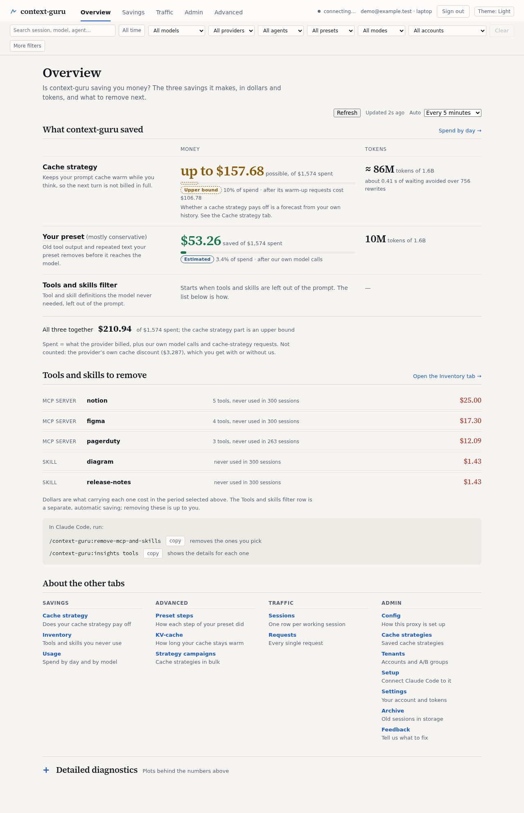

=== "Dark"

    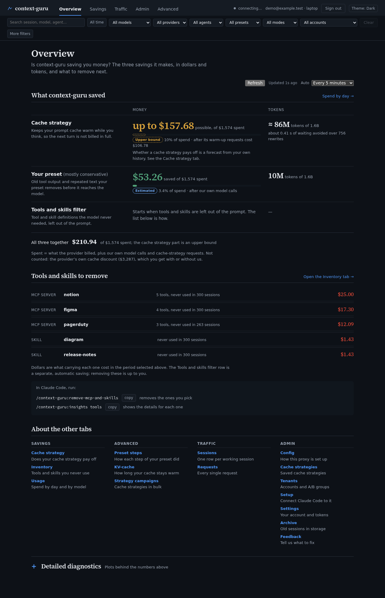

**What context-guru saved.** Three rows: Cache strategy, Your preset (with its name), and Tools and skills filter. Each shows money and tokens saved, set against what you spent in the selected range. An "Estimated" or "Upper bound" badge tells you how firm the number is. The cache strategy row also shows the waiting time it avoided, and says that whether to keep it on is a forecast from your own history: see the Cache strategy tab. A note under the rows explains that "spent" includes our own model calls and pings, and that the provider's own cache discount is not counted as our saving.

**Tools and skills to remove.** A ranked list of the tools and skills your agent carries but never uses, with what carrying each one cost in the selected range. Two commands you can copy, `/context-guru:remove-mcp-and-skills` and `/context-guru:insights tools`, remove them or show the details. A link opens the Inventory tab.

**About the other tabs.** One short line per tab, grouped like the navigation bar.

**Detailed diagnostics.** Closed by default. Open it for the plots behind the numbers. Every plot shows exact figures when you hover it. There are five: net saving over time (a line); money saved and money added (bars above and below the zero line; an outlined bar is an upper bound, not a firm figure); tokens removed (columns); where your input tokens went (columns that each fill to 100%: read from cache, written to cache, sent fresh); and time added to each request (two small lines, each on its own scale) together with the number of requests and how many missed the cache. Below them is a live table of requests as they arrive.

Detailed diagnostics, opened:

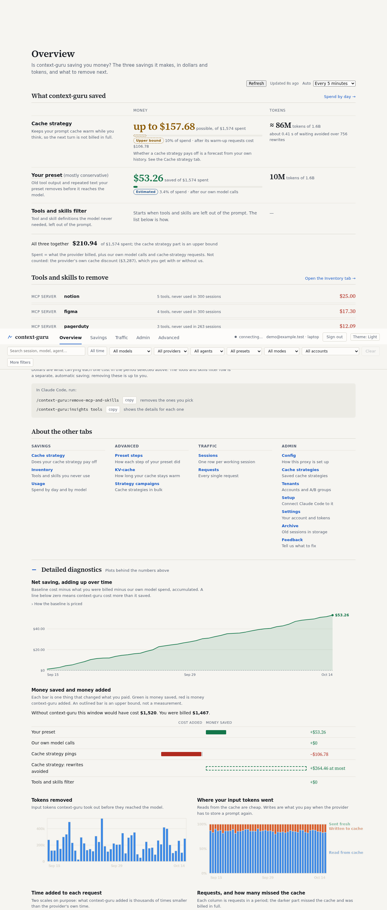

## Cache strategy

**Whether your cache strategy (keeping the prompt cache warm while you think) paid for itself, and which one to use. Also called keep-alive.**

=== "Light"

    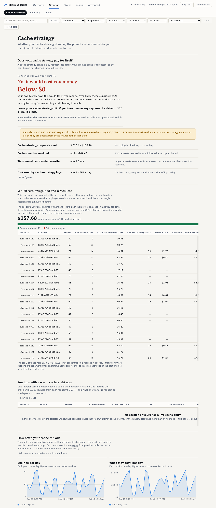

=== "Dark"

    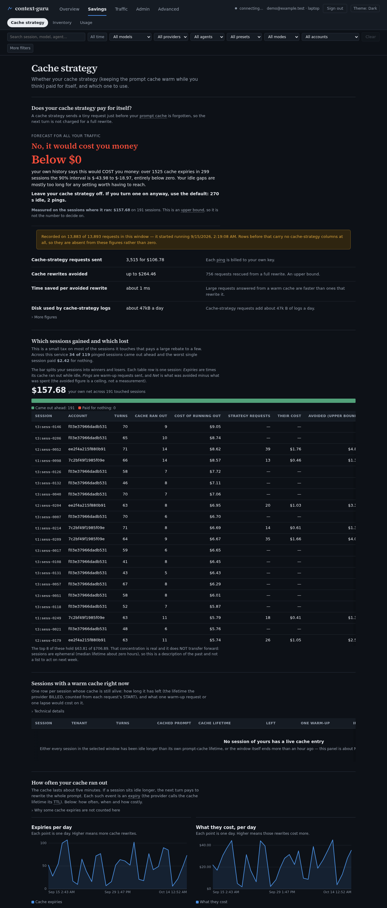

**Does your cache strategy pay for itself?** One verdict for your own history. The prompt cache is the provider's short-term memory of your conversation; it is dropped after a few minutes of silence. A cache strategy sends a tiny ping that keeps it warm (also called keep-alive).

**Which sessions gained and which lost.** A ranked list of sessions with what pings cost and what they saved. It shows whether the gain is spread out or sits in a few sessions. A second list shows sessions whose cache is still warm right now.

**How often your cache ran out.** Compact charts of the expiries: how many per day, what they cost, and how long you had been idle when they happened.

**What would other settings have earned?** A calculator and a recommendation. Change how long to wait before a ping and how many pings to send, and see what your past traffic would have cost.

## Inventory

**Every tool server and skill your requests carry, and the ones that were never used.**

=== "Light"

    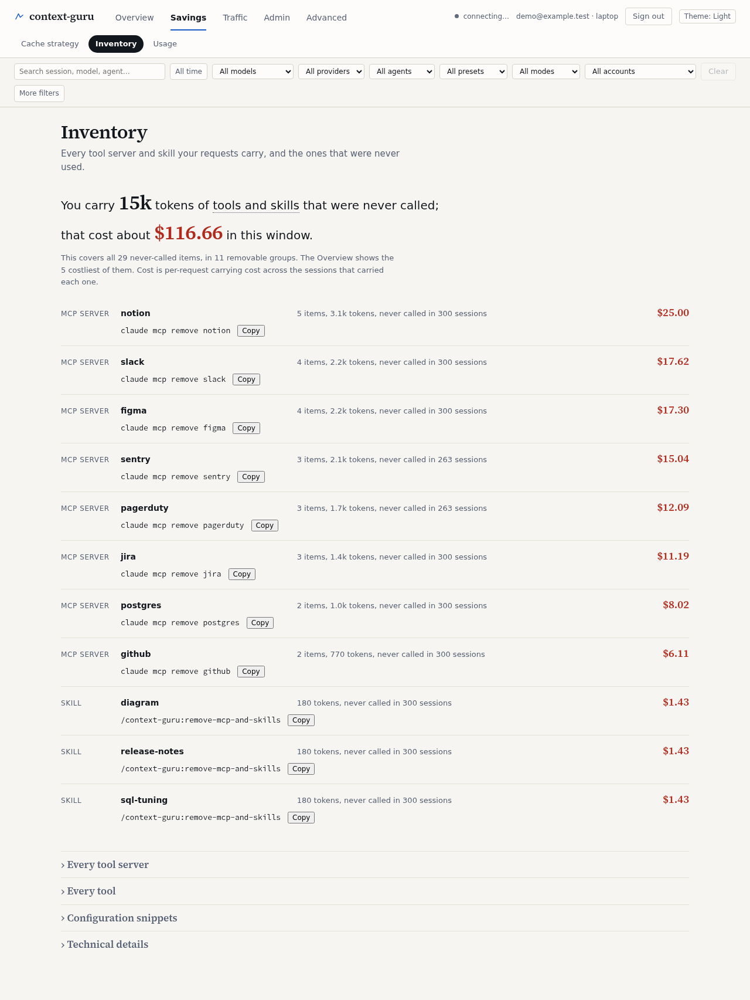

=== "Dark"

    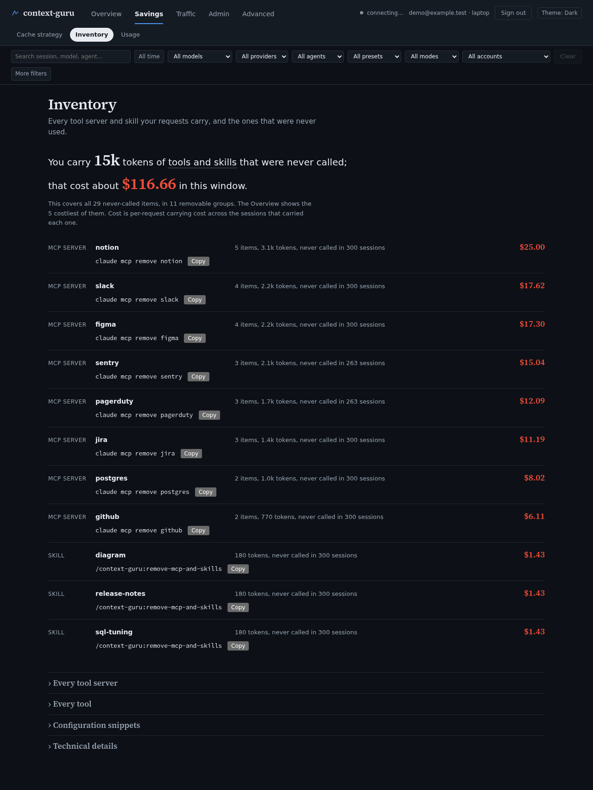

**Removable groups.** Ranked cards, biggest first. Each card is one thing you can remove, such as a whole tool server, with the cost of carrying it and the command to remove it.

**How much is never used?** Two short summaries of how much of what you send nothing ever calls. Tools are listed in every request, so you pay for them every time.

**What did my removals save?** After you remove something, this shows what it saved on requests really sent. It is kept apart from the estimates above.

**What is in the start of every request?** Splits the fixed start of each request into its parts and shows which parts you can change.

## Usage

**What you spent each day and on which models, and how much the provider cache covered.**

=== "Light"

    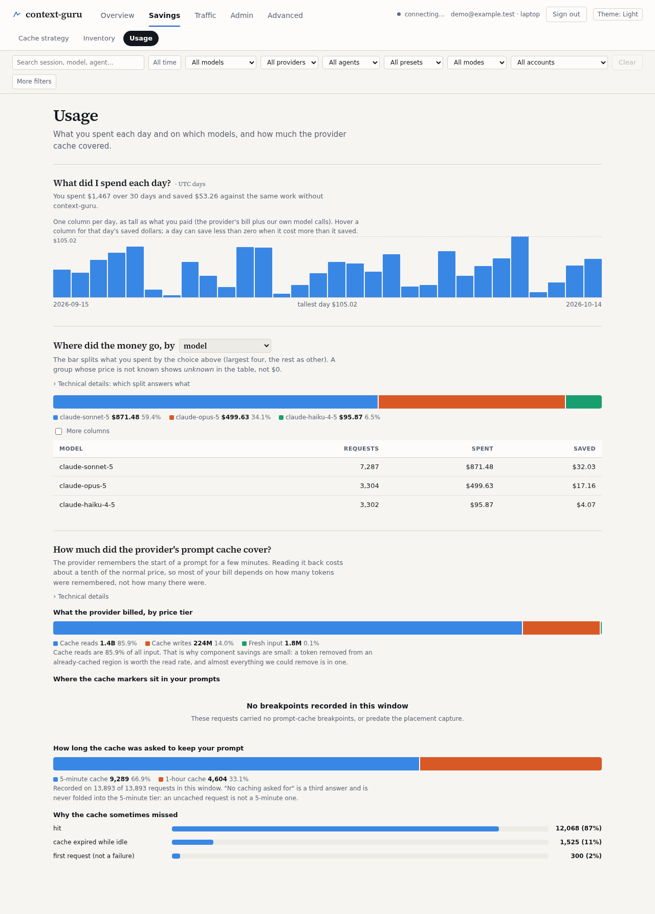

=== "Dark"

    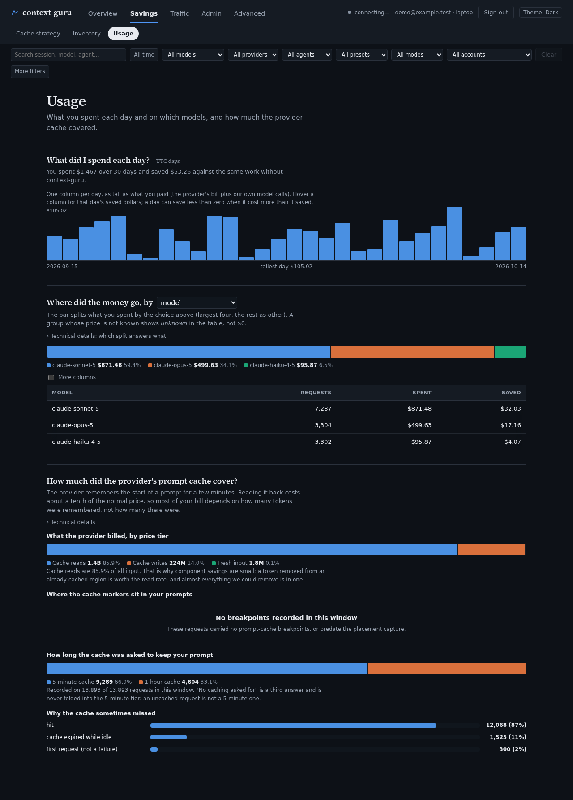

**What did I spend each day?** One chart of daily spend, in UTC days, with how much your preset took off. Hover a bar for the exact day.

**Where did the money go?** Splits spend by model or agent, so you can see which one costs the most.

**How much did the prompt cache cover?** Shows how requests were billed: cheap cache reads, dearer cache writes, and full-price new input. Charts show where cache markers sit in your prompts, how long the cache was asked to live, and why it sometimes missed.

## Sessions

**One row per working session: what it cost, how long it ran and what was saved.**

=== "Light"

    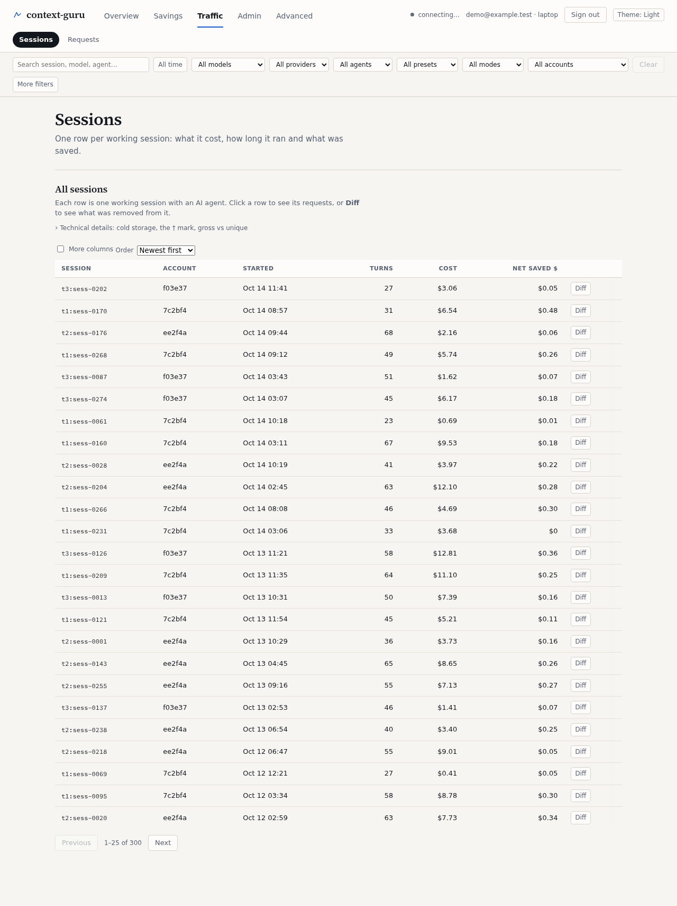

=== "Dark"

    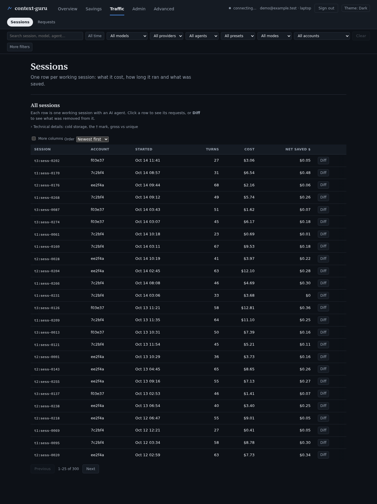

**All sessions.** A sortable table showing six columns by default; tick "More columns" to see the rest. Order it newest first or costliest first. Click a row to open the session and see its requests. The filter bar narrows the list by model, agent or account.

## Requests

**Every single request, newest first.**

=== "Light"

    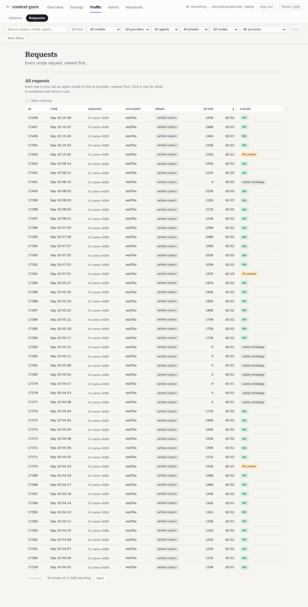

**All requests.** One row per message your agent sent to the model. Click a row to see what it contained, what was removed from it, and what the provider billed. With transcript storage on, a before-and-after diff shows what was rewritten.

## Config

**The settings this proxy is running with, and whether it is recording requests properly.**

=== "Light"

    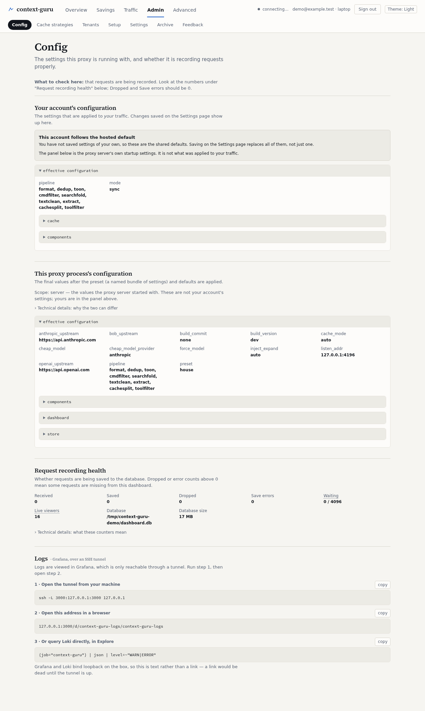

**Configuration.** Your account's settings and the settings of the whole proxy process. Read-only here; change them in Settings or in the config file.

**Request recording health.** The dashboard stores every request in a database. This says whether anything was dropped because it fell behind. Zero drops is healthy.

**Logs.** Steps to open the proxy logs through an SSH tunnel, when logging is set up.

## Cache strategies

**The cache strategies you saved and what each has done so far.**

*Managers only.*

=== "Light"

    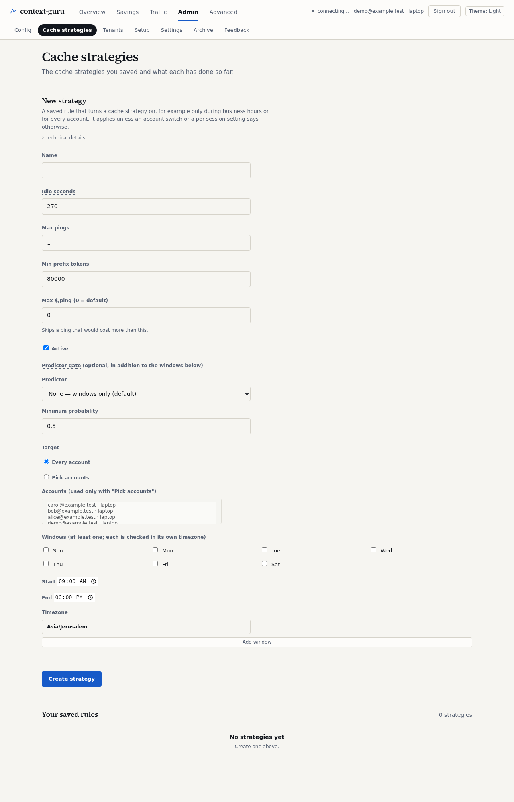

**New strategy.** Pick how long to wait before a ping and how many pings to send, name the rule, and save it.

**Your saved rules.** Lists every rule you have created.

## Tenants

**The accounts on this proxy, and the A/B groups they are split into.**

*Managers only, hosted service only.*

=== "Light"

    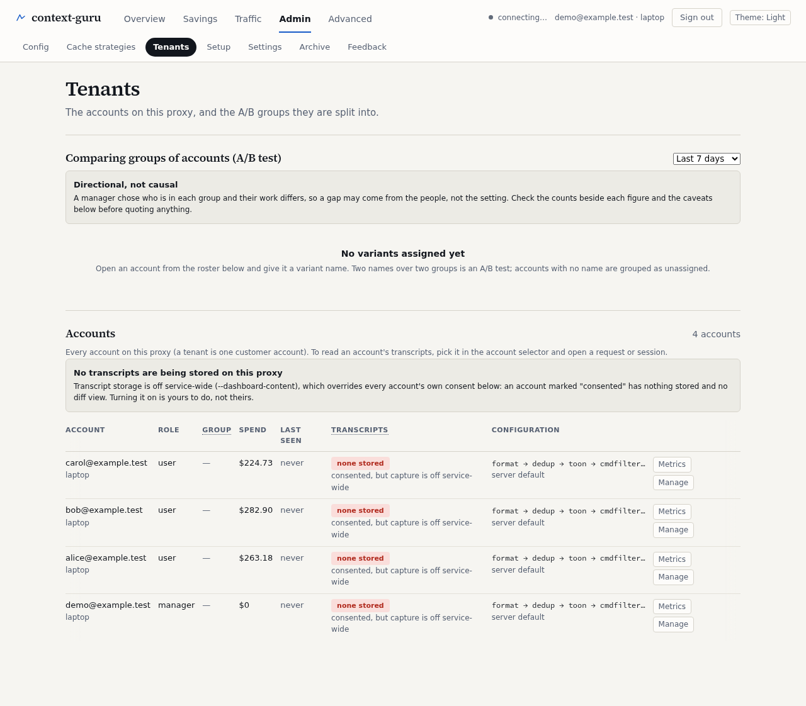

**Comparing groups of accounts.** A manager can put accounts into two named groups to compare them. A comparison shows a difference between groups, not proof of cause.

**Accounts.** One row per account (a tenant is one customer or user): role, spend, last activity, and whether transcripts are stored.

## Setup

**How to point Claude Code or Codex at this proxy.**

*Hosted service only.*

=== "Light"

    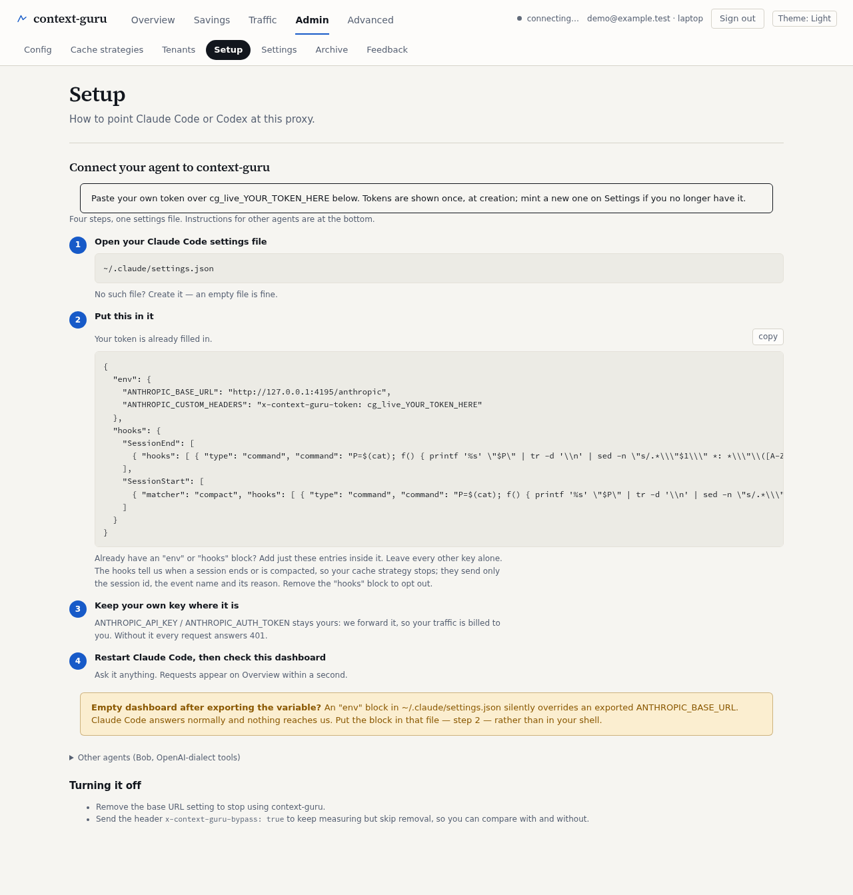

**Connect your agent.** Numbered steps with the exact settings to paste, already filled in with your address and token. Restart the agent, then check the dashboard.

**Other agents.** Short recipes for Bob and for tools that use the OpenAI format, and for turning it all off.

## Settings

**Your account: preset settings, access tokens, password and machines.**

*Hosted service only.*

=== "Light"

    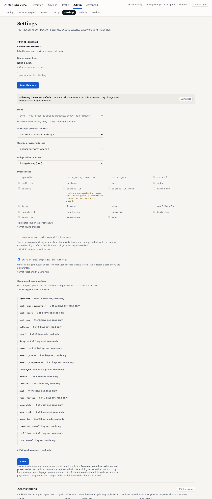

**Preset settings and tokens.** Change the preset options for your account and manage the access tokens your agents use.

**Password and machines.** Change your password and see where you are signed in.

**Recent changes.** A list of past changes to your settings.

## Archive

**Old sessions moved to cold storage to save disk.**

*Hosted service only.*

=== "Light"

    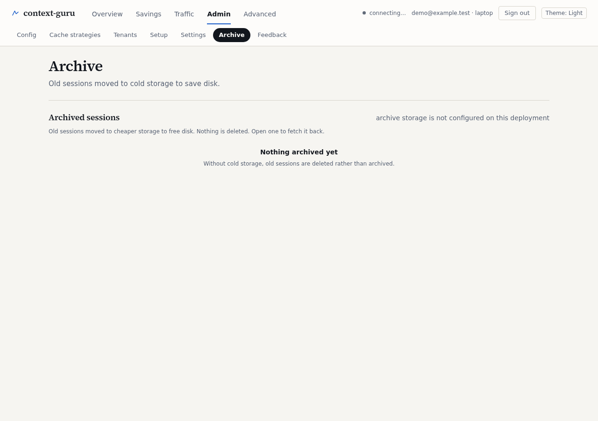

**Archived sessions.** Sessions older than the retention period are packed away instead of deleted. The list shows what is stored; open one to read it.

## Feedback

**Tell us what is working and what is not.**

*Hosted service only.*

=== "Light"

    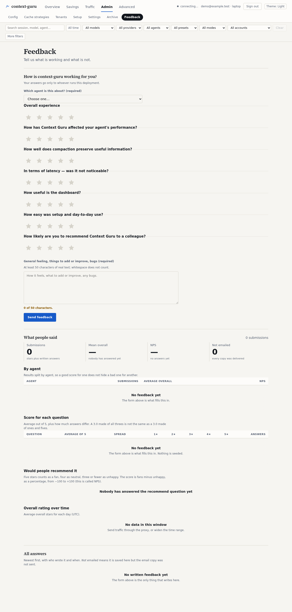

**How is context-guru working for you?** A short form. It takes under a minute.

**What people said.** For managers: charts of scores by agent and over time, and whether people would recommend it.

**All answers.** The raw answers, newest first.

## Preset steps

**How each step of your preset performed: what it removed, what it cost and whether it paid off.**

=== "Light"

    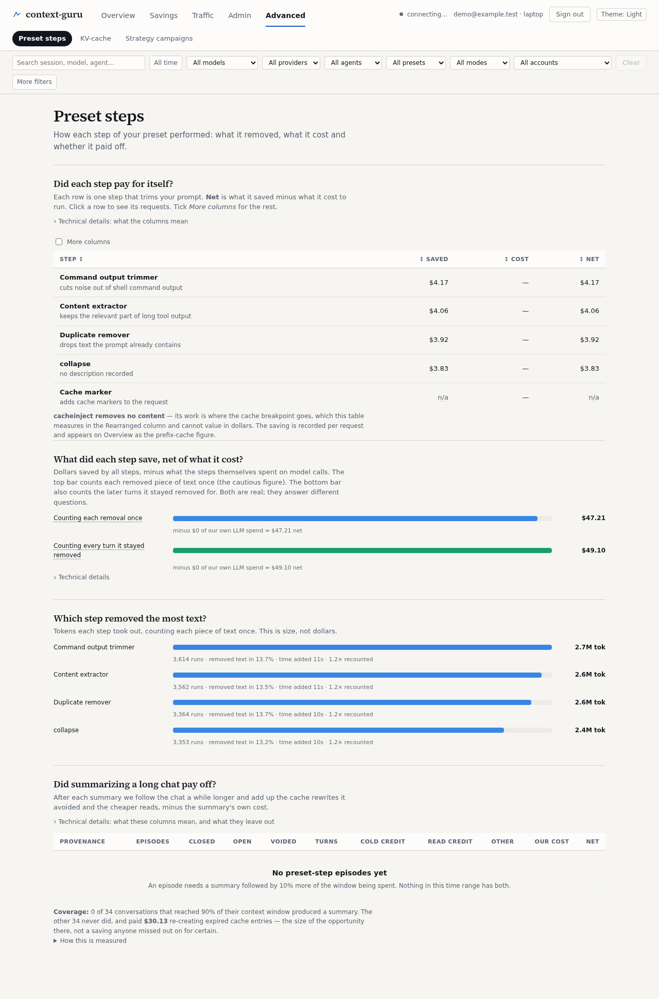

**Did each step pay for itself?** A preset is a list of steps (also called compaction components), such as removing duplicate text. The table shows how often each step ran and whether it earned more than it cost.

**What did each step save, net of what it cost?** The net dollars per step, after the cost of any model call the step made.

**Which step removed the most text?** A chart of tokens removed per step.

**Did summarizing a long chat pay off?** The result of the summarizing step on its own.

## KV-cache

**How long your prompt cache stays warm between requests, and what other timings would cost.**

=== "Light"

    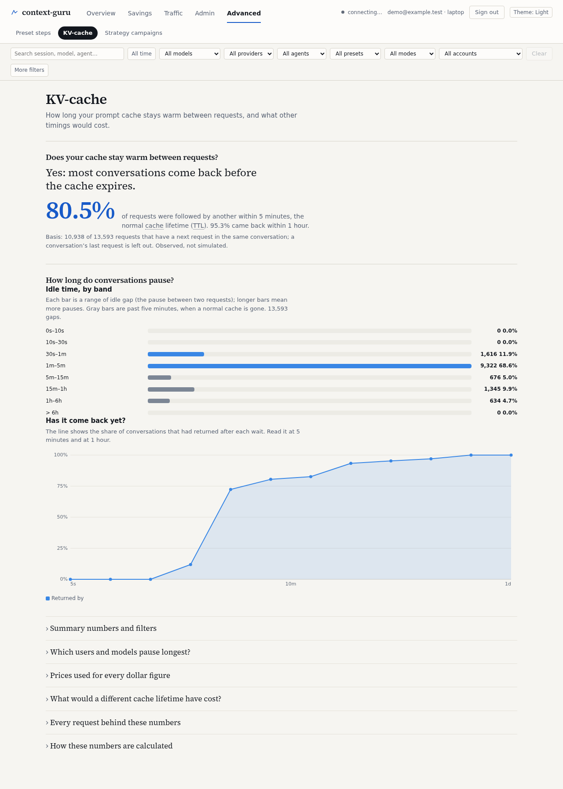

**How long do conversations pause?** Counts how often a request is followed by another and how soon. Requests with no follow-up are left out of averages.

**How long is the pause before the next request?** A chart of idle times and a curve of how many conversations had come back by each moment. It shows whether the five-minute cache window fits your habits.

**Which users and models pause longest?** The same idle times split by cache lifetime, user, model and time of day.

**What does caching cost?** Every price the page uses, and the cost of a different cache lifetime on your past traffic.

**Every request behind these numbers.** The raw rows, sortable, and a note on how the numbers are calculated.

## Strategy campaigns

**Create cache strategies for many sessions at once, then check them on data they have not seen.**

*Managers only.*

=== "Light"

    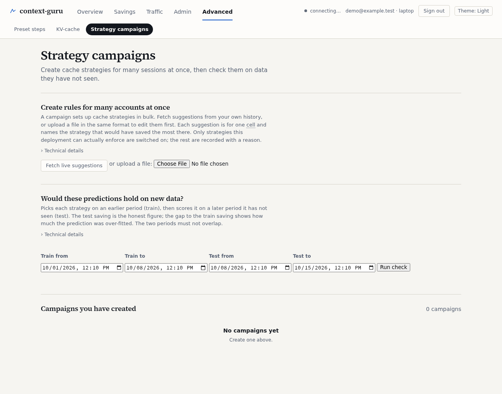

**Create rules for many accounts at once.** Fetch the suggested strategy for each account, or upload your own file, and create the cache strategies in one step.

**Would these predictions hold on new data?** Picks a rule on an earlier period and scores it on a later one. If it only works on the earlier period, the check says so.

**Campaigns you have created.** The list of campaigns and what each did.

## On a phone

At phone width every tab stacks into one column and tables scroll sideways inside their own box. Overview and Sessions:

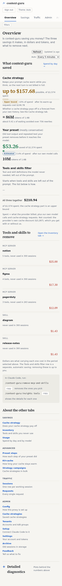{ width=260 }
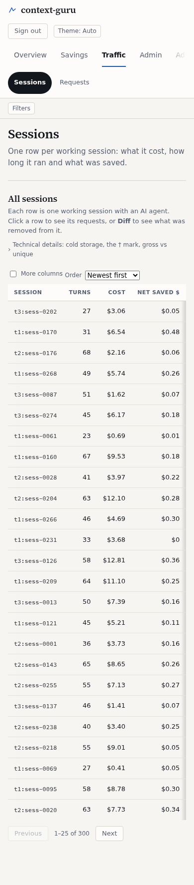{ width=260 }
