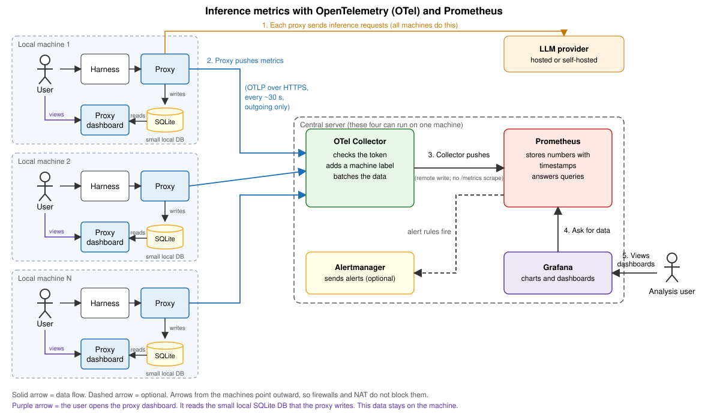
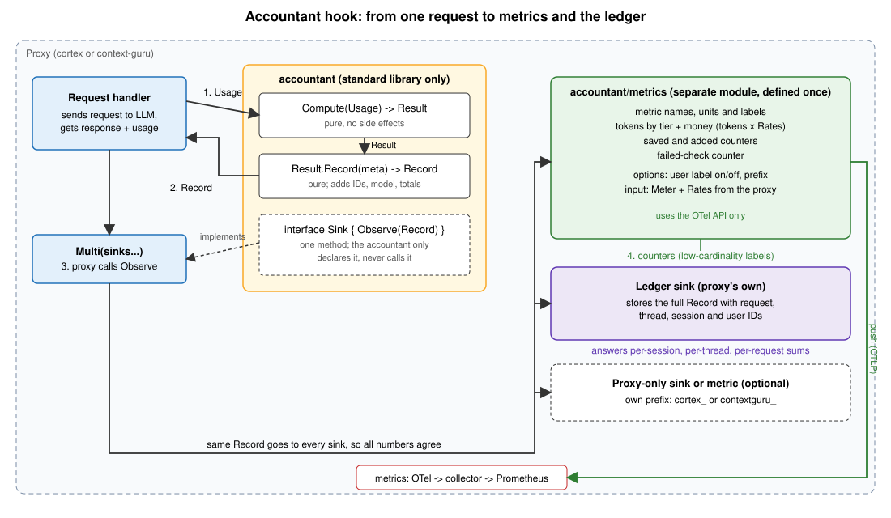

# Reporting inference and savings metrics with Prometheus

This note summarizes a design discussion. It is not a final decision. Open questions are at the end.

## 1. Goal

1. Collect regular inference metrics (requests, latency, errors, tokens, cost).
2. Collect savings metrics reported by the `accountant` library.
3. Do this for many local proxy instances (Cortex proxy or context-guru proxy) that report to one central Prometheus.
4. Define the metrics once, so two sets do not need to be maintained.
5. Support roll-up from request, to thread, to session, to user. Report both tokens and money.

## 2. Prometheus basics

- Prometheus normally **pulls**. The app serves plain text at `/metrics`, and Prometheus fetches it on a schedule.
- Counters are cumulative totals. Use `rate()` or `increase()` in a query to get values per time interval.
- A **label** is a key and value on a metric, such as `model="claude-sonnet"`. Each different set of labels is a separate series.
- Each new label value makes a new series. Labels with many or unlimited values (user ID, session ID, request ID, prompt text) make Prometheus slow and costly. Use labels with few values: `model`, `status`, `endpoint`, `host`.
- Good metric types: Counter for totals that only grow, Histogram for latency and sizes, Gauge for values that go up and down.

## 3. Collecting from many local instances

Pull works only if the central Prometheus can reach each instance. Laptops behind NAT or a firewall usually cannot be reached. Options:

| Option | How | Fit |
|---|---|---|
| Central scrape | Prometheus scrapes each instance | Servers with stable addresses |
| Local agent + remote write | A small agent on each machine scrapes `localhost` and sends out over HTTPS | Existing Prometheus-library code |
| OpenTelemetry (OTel) push | The app sends metrics to a central collector | Chosen option in this note |
| Pushgateway | Apps push to a gateway | Do not use. For short batch jobs only |

### Chosen setup: OTel push

- The proxy records metrics through the OTel library and **pushes** them to a central OTel Collector over HTTPS (outgoing connections only).
- The collector adds a machine label and a `proxy` label, then **pushes** to Prometheus with remote write. Prometheus must run with `--web.enable-remote-write-receiver`. Nothing calls `/metrics` on this path.
- Alternatively, the collector can expose its own `/metrics` and Prometheus can scrape it.
- The collector, Prometheus, Grafana and Alertmanager can run on one server for a small team. Expose only the collector to the local machines.
- Offline machines may lose data, because the library keeps no long backlog and Prometheus rejects very old samples.
- Adding a new metric changes only the proxy code. The collector, Prometheus and Grafana need no setup change. Check the final metric name in Prometheus, because it may be renamed (for example `_total` is added to counters).



## 4. Who owns the metric logic

The proxy owns metrics reporting. The accountant returns data only.

1. The accountant module imports only the standard library, and `boundary_test.go` enforces that. It must not import OTel or Prometheus.
2. `Compute` is deterministic and has no side effects. Keep it that way.
3. Two proxies share the accountant. The metric definitions must exist once, not twice.
4. The metrics may differ between proxies, so the shared part must not fix the full metric list.

### Layers

```
accountant            -> Result (tokens saved per change, per tier, checks); no OTel
accountant/metrics    -> separate Go module; defines common metrics once; uses the OTel API only
proxy                 -> passes Meter and Rates, picks options, adds its own metrics
```

### Share and keep separate

| Share (accountant or the metrics module) | Keep in each proxy |
|---|---|
| Roll-ups of `Result` (totals, per operation kind, failed checks) | Which extra metrics exist |
| Tier and operation-kind constants | Prefix for proxy-only metrics (`cortex_`, `contextguru_`) |
| Common metric names, units and labels | Rates used to convert tokens to money |
| | OTel setup, endpoint, token, interval |

### Keep the data comparable

1. Use the same names and labels for the metrics both proxies have.
2. The collector adds `proxy="cortex"` or `proxy="context-guru"` to everything.
3. Write the convention in one short file in the accountant `docs/`.

## 5. The accountant hook

The accountant declares a small interface. The proxy calls it after each finished request. The accountant never calls it.

```go
type Sink interface{ Observe(Meta, Usage, Result) }
```

- `Compute` stays pure. The proxy calls `sink.Observe(...)` itself, after the response returns.
- The proxy can pass the data to several sinks with a `Multi(sinks...)` helper: shared metrics, the proxy's ledger, and optional proxy-only metrics.
- Because the sink gets the same data, all numbers agree.

### Record, or Result plus Meta?

A separate `Record` type is not required. Passing `Meta`, `Usage` and `Result` works and has one type fewer. The risk is that each sink sums the per-change numbers itself, and the copies drift. Avoid this with pure helper methods on `Result`:

```go
res.Totals()   // saved and added, per tier
res.ByKind()   // the same, per rewrite / spend / setting
res.Failed()   // names of failed checks
```

Recommendation: use `Observe(Meta, Usage, Result)` plus the helpers. Add a `Record` type later only if the ledger needs a frozen on-disk format. Confirm in `docs/design.md` whether `Result` already carries the meta and usage. If it does, the call can be `Observe(Result)`.



The diagram shows a `Record` for clarity. Read it as the data passed to `Observe`.

## 6. Tokens and money

1. The accountant knows tokens only. The host turns tokens into money with its own rates.
2. The shared metrics module takes `Rates` and records both tokens and money, by tier.
3. Compute money when the request happens, with the rate of that moment, and store it. Do not recompute old money with new rates.
4. Tokens by tier: `input`, `cache_write_5m`, `cache_write_1h`, `cache_read`.
5. A change can break the cache and cost more than it saves. Savings can be negative. Use two counters, `saved` and `added`. Net savings is `saved - added` in a query.
6. Label by operation kind (`rewrite`, `spend`, `setting`), not by change ID. Change IDs are unbounded.
7. Count failed checks from `Result.Checks`.

## 7. Roll-up: request, thread, session, user

Prometheus labels cannot hold request, thread or session IDs. Split the job:

| Level | Where | How |
|---|---|---|
| Fleet, proxy, model, operation kind, tier | Prometheus | Labels with few values |
| User | Prometheus if there are few users (tens). Otherwise the ledger | Label `user` |
| Session, thread, request | Ledger (event store) | Store each record in full with all IDs |

- All values are sums (tokens and money), so they roll up at every level.
- Prometheus answers "how much did we save per model per hour". The ledger answers "how much did this session save".
- For a jump from a chart to one request, use OTel traces and put the request and session IDs on the trace, not on the metric.

## 8. Open questions

1. Where does the shared metrics module live: as a separate module in the accountant repo, or in its own repo?
2. How many users are expected? This decides whether `user` is a metric label.
3. Do both proxies already store full per-request records? If not, the ledger sink is the larger piece of work.
4. Does `Result` already carry the meta and usage?
5. Is the first version tokens and money, or tokens only?
