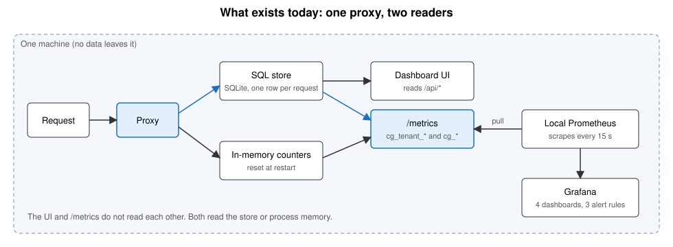
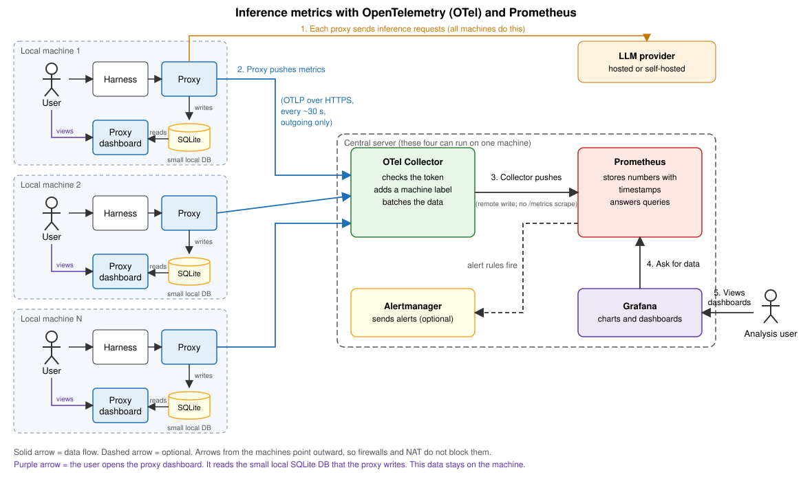
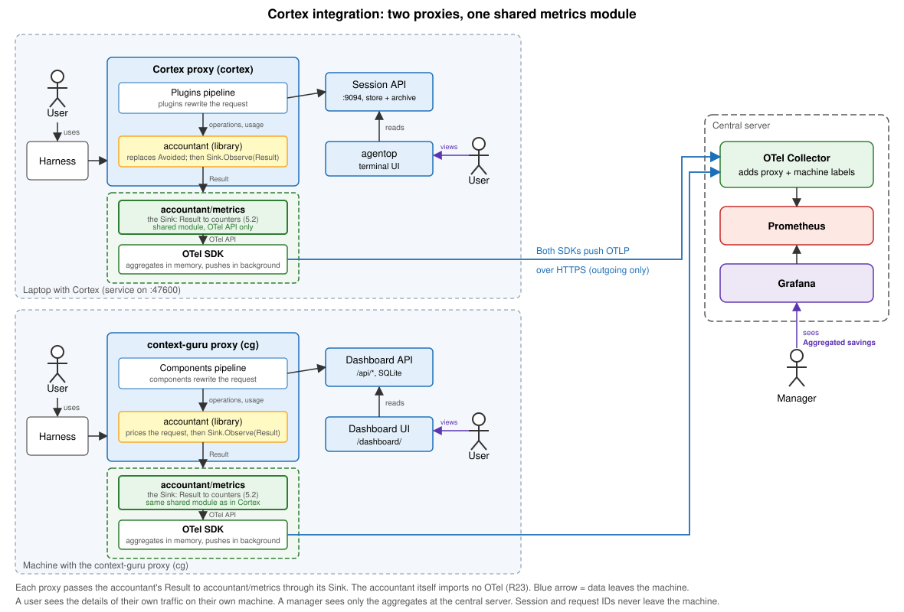

# Metrics reporting: spec

Status: draft. Issue: #886.

This spec gives requirements, a metric list, dashboards and analyses. Items marked **Open** need a decision before the work starts.

## 1. Goal

1. Report inference metrics and `accountant` savings metrics from every proxy to one central Prometheus.
2. Define the common metrics once. The Cortex proxy and the context-guru proxy share them.
3. Show money and tokens at every roll-up level that Prometheus can hold: fleet, proxy, machine, model, operation kind and tier.
4. Show whether context-guru earns its cost: gross saving, added cost, net saving.
5. Support many local proxies that report to one central metrics server. Managers use it to estimate the savings of the whole fleet.
6. Let each user see the details of their own traffic on their own proxy.
7. Support at least two proxies: the context-guru proxy (cg) and the Cortex proxy.

Not goals:
- Per-session, per-thread and per-request figures. The dashboard store and the ledger hold these.
- Replacing the dashboard (`dash/`). Prometheus gives the fleet view. The dashboard gives the session view.
- Prompt text or any customer content in a metric or label.

## 2. What exists today

Three parts exist. They share one data flow:

The dashboard UI and `/metrics` both read the store or the proxy's memory. Neither reads the other.

### 2.1 The dashboard UI (`dash/ui`)

A single-page app embedded in the binary. It is **off by default**. `--dashboard` turns it on. It needs no Prometheus, no CDN and no network.

What it covers:
- **Overview.** Dollars saved out of what the traffic would have cost, with percent saved and tokens removed. Cards for cache, preset and tool filter. Five diagnostic plots and a live request table.
- **Savings.** Cache strategy (keep-alive), tool inventory, cleanup advice, usage over time.
- **Traffic.** Sessions and requests. A request view shows a diff of what was rewritten on the wire.
- **Admin.** Config, cache strategies, tenants, setup, settings, archive, feedback (some only in a hosted service).
- **Advanced.** Per-component economics, the KV-cache view, strategy campaigns.

Limits:
1. **One proxy only.** Each proxy has its own store. No view spans machines.
2. **Needs the store.** It shows nothing without `--dashboard`.
3. **Access is by network location.** Aggregates are open to anyone who can reach the port. Content and prompt text need loopback or a trusted CIDR. There is no fleet-wide sign-in outside the hosted service.
4. **No alerts.** It shows numbers. It does not page anyone.
5. **No export format for other tools.** Other tools read `/api/*` or `/metrics`.

### 2.2 The SQL store (`dash/store.go`, `dash/schema.go`)

SQLite in WAL mode (pure Go). One row per request in `requests`. Other tables hold per-component figures (`request_components`), request content (`request_content`), tool declarations and uses, session state, request lifecycle, extraction calls, tenant spend and the archive index.

What it covers:
- **Every request, in full detail.** Tokens by tier, cost, baseline cost, cache fields, cache miss cause, thread and session IDs, keep-alive fields, settings.
- **Per-component savings.** `saved_usd`, the split `saved_first_usd` and `saved_replay_usd`, and `priced_by`. The `accountant` library produces these figures.
- **State that survives a restart.** Session state, checkpoints, and the data the cache tracker needs.
- **Cold storage.** Old sessions move to an archive. An index and the monthly tenant spend are kept.

Limits:
1. **Local to one proxy.** There is no sync to a central place.
2. **Retention is bounded** by age (`--dashboard-retention`) and by size (`--dashboard-max-bytes`). A burst can evict old rows.
3. **Derived data can be dropped.** When the schema version changes, the metrics tables restart. Only the archive index and tenant spend carry over.
4. **Not built for fleet queries.** Cross-machine roll-up needs a second system.
5. **May hold customer text.** The content tables are a deliberate exception to "metadata first". They are gated by storage level and by access rules.
6. **Old rows keep old figures.** Rows written before the `accountant` switch keep the legacy figure (`priced_by` empty). A window across the switch mixes two definitions.

### 2.3 The `/metrics` endpoint (`proxy/promexport.go`)

Prometheus text, served by the proxy. It is hand-written and uses no client library. A local Prometheus scrapes it every 15 seconds. `deploy/grafana/` has the scrape config, 4 dashboards (`context-guru`, `host`, `slo`, `logs`) and 3 alert rules (`cg-service-down`, `cg-refusal-rate`, `cg-metrics-stale`). `install.sh grafana` installs it.

Two families:

| Family | Source | Scope | Behavior |
|---|---|---|---|
| `cg_*` | In-memory aggregator, the same data as `/stats` | All tenants together | Starts at 0 when the process starts. Real counters. Use `rate()`. |
| `cg_tenant_*` | The SQL store, cached about 60 s | One tenant | Month to date. Most are gauges, including four that end in `_total`. |

What it covers:
- Requests, refusals, latency, added latency, time to first byte for streams.
- Tokens before and after compaction, billed tokens by tier.
- Cost, baseline cost, saved dollars, net saved dollars, the compaction model's own cost.
- Per-component runs, events, tokens removed and time spent.
- Expand and stash counters, cache-frozen headroom, extraction value.
- Exporter health: `cg_metrics_age_seconds`, render time, dropped capture events.
- Per-tenant cost, tokens, sessions and archive size.

Limits:
1. **Pull only.** A central Prometheus must reach the proxy. A laptop behind NAT or a firewall cannot be reached.
2. **Two families do not agree.** `cg_*` is per process and resets at restart. `cg_tenant_*` is per tenant and month to date. A panel that mixes them is wrong. The HELP text says so.
3. **Month-to-date gauges.** `rate()` and `increase()` read a fall as a counter reset. No shipped panel uses them on these series.
4. **Savings are single figures.** `cg_saved_usd` and `cg_net_saved_usd` are gauges. There is no `saved` and `added` pair. There is no split by operation kind, by tier, or by cache effect (break, rescue, split, TTL).
5. **No keep-alive or cache-miss series by cause.** The data is in the store. It is not exported.
6. **Label set is small.** Labels in use: `tenant`, `tier` (billed tokens only), `component` (component series only), `reason`, `gate` and `event`. There is no `model` or `provider` label, so a cost or a saving cannot be split by model.
7. **Service-wide view.** It carries every tenant's spend. It is open on loopback only, or with `METRICS_TOKEN`. The deploy keeps Prometheus and Grafana on loopback.
8. **Not shared with the Cortex proxy.** The names live in this proxy's code. A second proxy would copy them.
9. **Grafana is a second view.** It reads only `/metrics`. It cannot show a session or a request.

### 2.4 What the push work adds

| Gap | Part that has it | What this spec adds |
|---|---|---|
| No fleet view | UI, store, `/metrics` | A push path to one central Prometheus (section 4). |
| Savings are one figure | `/metrics` | `saved` and `added` counters by kind, tier and component (5.2). |
| Not shared with Cortex | `/metrics` | One metrics module for both proxies (R27). |
| No cache-miss or keep-alive series | `/metrics` | New counters (5.3, 5.4). |

What stays as it is: the UI and the store. The pull `/metrics` and the local Prometheus and Grafana are retired (R22). Prometheus cannot replace the store or the UI, because it cannot hold session, thread or request IDs as labels. Section 4 shows where each part sits.

## 3. Requirements

### 3.1 Needs: fleet, user and proxies

Three needs drive these requirements.

| Need | Who | Where it is served |
|---|---|---|
| Estimate the savings of the whole fleet | Manager | Central Prometheus and Grafana |
| See the details of my own traffic | User | Own proxy dashboard and local DB |
| Run on more than one proxy | Both | Shared metrics, one `proxy` label |

**Many proxies, one central server (managers)**

- R1. Many local proxies report to one central metrics server. A proxy needs no inbound connection, so a laptop behind NAT or a firewall can report.
- R2. A manager can estimate the savings of the fleet from the central server alone. The manager needs no access to any local proxy and sees no customer content.
- R3. The manager view shows gross saving, added cost and net saving. It can be split by `proxy`, `machine`, `model` and `preset`. It shows the share of the figure that is an estimate (R36, section 5.2).
- R4. The central server shows which machine each number comes from. If a machine stops sending data, the manager sees it within 15 minutes.
- R5. The design supports at least **50 machines** with the cardinality budget in section 5.7. **Open:** confirm the target (tens, hundreds or more).

**Details for a user on the own proxy**

- R6. A user can see the details of their own traffic on their own proxy: sessions, requests, tokens by tier, cost, saving per component and cache misses. This is the proxy dashboard and its local DB.
- R7. The details stay on the machine. Session, thread and request IDs, and any stored content, are never sent to the central server (R29, R31).
- R8. The proxy dashboard and its local DB work with no collector and no network. Turning the push on or off does not change what the user sees there.

**More than one proxy**

- R9. The design supports at least two proxies: the context-guru proxy (`cg`) and the Cortex proxy.
- R10. Both proxies report the common metrics (section 5) with the same names, units and labels. The `proxy` label tells them apart (R40).
- R11. Adding a third proxy changes only that proxy's code and a new `proxy` value. The collector, Prometheus and Grafana need no new setup.
- R12. Each proxy keeps its own extra metrics under its own prefix (R28). A dashboard panel on a common metric works for both proxies without a filter.
- R13. The manager view (R2, R3) shows the two proxies side by side, so managers can compare them.
- R14. The Cortex proxy gives its user the same details as R6. **Open:** confirm what local view and store the Cortex proxy has. If it has none, R6 applies to the cg proxy first and the Cortex proxy later.

### 3.2 Transport (design rules)

- R15. The proxy pushes metrics to an OpenTelemetry Collector over HTTPS. It makes outgoing connections only.
- R16. The push is **asynchronous**. The proxy records a metric in memory and returns at once. A separate background task sends the data to the collector in batches. The push never runs on the path of a request. It adds no time to a request or to the answer, and it never waits for the collector.
- R17. The collector adds the labels `machine` and `proxy`. It sends the data to Prometheus with remote write.
- R19. There is no default collector URL. The operator sets the URL in the config file, with a flag, or with an environment variable. The access token is a setting too (R44). A setting turns the push off. If the URL is empty, the proxy logs one warning at start, makes no outgoing connection and reports no metrics. The PR chooses the names of the settings. Data leaves a machine only after the operator names a collector, so the PR names this at the top: what is sent, and how to turn it off (`RELEASING.md`).
- R20. If the collector is down or slow, the proxy keeps working. A failed push never delays or changes a request, and it never blocks a request. Fail open.
- R46. Metrics reporting must not affect the response time of a request. This covers every step: pricing the result into numbers, recording them, and the push.
  1. The extra time on the path of a request is a fixed small amount that does not depend on the collector, the number of series or the size of the request. **Open:** choose the budget, for example under 50 microseconds at p99 per request.
  2. Work that needs the response, such as the savings counters, runs after the last byte is sent to the client. It never delays the answer or the first byte of a stream (time to first byte).
  3. Recording makes no network call, no disk write and no blocking lock. A failure or a panic in the metrics code is caught and counted, and the request continues (R20).
  4. The push runs in its own background task (R16). A full or slow export never slows a request.
  5. The proxy reports `llm_inference_added_seconds` without counting its own metrics time as upstream time, so the figure shows what the metrics cost, not what the provider took.
- R22. The pull path is retired. The `/metrics` endpoint and the local Prometheus and Grafana setup are removed. The product is new and has no legacy users, and the central server replaces them. The developer (David Boaz) decided this. The PR names the change at the top: who it affects, the old and new behavior, and that the user's own view is the proxy dashboard (R8). The dashboard and its local DB do not use `/metrics`, so they are not affected.

### 3.3 Consistency across proxies

- R23. The `accountant` library stays free of metrics code. It imports the standard library only, and it never sends or stores a metric. `boundary_test.go` keeps enforcing this.
- R24. Pricing a request stays pure. It has no side effects. Reporting a metric happens after the pricing, from the result.
- R25. The savings metrics are the same on every proxy. Each metric has the same name, unit and meaning, and every proxy computes it from the same `accountant` result. The token counters are therefore equal for the same request. The `usd` counters are not shared: each proxy prices tokens with its own rate table (R47).
- R26. A proxy needs no copy of the metric code. Adding the savings metrics to a proxy takes a small, fixed amount of code in that proxy. The totals, the split by kind, the failed checks and the metric definitions exist once.
- R27. The common metrics are defined once, in one place that both proxies import. A fix or a new common metric is made once and reaches every proxy.
- R28. Each proxy can add its own metrics under its own prefix (`cortex_`, `contextguru_`). The common set does not fix the full list.

### 3.4 Data rules

- R29. Metrics use counts, sizes, token numbers, prices, model names and status codes only. They use no stored customer data.
- R30. Allowed labels have few values: `proxy`, `machine`, `model`, `provider`, `status_class`, `stream`, `stage`, `direction`, `source`, `kind`, `tier`, `effect`, `cause`, `component`, `result`, `reason`, `check`, `outcome`, `version`, `preset`.
- R31. Forbidden labels: request ID, session ID, thread ID, change ID, user ID (unless R32), prompt text, tool name, file path.
- R32. `user` is a label only if the user count is about 50 or fewer. **Open.** Otherwise per-user figures come from the ledger.
- R33. Tokens are recorded as tokens. Money is recorded when the request happens, at the rate of that moment. Old money is never recomputed with new rates.
- R34. Tokens by tier use the values `input` (uncached input), `cache_read`, `cache_write_5m`, `cache_write_1h` and `output`. The two write tiers stay apart because they have different prices.
- R35. `saved` and `added` are two counters. A change can cost more than it saves. Net is `saved - added` in a query. The cost of the compaction model's own calls is part of `added`, booked under the component that made the call (R45).
- R36. A request the `accountant` cannot price adds nothing to `saved` or `added`. It adds 1 to a counter of unpriced requests, by reason.

- R47. Each proxy keeps its own rate table. The common module takes a `Pricer` from the proxy and shares no rates. Two proxies can price the same tokens differently. A `usd` figure is a figure of one proxy, and the `proxy` label says which. A comparison of proxies by money (A6) must state this, and a comparison by tokens needs no caveat. A price from a fallback rate is counted in `llm_inference_estimated_cost_usd_total` and `llm_savings_estimated_total`.
- R45. The cost of an LLM call that a component makes itself, such as compaction, is booked as `added` (cost and tokens) under that component's `component` label. There is no separate counter, so net is always `saved - added`. **Open:** confirm that the `accountant` sees these calls (open question 4). If it does not, the proxy must pass them to the `accountant` as a `spend` change.

### 3.5 Convention

- R39. One short file in the `accountant` `docs/` lists the common names, units and labels.
- R40. Both proxies use the same names and labels for the metrics they share.

### 3.6 Documentation

- R41. The PR adds a row to `docs/data-dependence.md`. The row says: metadata only, works at every storage level.

### 3.7 Privacy and access

- R43. `machine` is a pseudonymous install ID: a random value made at first start. It is not the host name, because a host name often holds a person's name. The operator keeps the map from install ID to person or team outside the metrics system.
- R44. The collector accepts a push only over HTTPS and only with a valid access token. Each install has its own token, so one token can be revoked. Read access to the central Prometheus and Grafana is limited to named managers and operators. A token binds to a proxy, not to a machine: the `machine` label is the sender's claim (design 8.8). **Open:** who issues the tokens, and who is on the access list.

## 4. Proposed architecture

There is one path: push. The pull path (section 2) is retired (R22). The picture shows the push path: each proxy sends metrics to a central collector, which sends them to Prometheus and Grafana. The push is asynchronous: it runs in the background, off the path of a request, so it adds no time to the proxy (R16).

The next picture shows how the Cortex proxy fits in next to the context-guru proxy. Both call the `accountant`, both use the same shared metrics module, and both push to the same collector. Cortex keeps its own local views (session API, `agentop`, archive).

**Open:** the picture assumes that Cortex can call the `accountant` after its cost settle step (`core/cost/settle`), because the `accountant` needs the usage of the response. It would replace Cortex's own savings step, `settle.Avoided`. This is not wired today, and it may change the savings figures that Cortex users see. Confirm this with the Cortex team (open questions 3 and 11).

| Component | Status | Role |
|---|---|---|
| proxy | exists | Forwards requests and calls the `accountant`. |
| `accountant` | exists | Returns `Result`. Imports no OTel (R23). |
| `PricedOp.Kind` | new | One field in the `accountant`, copied from the input operation (section 4.1). |
| `accountant/metrics` | new | Holds the `Observer` hook and defines the common metrics once (R25, R26, R27). |
| OTel SDK and push setup in each proxy | new | Aggregates in memory and pushes in the background (R16). Each proxy owns this code (section 4.1). |
| dash store and `dash/ui` | exists | Per-session and per-request views. Do not use Prometheus. |
| OTel Collector | new | Receives pushes. Adds `machine` and `proxy`. |
| central Prometheus | new | Stores the pushed series. |
| central Grafana, Alertmanager | new | Fleet dashboards and alerts. |

### 4.1 Design notes

These notes say how the requirements can be met. They are proposals. The PR may change them if R23 to R28 still hold.

| Requirement | Proposed way |
|---|---|
| R23, R24 | The `accountant` keeps its pure `Compute`. The proxy reports after the response returns. |
| R25, R26 | The hook is `metrics.Observer` (`Observe(Observation)`, where `Observation` holds the meta, the usage and the `Result`). It lives in the `accountant/metrics` module, not in the `accountant`, so the `accountant` gets one change only: `PricedOp.Kind` (below). `metrics.Multi(...)` passes the same data to several consumers: the shared metrics, the local ledger and any proxy-only metrics. It recovers a panic in one consumer. No `Result` helper methods were needed; the sink reads the fields of the `Result`. |
| R27, R47 | A separate Go module `accountant/metrics`. It uses the OpenTelemetry API only. The proxy gives it a `Meter` and a `Pricer`, an interface with one method, `Price(model, at, tier) (usdPerToken, estimated)`. The rates stay in the proxy. Money is booked only when `Billing.Mode` is `api`. For `subscription`, `unknown` or an unset mode, the token counters move, no `usd` counter moves, and the request counts as estimated. |
| R15, R16, R19, R44 | The SDK, the exporter and the push settings belong to each proxy, in a small package of its own (`internal/metricspush` in context-guru). `accountant/metrics` stays API-only, and the `accountant` repo has no network code. The cost is about 150 lines that each proxy holds. The exporter is a hand-written OTLP/JSON exporter on the standard library. The standard OTLP exporter adds about 12 MB of gRPC and protobuf to the binary, and a test (`depguard_test.go`) keeps those packages out of the default build. The settings have no default URL (R19). The exporter refuses `http` to a remote host, except to a loopback address (R44). |
| R28 | The proxy adds its own metrics with its own prefix. |

Decisions:
- **Process boundary (R46).** R46 decides where the metrics code runs. A separate process is allowed only if it satisfies R46. The first build is an in-process library, because it is the cheapest way to test R46: `Observe` only adds to in-memory counters, after the response. This is a starting point for the latency benchmark (section 10), not a decision. The benchmark ran on the first build: the calls run in the handler's deferred `finish`, after the response, and add about 12 to 35 microseconds at p50. The noise on the test machine is too large to state a p99. If a later benchmark shows that the in-process version breaks R46, move the work to a separate process and measure that against R46 too. A separate process adds a write to a socket on each request, so it must never block: a full buffer drops the data and counts it. In the diagram, the dashed green box is a logical group, not a process.
- **Pricing (R47).** No shared rate table. Each proxy gives the module its own `Pricer`.
- **`Kind` on `PricedOp`.** The simplest change is one new field, `PricedOp.Kind`, copied from the input `Operation` when the library builds the result. It is a pure copy and adds no import, so R23 holds. The alternative, passing the input operations to `Observe` as well, was rejected: it adds a second argument and a join by `OpID`.

Open choices:
- If `Result` already carries the meta and the usage, the hook can be `Observe(Result)`.
- The shared module can live in the `accountant` repo or in its own repo.

## 5. Proposed metrics

OTel metric names use dots and units. The Prometheus names below are what you see after the collector converts them. Counters get `_total`. A unit suffix such as `_usd` stays. Check the final names in Prometheus. Put the unit in the name, as `usd` or `tokens`, and never set an OTel unit of `USD` on a counter: the exporter appends the unit as written, and the series becomes `_USD_total`. A test compares the names Prometheus shows with the tables.

Prefix `llm_` is for the common set. It is neutral, so both proxies can emit it, and it keeps the names clear of other tools on the same central server.

### 5.1 Inference (common)
Labels in this section:

| Label | Values | Meaning |
|---|---|---|
| `model` | The model name the request was sent for, such as `claude-sonnet-5-5`. About 10 values per machine. | Which model served the request. If a component changed the model, this is the model after the change. |
| `provider` | The upstream provider, such as `anthropic`, `openai`, `bedrock`. A few values. | Who billed the request. |
| `status_class` | `2xx`, `3xx`, `4xx`, `5xx` | The HTTP status of the answer, in classes. A single code is not a label. |
| `stream` | `true`, `false` | Whether the answer was streamed. |
| `source` | `upstream`, `proxy`, `client` | Who caused an error. `upstream`: the provider failed. `proxy`: context-guru failed. `client`: the client hung up or sent a bad request. |
| `tier` | `input`, `cache_read`, `cache_write_5m`, `cache_write_1h`, `output` (R34) | The price class of the tokens. Each class has its own rate. |
| `stage` | Request bytes: `client`, `forwarded`. Response bytes: `upstream`, `delivered`. | Where in the proxy the body was measured. The two values of one counter show what the proxy changed. |

| Metric | Type | Unit | Labels | Meaning |
|---|---|---|---|---|
| `llm_inference_requests_total` | counter | 1 | `model`, `provider`, `status_class`, `stream` | Requests that reached the proxy. |
| `llm_inference_errors_total` | counter | 1 | `model`, `provider`, `status_class`, `source` | Requests that failed. `source` is `upstream`, `proxy` or `client`. |
| `llm_inference_request_bytes_total` | counter | By | `model`, `provider`, `stage` | Size of the request body. `stage` is `client` (as the client sent it to the proxy) or `forwarded` (as the proxy sent it upstream, after the components ran). Bytes removed is `client - forwarded`. Headers are not counted. |
| `llm_inference_response_bytes_total` | counter | By | `model`, `provider`, `stage` | Size of the response body. `stage` is `upstream` (as the provider sent it to the proxy) or `delivered` (as the proxy sent it to the client, after any rewrite). For a stream, the sum of the chunks. Headers are not counted. |
| `llm_inference_duration_seconds` | histogram | s | `model`, `provider`, `stream` | Total time, from request to last byte. |
| `llm_inference_ttfb_seconds` | histogram | s | `model`, `provider` | Time to first byte for streamed answers. |
| `llm_inference_added_seconds` | histogram | s | `model` | Time the proxy added on top of the upstream time. |
| `llm_inference_tokens_total` | counter | 1 | `model`, `provider`, `tier` | Provider-billed tokens. `tier` is from R34: read input (`cache_read`), write input (`cache_write_5m`, `cache_write_1h`), uncached `input`, and `output`. |
| `llm_inference_cost_usd_total` | counter | USD | `model`, `provider`, `tier` | Provider cost at request time. |
| `llm_inference_estimated_cost_usd_total` | counter | USD | `model`, `provider` | Part of the cost priced from a fallback rate. Sub-set of the line above. |

The cache read ratio is not exported. Query it: `cache_read / (cache_read + cache_write_* + input)` on `llm_inference_tokens_total`.

**Names (11).** Every counter is `llm_<area>_<what>[_<unit>]_total`, with `usd`, `tokens` or `bytes` as the unit when the counter has one. Histograms end in `_seconds`. The collector must not add a second unit suffix (for example `_USD`). A test compares the names Prometheus shows with this table.

### 5.2 Savings (from the `accountant`)
Labels in this section:

| Label | Values | Meaning |
|---|---|---|
| `kind` | `rewrite`, `spend`, `setting` | The type of change, from the `accountant`'s `Operation.Kind`. `rewrite`: an edit to the prompt body, such as `mask` or `dedup`. `spend`: the component's own LLM call, such as compaction (R45). `setting`: a changed request parameter that the body does not show but that changes the cost or the cache, such as the model or the cache TTL. |
| `tier` | Same values as 5.1 (R34) | The price class of the tokens saved or added. |
| `component` | The operator name without the host prefix, such as `mask`, `dedup`, `headttl`. About 30 values. | Which operator made the change. One component can report more than one `kind`. |
| `effect` | `break`, `rescue`, `split`, `ttl_premium`, `ttl_rescue` | The cache effect of a change. `break`: a change moved the prefix and the cache missed. `rescue`: a change or a ping kept a cache that would have expired. `split`: a change split one cached prefix into two. `ttl_premium`: extra cost of a longer cache TTL. `ttl_rescue`: saving from a longer TTL. |
| `cause` | `model_changed`, `ended_change`, `none` | Why the effect happened. `model_changed`: the model changed. `ended_change`: a change that was active before stopped. `none`: no single cause. |
| `direction` | `saved`, `added` | Whether the cache effect lowered or raised the bill. |
| `model` | As in 5.1 | The model of the baseline cost. |
| `result` | `priced`, `unpriced`, `skipped` | What the `accountant` did with the request. |
| `reason` | For `unpriced`: `penalty_unknown`, `unknown_kind`, `operator_not_allowed` and others from the library. For `fallback`: the gate that declined. | Why the request was not priced, or why no saving was booked. |
| `check` | `sum`, `order`, `unique_change`, `spans`, `attribution`, `conservation`, `shared_warm` | The library check that failed. |

| Metric | Type | Unit | Labels | Meaning |
|---|---|---|---|---|
| `llm_savings_saved_tokens_total` | counter | 1 | `kind`, `tier`, `component` | Tokens the provider did not bill, by tier. |
| `llm_savings_added_tokens_total` | counter | 1 | `kind`, `tier`, `component` | Tokens the provider billed because of a change. |
| `llm_savings_saved_usd_total` | counter | USD | `kind`, `tier`, `component` | `tokens_saved` priced at the tier rate at request time. |
| `llm_savings_added_usd_total` | counter | USD | `kind`, `tier`, `component` | `tokens_added` priced the same way. |
| `llm_savings_cache_effect_usd_total` | counter | USD | `effect`, `cause`, `direction` | Cache effects: `effect` is `break`, `rescue`, `split`, `ttl_premium`, `ttl_rescue`. `direction` is `saved` or `added`. `cause` is `model_changed`, `ended_change` or `none`. |
| `llm_savings_baseline_usd_total` | counter | USD | `model` | What the traffic would have cost with no change. |
| `llm_savings_requests_total` | counter | 1 | `result` | `result` is `priced`, `unpriced`, `skipped`. |
| `llm_savings_unpriced_total` | counter | 1 | `reason` | Why a request was not priced. Values come from the library: `penalty_unknown`, `unknown_kind`, `operator_not_allowed` and others. |
| `llm_savings_estimated_total` | counter | 1 | none | Requests whose figure is marked estimated. |
| `llm_savings_check_failures_total` | counter | 1 | `check` | Failed library checks: `sum`, `order`, `unique_change`, `spans`, `attribution`, `conservation`, `shared_warm`. |
| `llm_savings_fallback_total` | counter | 1 | `reason` | Requests that booked no saving because the dashboard gate declined. |

**Saved tokens and added tokens.** Both counters compare the request as it was sent with the request as the client wrote it. They are two sides of one change, and neither one is net.
- `llm_savings_saved_tokens_total`: tokens the provider billed less, because of a change. Example: `dedup` removes 10,000 tokens from the prompt. Saved: 10,000 at tier `input`, or at tier `cache_read` if those tokens would have been read from the cache.
- `llm_savings_added_tokens_total`: tokens the provider billed more, because of a change. Examples: a rewrite changes the prefix, the cache breaks, and 50,000 tokens are billed as `cache_write_5m` where they would have been `cache_read`. A keep-alive ping bills its own tokens. A compaction call bills the compaction model's tokens (R45).
- One change can add to both. A rewrite can save 5,000 input tokens and also cause a break that adds 50,000 write tokens. Do not net them inside the change. Each counter takes its own part, so the reports can show a component that saves tokens but loses money.
- Both counters are never negative. They only rise.
- Tokens at different tiers have different prices, so `saved_tokens - added_tokens` is not a money figure. Use the `usd` counters for money. Each `usd` counter is its tokens priced at the tier rate at request time (R33).
- The tokens counters answer "how much did the traffic shrink or grow?". The `usd` counters answer "did it pay?".

**No double counting (5).** `llm_savings_saved_usd_total` and `llm_savings_added_usd_total` are the only counters that add up to the saving. They already include the cache effects. `llm_savings_cache_effect_usd_total` is a breakdown of the same money by effect. A query must never add it to `saved` or `added`. A test checks that, for each priced request, the sum of the cache effects is not larger than `saved + added`. **Open:** confirm with the `accountant` that cache effects are part of the component figures. If they are not, give them `kind="cache"` and drop the separate counter.

The `component` count is bounded by the shipped list. **Open:** confirm the count is small enough to keep as a label.

### 5.3 Keep-alive
Labels in this section:

| Label | Values | Meaning |
|---|---|---|
| `model` | As in 5.1 | The model whose cache the ping kept warm. |
| `outcome` | `ok`, `failed`, `timeout`, `skipped` | `ok`: the ping succeeded. `failed`: the provider returned an error. `timeout`: no answer in time. `skipped`: the proxy chose not to ping, for example because a sibling thread kept the cache warm. |

| Metric | Type | Unit | Labels | Meaning |
|---|---|---|---|---|
| `llm_keepalive_pings_total` | counter | 1 | `model`, `outcome` | `outcome` is `ok`, `failed`, `timeout`, `skipped`. |
| `llm_keepalive_cost_usd_total` | counter | USD | `model` | What pings cost. |
| `llm_keepalive_rescue_usd_total` | counter | USD | `model` | Saving from rescues (`rescue` effect). |
| `llm_keepalive_shared_warm_tokens_total` | counter | 1 | `model` | Tokens not credited because a sibling thread kept them warm (#853). |

Net keep-alive value is `rescue_usd - cost_usd`.

### 5.4 Cache health

| Metric | Type | Unit | Labels | Meaning |
|---|---|---|---|---|
| `llm_cache_misses_total` | counter | 1 | `model`, `cause` | Misses by cause from `cache_miss_cause`: `ttl_expiry`, `prefix_change`, `model_changed`, `compaction_after_rewrite`, `bypass_flip`, `cold_start`, `other`. |
| `llm_cache_miss_cost_usd_total` | counter | USD | `model`, `cause` | Extra cost of those misses. |

### 5.5 Proxy health

| Metric | Type | Unit | Labels | Meaning |
|---|---|---|---|---|
| `llm_proxy_info` | gauge | 1 | `version`, `preset` | Always 1. Shows build and config. |
| `llm_proxy_component_duration_seconds` | histogram | s | `component` | Time in each component. |
| `llm_proxy_component_failures_total` | counter | 1 | `component`, `reason` | A component error or panic that reverted. |
| `llm_proxy_fail_open_total` | counter | 1 | `reason` | Requests forwarded unchanged. |
| `llm_proxy_export_failures_total` | counter | 1 | `reason` | Failed pushes to the collector. The next push carries the totals, so a failure loses no count. |

### 5.6 Labels the collector adds

| Label | Source | Values |
|---|---|---|
| `proxy` | collector config | `cortex`, `context-guru` |
| `machine` | resource attribute `service.instance.id`, the install ID (R43) | One per install. Bounded by the fleet size. |
| `preset` | resource attribute | A few values. A change of preset starts a new series, so a split by `preset` follows the change (8). |
| `service_version` | resource attribute | A few values. |

`machine` has as many values as there are machines. This is acceptable for tens of machines. Do not use it for thousands.

### 5.7 Cardinality budget

Estimate series per machine. A histogram has 12 buckets, plus a sum and a count: 14 series per label set (11 bounds in section 12, plus `+Inf`).

| Metric group | Label sets | Series |
|---|---|---|
| Savings counters (4) by `kind` x `tier` x `component` | 3 x 4 x 30 = 360 each, worst case. About 1 in 4 is used. | about 360 |
| Cache effects | 5 x 3 x 2 = 30 | 30 |
| Inference counters (2) by `model` x `provider` x `tier` | about 10 x 1 x 5 = 50 each | about 100 |
| Request and response bytes | 10 x 2 stages x 2 = 40 | 40 |
| `duration_seconds` | `model` 10 x `stream` 2 = 20 label sets x 14 | 280 |
| `ttfb_seconds` | 10 x 14 | 140 |
| `added_seconds` | 10 x 14 | 140 |
| `component_duration_seconds` | 30 x 14 | 420 |
| Keep-alive and cache health | about 10 models x 4 outcomes + 7 causes x 2 | about 150 |
| Proxy health and failures | about 100 | about 100 |
| **Total** | | **about 1,700** (the 40 for bytes is inside the rounding) |

The total sits close to the target, so the target is a real limit and not a safe margin. If the count is too high, drop `model` from `added_seconds` and `ttfb_seconds`, or use fewer buckets for the component histogram.

Target: **under 2,000 active series per machine.** For 50 machines this is 100,000 series. Check this limit in a test (R42 below).

- R42. A test counts the label sets a typical session creates. It fails if the count exceeds the budget.

## 6. Dashboards

All dashboards use the central Prometheus. They are Grafana JSON files in `deploy/grafana/dashboards/`. Each panel states its query. Use `$__rate_interval`.

Filters on every dashboard: `proxy`, `machine`, `model`, time range.

### 6.1 Fleet overview

Question: is the fleet healthy, and do we save money?

| Panel | Type | Query idea |
|---|---|---|
| Machines reporting | stat | `count(count by (machine) (llm_proxy_info))`. Use `llm_proxy_info`: it is always 1, so an idle machine still shows. A request counter has no series until the first request. |
| Requests per minute | time series | `sum(rate(llm_inference_requests_total[...]))` by `proxy` |
| Error rate | stat | errors / requests |
| Spend today | stat | `increase(llm_inference_cost_usd_total[1d])` |
| Gross saved today | stat | `increase(llm_savings_saved_usd_total[1d])` |
| Added cost today | stat | `increase(llm_savings_added_usd_total[1d])` |
| **Net saved today** | stat | saved - added |
| Saving rate | stat | net / baseline |
| Net saved per day | bar | `increase(...[1d])` for 30 days |

### 6.2 Savings

Question: where does the saving come from, and where does it leak?

| Panel | Type | Query idea |
|---|---|---|
| Saved vs added | time series | both counters, stacked |
| Net by kind | stacked bars | `kind` = rewrite, spend, setting |
| Net by component | bar gauge, sorted | top 15 components |
| Components with negative net | table | `component` where saved - added < 0 |
| Saving by tier | pie or stacked | which tier the saved tokens belong to |
| Cache effects | stacked bars | `break`, `rescue`, `split`, `ttl_premium`, `ttl_rescue` |
| Break cost by cause | bar | `effect="break"` by `cause` |
| Estimated share | stat | `estimated_total / priced_total` |
| Unpriced requests | time series | by `reason` |

### 6.3 Cache and keep-alive

Question: does the cache pay, and do pings pay?

| Panel | Type | Query idea |
|---|---|---|
| Cache read ratio | time series | by `model` |
| Misses by cause | stacked bars | `llm_cache_misses_total` by `cause` |
| Miss cost by cause | bar | `llm_cache_miss_cost_usd_total` |
| Ping outcomes | stacked bars | by `outcome` |
| Ping cost vs rescue | time series | cost, rescue and net |
| Pings that paid | stat | `rescue_usd / cost_usd` |
| Shared-warm tokens | time series | credit not given (#853) |

### 6.4 Inference

Question: how does the traffic behave?

| Panel | Type | Query idea |
|---|---|---|
| Requests by model | time series | `rate` by `model` |
| Latency p50, p95, p99 | time series | `histogram_quantile` on `duration_seconds` |
| Added latency p95 | time series | `added_seconds` |
| TTFB p95 for streams | time series | `ttfb_seconds` |
| Errors by status class and source | stacked bars | |
| Tokens by tier | stacked bars | `llm_inference_tokens_total` |
| Cost by model | stacked bars | |
| Cost per 1,000 requests | time series | derived |

### 6.5 Proxy health

Question: is context-guru itself working?

| Panel | Type | Query idea |
|---|---|---|
| Proxy versions | table | `llm_proxy_info` |
| Component failures | time series | by `component` |
| Fail-open count | time series | by `reason` |
| Component time p95 | time series | `component_duration_seconds` |
| Export failures | time series | by `reason` |
| Machines silent | table | `last_over_time(llm_proxy_info[1d]) unless llm_proxy_info`. Prometheus writes no stale marker for pushed data, so use a query that compares with the last day. |
| Check failures | time series | `llm_savings_check_failures_total` by `check` |

### 6.6 Machine comparison

Question: which machines or configs save the most?

| Panel | Type | Query idea |
|---|---|---|
| Net saved by machine | bar gauge | sorted |
| Saving rate by machine | table | net / baseline |
| Saving rate by preset | table | by the `preset` label |
| Saving rate by proxy | bar | `cortex` vs `context-guru` |

## 7. Aggregations

Recording rules make dashboard queries fast. Put them in one rules file. Name them `level:metric:operation`.

| Rule | Expression |
|---|---|
| `fleet:llm_savings_usd_net:increase1d` | `sum(increase(llm_savings_saved_usd_total[1d])) - sum(increase(llm_savings_added_usd_total[1d]))` |
| `proxy:llm_savings_usd_net:rate5m` | same, `sum by (proxy)` |
| `machine:llm_savings_usd_net:rate5m` | same, `sum by (machine)` |
| `model:llm_savings_usd_net:rate5m` | same, `sum by (model)` if `model` is kept on savings. **Open.** |
| `component:llm_savings_usd_net:rate5m` | `sum by (component, kind)` |
| `fleet:llm_saving_rate:ratio1d` | net / baseline |
| `fleet:llm_cache_read_ratio:ratio5m` | cache_read / all input tokens |
| `fleet:llm_inference_error_ratio:ratio5m` | errors / requests |
| `fleet:llm_keepalive_payoff:ratio1d` | rescue_usd / cost_usd |

Roll-up levels and where each one lives:

| Level | Where | How |
|---|---|---|
| Fleet, proxy, machine, model, kind, tier, component | Prometheus | Labels and recording rules. |
| User | Prometheus if R32 allows. Otherwise the ledger. | Label `user`. |
| Session, thread, request | Ledger (event store) | All IDs stored with the record. |

All values are sums (tokens and money), so they add up at every level. Ratios are always computed from sums, never averaged.

## 8. Analysis

Questions the data must answer. Each has a query or a drill-down.

| # | Question | Method |
|---|---|---|
| A1 | Does context-guru save money net of its cost? | `saved - added` over a week. `added` includes the compaction model's own calls (R45). Must be above 0. |
| A2 | Which components lose money? | Net by component below 0 for 7 days. Candidate to turn off. This is #670. |
| A3 | How much do cache breaks cost compared with the savings? | Break `added` cost / `saved` cost. |
| A4 | Is keep-alive worth it? | Payoff ratio above 1 by model and by idle time. |
| A5 | Which preset saves most? | Saving rate grouped by `preset`. Needs enough machines per preset. |
| A6 | Do the two proxies differ? | Compare `proxy` values on the same metric names (R40). Compare tokens directly. Money differs if the rate tables differ (R47). |
| A7 | How much of the figure is an estimate? | `estimated_total / priced_total`. If above 20 percent, treat the headline as a range. |
| A8 | Why do requests miss the cache? | Misses by cause, and cost by cause. |
| A9 | Does a model change break the cache often? | `cause="model_changed"` count and cost. |
| A10 | Is the saving real, or does our baseline overstate it? | Compare `baseline - cost` with the provider's own cache saving. Review monthly. |
| A11 | Does the proxy dashboard agree with the central metrics? | Compare the dashboard totals of one machine with the central totals for that `machine` over one week. Differences must be explained (retention, estimates, a push that was off). |
| A12 | What did one session save? | Drill down: ledger, by session ID. Not a Prometheus query. |

### Alerts

Alerts go to Alertmanager. Thresholds are proposals.

| Alert | Condition | Severity |
|---|---|---|
| Net saving negative | Fleet net below 0 for 24 hours | warning |
| Component losing money | A component net below -$5 over 7 days | info |
| Many unpriced requests | Unpriced above 10 percent for 1 hour | warning |
| Check failures | Any `sum` or `conservation` failure | warning |
| Export failures | `export_failures_total` rising for 1 hour | warning |
| Machine silent | `llm_proxy_info` missing for 15 minutes | info |
| Error rate | Above 5 percent for 10 minutes | critical |
| Cache read ratio low | Below 0.5 for 1 hour on a model with traffic | info |

## 9. Delivery plan

1. **Hook.** Add `PricedOp.Kind` to the `accountant`, and `Observer`, `Observation` and `Multi` to `accountant/metrics`. Test them. The `accountant` imports no OTel.
2. **Shared module.** Create `accountant/metrics` with the savings set (section 5.2). Test with an in-memory OTel reader.
3. **Proxy wiring.** Call the sink after each response. Add the inference set (5.1) and the health set (5.5). Add the settings for the collector URL, the token and the interval, and the switch that turns the push off (R19).
4. **Keep-alive and cache sets** (5.3, 5.4).
5. **Collector and Prometheus config.** Add the collector config, the remote-write receiver flag, and the recording rules file.
6. **Dashboards and alerts** (sections 6 and 8).
7. **Retire the pull path** (R22). Remove `/metrics` (`proxy/promexport.go`, `dash/metrics_export.go`) and the local Prometheus and Grafana install. Move or delete the dashboards and alert rules in `deploy/grafana/`. Do this after the central dashboards (item 6) work.
8. **Docs.** Convention file in `accountant/docs/`, row in `docs/data-dependence.md` (the "Metrics (`/stats`, `/metrics`)" row changes), a section in `docs/hosted.md` (the Grafana section changes).

Version one: items 1 to 3, and the savings dashboard (6.2). Tokens and money both. **Open:** confirm that tokens-only is not the first step.

## 10. Test plan

| Test | What it checks |
|---|---|
| Same numbers everywhere | The same priced result gives the same token totals in the shared metrics, in the local ledger and in any proxy-only metric (R25, R26). The `usd` totals are checked against the proxy's own rate table only (R47). |
| Totals add up | The split by kind adds up to the total. The total equals the sum of the parts (R26). |
| No duplicate code | The cg proxy and the Cortex proxy report the savings metrics through the same shared code. A check fails if either proxy defines a common metric itself (R26, R27). |
| Money at request time | A rate change does not change counters already recorded. |
| Saved and added | A request with a break adds to `added`. Net can be negative. |
| Unpriced request | Adds nothing to `saved` or `added`. Adds 1 to `unpriced_total`. |
| Label rule | No forbidden label (R31) appears on any metric. |
| Cardinality | Series per machine stay under the budget (R42). |
| Many machines | Several test proxies push at once. The central server shows each `machine` and the fleet sum equals the sum of the parts (R1, R4). |
| No inbound connection | A proxy behind a blocked inbound port still reports (R1). |
| Manager view has no content | The central series carry no session, thread, request or content value (R2, R7). |
| Local view without the push | With the push off, or the collector down, the proxy dashboard shows the same figures (R8). |
| Two proxies | A cg proxy and a Cortex proxy report the same common metric. One panel shows both, split by `proxy` (R10, R13). |
| Third proxy | A test proxy with a new `proxy` value appears with no change to the collector or Prometheus (R11). |
| Fail open | A collector that hangs or refuses does not delay a request or change a response. |
| Async push | With a collector that never answers, the time of a request and its answer is the same as with the push turned off, within test noise (R16). |
| Latency budget | The time of a request and its answer, and the time to first byte of a stream, are the same with the metrics on and off, within the budget of R46. A benchmark in the PR runs both and reports the difference at p50 and p99, with a collector that answers, hangs and refuses. |
| Record is cheap | Recording one metric takes a fixed small time and makes no network call. A benchmark in the PR reports the time (R16). |
| Export failure | A failed push is counted. The next successful push carries the totals, so a counter does not lose counts. |
| Machine ID | The `machine` label is the install ID. It holds no host name (R43). |
| Pull path gone | After the retirement, `/metrics` is not served. The proxy dashboard shows the same figures as before (R22, R8). |
| No URL | With no URL, the proxy makes no outgoing connection, starts normally, logs one warning and reports no metrics (R19). |
| Turned off | With the push turned off, the proxy makes no outgoing connection for metrics (R19). |
| Agreement | For one session, the sink totals equal the dashboard `request_components` totals. |
| End to end | Proxy to a local collector to Prometheus. The expected names and labels appear. |

## 11. Open questions

1. Where does `accountant/metrics` live: in the `accountant` repo, or in its own repo? (R27, section 4.1)
2. How many users? Is `user` a label? (R32)
3. Do both proxies store full per-request records? If not, the ledger is the larger work item.
4. Does `Result` carry meta and usage already? It decides the shape of the hook (section 4.1). Does the `accountant` see the compaction model's own calls? If not, R45 needs the proxy to report them as a `spend` change.
5. Version one: tokens and money, or tokens only?
6. Who issues the access tokens, and who is on the read access list? (R44)
7. Is the `component` label small enough to keep? Is `model` kept on savings metrics? (5.2, section 7)
8. What happens to the dashboards and alert rules in `deploy/grafana/`? Port them to the central Grafana, or delete them. The host and logs dashboards use the node exporter and Loki, not `/metrics`. Do they stay? (R22)
9. Which retention does the central Prometheus use? 30 days is enough for the dashboards above. Long-term trends need more.
10. How many machines must the fleet view support? (R5)
11. What local view and store does the Cortex proxy have? (R14)
12. Who are the managers, and may they see a split by user or team? A `team` label would need a rule like R32.

## 12. Technical notes

- Prometheus needs `--web.enable-remote-write-receiver`.
- The OTel to Prometheus conversion adds `_total` to counters and may add the unit as a suffix. It changes dots to underscores. Check the final names.
- Histogram buckets: use explicit bounds for latency. Suggested seconds: 0.05, 0.1, 0.25, 0.5, 1, 2.5, 5, 10, 30, 60, 120.
- A machine that is offline sends its totals when it is back. The totals are correct, but the time of the increase is the time of the push, not the time of the events. Time detail stays in the dashboard store. Prometheus rejects out-of-order samples unless `out_of_order_time_window` is set.
- The OTel SDK aggregates in memory and keeps no queue of points, so a failed push loses no count.
- Counters restart at 0 when a process restarts. Use `rate()` and `increase()`, which handle this.
- Do not use the Pushgateway.
- Related existing code: `proxy/promexport.go` (pull exporter, to retire), `dash/metrics_export.go` (to retire), `deploy/grafana/` (to move or delete), `proxy/accountant_*.go` (the accountant wiring), `dash/accountant_price.go` (pricing).
