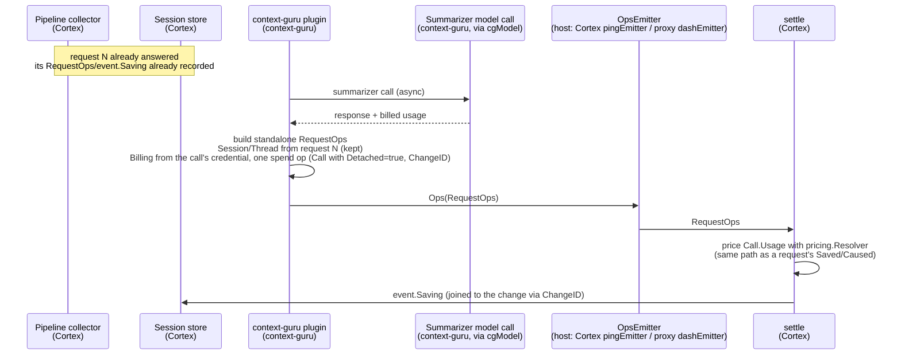
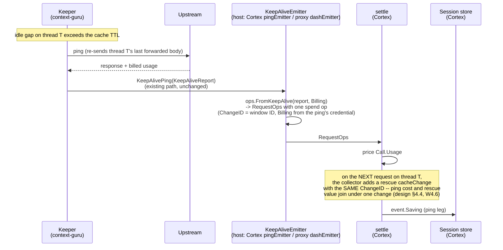

# Context operations: wiring in Cortex and the context-guru proxy

**Status:** proposed. Split out of the context operations design after review of
rossoctl/context-guru#592.
**Companion:** `2026-10-18-context-operations-design.md` in `rossoctl/context-guru` defines the
method (the operation model, the counterfactual, the tiers). This document says how Cortex and the
context-guru proxy connect to it. Text below is moved from that design. A plain `§N` reference points at the method document, in its
current numbering. Sections that start with `W` are this document's own.

**Problem statement:** [rossoctl/cortex#1417](https://github.com/rossoctl/cortex/issues/1417).

**Open.**
- **Push or fingerprint (design §11, question 4).** This document and the migration steps assume a
  collector that keeps one fingerprint for each thread. A push model, where components push facts
  with an identity and the receiver keeps no state, is under review. Until it is decided, the
  fingerprint design below is the current one.
- `pctx.ReportOps` and the Cortex name for the component that writes to the cost ledger have no
  chosen name (design §11, question 8).

### W0.1 The questions in cortex#1417

[cortex#1417](https://github.com/rossoctl/cortex/issues/1417) lists the open questions from the
Cortex side. This spec answers them as follows.

| # | Question in the issue | Answer in this spec |
|---|---|---|
| 1 | One set of numbers: spend and savings priced from different rate tables | Inside one host, spend and savings use one resolver (D3, D4, W4.6). The tier logic is in one library. The rates stay host-local by design (§1). |
| 2 | A figure deployers can trust: how it was computed, and who stands behind it | Each recorded figure names its operator, its component, `Estimated` and `DryRun` (W7.1), and the `ops` version that computed it (R46). The rules are reviewed in context-guru through the case list and `differences.json` (design §10.4). |
| 3a | Cache effects: a saving priced at the tier the rewritten request landed in | Saved tokens are priced at the tier they would have had without the change: B\* and the breakpoints (§5.1, R36, R37). A break that a change caused is a separate `cacheChange` cost, linked to that change (R23). |
| 3b | The plugin's own LLM calls through `core/llmclient`, not in the ledger; the `ibac` judge too | `spend` operations with the call's billed usage (D4, W4.6). This applies to every plugin that calls a model, not only context-guru (R47). |
| 3c | Keep-alive: the cost and the benefit land on different requests | a `spend` per ping, a rescue `cacheChange`, one `ChangeID` (design §4.4, W4.6). |
| 4 | Content re-sent every turn: overcount for compaction, correct for tool-prune | `ChangeID` (R22, D1); the tier comes from the position, so tool-prune is priced on every turn and a compaction is not counted again at the full rate (design §4.6). |
| 5 | Two ways of counting tokens | `Size.Tokenizer`, `bytes-estimate` and `Estimated` (R8); the correction factor is open (design §11, Q4). |
| 6 | Credit across several plugins | Each operator is measured against its own input (R29), and R25 for the same content. |
| 7 | Observe mode | `DryRun` (R12), never counted in totals. |
| — | Where the baseline lives, and how changes to it are reviewed | In the `ops` library in context-guru (D2). A change to it changes the case list, and every intended difference is in `differences.json` (design §10.2, §10.4). |

### W4.6 How operations reach the host

There are three kinds of operator, and each reaches the host through a path that already exists.
The design adds no new reporting interface for the engine or the keeper.

| Operator | When it runs | How its operations reach the host |
|---|---|---|
| **The context-guru engine** (every component, including the ones whose bytes `apply` writes, §4.2 rule 8) | inside a request | **`apply.Result.Ops`**: the engine returns its operations with the rewritten body, in both hosts. In Cortex the context-guru plugin passes them to `pctx.ReportOps(result.Ops...)`. In the proxy there is no other operator, so the proxy reads `result.Ops` directly. |
| **Another Cortex plugin** (tool-prune, cpex) | inside a request | `pctx.ReportOps(ops...)`, during its own pass. Cortex only. |
| **The keeper**, and a **detached** engine model call | between requests, or after the response | the host's `components.Emitter`, through its optional capabilities: `KeepAliveEmitter.KeepAlivePing(KeepAliveReport)` for a ping (exists today), and `OpsEmitter.Ops(RequestOps)` for a detached call (new, same pattern). |

**Why not a new `Sink`.** A `Sink` interface for pings would duplicate what exists. The keeper already
has a host-agnostic report path: `components.KeepAliveEmitter`, added so the keeper could be
exported from the proxy without a direct call into `dash` (issue #382, PR #591). The proxy wires
it to its `dashEmitter`; Cortex wires it to `pingEmitter` (`core/plugins/contextguru/spend.go`). A
second interface would make the keeper report each ping twice, or retire `KeepAliveReport` and lose
the fields the dashboard groups by (`Strategy`, `Preset`, `StopReason`, `MaxTokens`,
`FreshInput`). So the keeper keeps reporting `KeepAliveReport`, and **each host converts it** to a
`RequestOps` with one `spend` operation:

| `KeepAliveReport` | `spend` operation |
|---|---|
| `Session`, `Thread` | `RequestOps.Session`, `RequestOps.Thread` |
| `Window` (new, additive: the start of the idle gap the ping served) | `ChangeID = "ka:" + Thread + ":" + Window` |
| `Model`, `Provider`, `Route` | `Call.Model`, `Call.Host` |
| `CacheRead`, `CacheWrite`, `CacheWrite1h`, `FreshInput`, `Output` | `Call.Usage` (its prompt fields and `Output`) |
| `TS` | `RequestOps.At` |
| `Strategy`, `Preset`, `StopReason`, `MaxTokens`, `Agent` | not on the operation; the dashboard keeps reading them from `KeepAliveReport` (design §9.1) |
| `CostUSD` | not used: the host prices `Call.Usage` with its own rates, like every other call |

The conversion is a pure function in `ops` (`ops.FromKeepAlive(KeepAliveReport, Billing)`), so both
hosts build the same operation. The host supplies `Billing`, because only it knows which credential
the ping used.

```go
// OpsEmitter is an optional Emitter capability, the same pattern as KeepAliveEmitter: the engine
// type-asserts for it and does nothing if it is absent. It carries a RequestOps that has no
// request to travel with: today, only a detached model call.
type OpsEmitter interface {
    Ops(RequestOps)
}
```

The contract of both capabilities: safe for concurrent use; no
blocking I/O; never makes the session active (a ping is not agent activity); may drop a report for
a session that no longer exists.

**Who builds a standalone `RequestOps`.** No collector is open, so the caller fills it from what it
knows about the thread it acts on: `Session` and `Thread`. It sets `Billing` from the credential its
call used (R41, design §7.1).

**Where the usage comes from.** The host gives the engine its model client (`components.Model`;
in Cortex, `cgModel`). The client reads the usage from each response, and fills `ModelCall`. The
engine's own usage accounting is not used, because under Cortex it is zero (2026-10-14 spec, §0).

**A detached call.** A summarizer call can finish after its request was answered. Its `spend`
operation then cannot travel in that request's `apply.Result`. The engine sends it through
`OpsEmitter`, as a standalone `RequestOps` with `Detached = true` on the call, and
`Session`/`Thread` from the request that caused the call. Its `ChangeID` is the change it made,
so the cost is still joined to that change.

**A prefix ask.** `extract_llm_sweep` asks the request's own model a question, as a separate
upstream call whose body is the previous turn's forwarded bytes plus one trailing user message
(`PrefixAsker`). That is an ordinary `spend` operation: its `Call.Usage` shows the cache read it
was designed for (measured 19,595 read, 0 written). When the sweep falls back to a call without the
cached prefix, the same operation shows fresh input instead. No new kind is needed; the test cases
cover both (design §10.3).

**How the host records it.** The host handles operations from `apply.Result`, from `ReportOps`,
and from either Emitter capability the same way. It prices `Saved`, `Caused` and `Call.Usage` with
one resolver. So spend has the same rates, provenance, currency and billing basis (design §7.1) as the
savings.

**What it replaces.** `core/cost/spend` (`Charge`, `CostRecorder`, `RecorderConsumer`) is removed.
Today both Cortex wirings inject `spend.LogRecorder{}`, which only logs, and the recorder that would
write the ledger was never built. So no recorded figure changes. Cortex's `pingEmitter` keeps
implementing `KeepAliveEmitter`, and calls `ops.FromKeepAlive` instead of building a `spend.Charge`.

### W4.8 Sequence: three flows, and which repo each step is in

`participant` labels mark which repo owns each piece: Cortex (the pipeline, the collector,
`settle`) or context-guru (a plugin, the keeper, `ops`). `ops` is a library import in both; it
runs in-process in whichever repo calls it, never as its own service.

**A. A normal request.** A plugin reduces a tool output; the collector finds no break; `settle`
prices and records.


**B. A detached call.** The request has already been answered; its `RequestOps` may already be
closed and recorded. The summarizer call finishes afterward and reports through the host's
`OpsEmitter`.



**C. A standalone keep-alive ping.** No request is open at all; the keeper acts between turns.



## 5. The collector

**Current design.** Each host keeps one fingerprint for each thread and compares each request with
its own thread's previous request. The alternative, a push model, is open (design §11, questions 4
and 5).

Each host has a collector: Cortex, and the context-guru proxy. The parts are split this way. The pure parts are in the method document (design §5).

| Part | Where | Cortex | Proxy |
|---|---|---|---|
| Resolve the thread | `internal/thread` (engine) | the engine resolves it inside `apply`, as today, and returns it in `apply.Result.Thread` | the same |
| Collect the operations | host | `pctx.ReportOps`, from every plugin, in pipeline order (W5.1) | `apply.Result.Ops`: the engine is the only operator |
| Keep the previous request's fingerprint, per thread | host | a map keyed by `thread.Key(session, thread)` | the same map, beside `dash.Recorder`'s `lastTail` (W5.2) |
| Compare, and find B\*, the break and the cache state | `ops.Compare` (pure) | called after the response | the same call |
| Convert keep-alive reports | `ops.FromKeepAlive` (pure) | in `pingEmitter` | in `dashEmitter` |


### W5.1 Collecting

- Each plugin calls `pctx.ReportOps(ops...)` during its pass. The pipeline runs in sequence, so the
  list is in order.
- The framework sets `Operator`. A plugin cannot report under another plugin's name.
- The framework sets `DryRun = true` on every operation of a plugin whose `SetBody` returned
  false (`on_error: observe`).
- An operator reports only changes that are in the forwarded body, or that would be there for a
  `DryRun` operation. A change the pipeline reverted (an error, a panic, the never-worse guard) is
  not reported. It saves nothing, as a change that ended (§4.5). Its model call, if any, is still a
  `spend` operation, so the money it cost is counted.
- The host keeps an explicit allow-list of operators, for the reason `savingComponents` has today:
  a plugin must not add itself to the money record only by reporting operations. Operations from
  an operator that is not on the list are kept on the event and marked unpriced.

### W5.2 The thread, and the previous request

**The thread comes from `internal/thread`, not from the collector.** The engine already resolves
each request's thread (`thread.Result`): the agent's header first, then prefix continuity, then the
session as a last resort. It also returns two signals that a weaker rule would lose:

- `Disagree`: the header named a known thread, but prefix continuity matched a different one. The
  header wins; the host logs the drift.
- `Inherits`: a new thread whose content is mostly an existing thread's — a rewind, an edited
  earlier message, a fork. Its first request is that thread's next turn, not a cold start.

The engine runs inside both hosts, so both get the same `thread.Result` for the same traffic. `RequestOps.Thread` carries
`ID` and `Parent` (`Parent = Inherits`).

**The previous request is this thread's previous request.** The host keeps one fingerprint per
thread, keyed by `thread.Key(session, thread)` — the key `dash.Recorder` already uses for
`lastTail` and `lastSeen`. A new thread with `Inherits` set starts from the inherited thread's
fingerprint, so a fork reads its parent's cache instead of scoring cold.

An earlier draft matched each request against the last 4 fingerprints of the session by longest
common prefix. That answered a weaker question. After interleaved subagent requests the best prefix
match can be an older request, and a main thread whose previous turn is more than 4 requests back
drops out of the window. `cachesplit`'s saving depends on comparing the volatile tail with **this
thread's immediately previous request** (`cachesplitSavedUSD`, `TailChanged`), so a stale match
would misattribute it. Keying by thread gives the right baseline for every rule that needs one.

### W5.3 Limits

- **Memory:** 12 bytes for each position (`PosHash`, design §5.1). 2 bodies × 2,000 positions is about
  48 KB for each thread. `internal/thread` caps threads at 64 for each session; a typical session
  has 1 to 5. `session.max_sessions` (100) bounds the total.
- **Restart:** fingerprints are lost. Only the next request of each thread gets `penalty_unknown`.
  They are not persisted (design §9).
- context-guru keeps its own `MaxCachedIdx` for its own decisions. For pricing, the collector's B\*
  is the only authority (R30), because it is computed from the forwarded body after every plugin
  ran. In the proxy there is no later plugin, so the two must agree: the proxy checks
  `MaxCachedIdx` against B\* and counts a disagreement (a bug in one of them), at no extra cost.

### W7.1 From `Result` to `event.Saving`

`settle` calls `ops.Price` once for each request, over the in-process `RequestOps`/`Operation`
list (R20): that list is never recorded. `settle` prices `Saved` and `Caused` with its
`pricing.Resolver`, at the same model and long-context tier as the request itself, then discards
the operations and writes one `event.Saving` for each (operator, component) — the only form that
reaches the session store, `:9094`, and the archive:

| `event.Saving` field | Source |
|---|---|
| `Component` | the operator name, for example `context-guru.mask` |
| `TokensAvoided` | sum of `Saved` over all tiers |
| `USD` | `Saved`, priced |
| `PenaltyUSD` | `Caused`, priced, plus the attributed `cacheChange` operations |
| `Tier` | the tier with the largest `Saved` |
| `DryRun` | `DryRun` |
| `Estimated` | any operation `Estimated` |
| `OpsVersion` (new, additive) | `Result.Version`, the version of the `ops` rules (R46) |

New fields, all additive (the ledger rule is "add, never rename"):

| Field | Where | Why |
|---|---|---|
| `Saving.Operator` | event and ledger | group `context-guru/*` in the per-plugin breakdown |
| `Saving.Changes []ChangeSaving` | event only | `{changeId, savedUSD, causedUSD}`, for totals and payback for each change. Not in the ledger, which keys by minute. |
| `Event.UnattributedBreakUSD` | event | client edits and expired caches. Shown, never charged to a plugin. |
| `Event.InteractionUSD` | event | the interaction on a rescued request (§6.2). Counted in the session total, never charged to a plugin. |
| `Saving.Thread`, `ChangeSaving.Thread` | event and ledger | sum for each thread; a subagent's saving is separate from the main thread's |

`TotalAvoidedUSD` does not change: `max(0, USD − PenaltyUSD)` for each saving, floored at zero.
Signed totals are out of scope (design §9).

**Size.** `Saving.Changes` is already small per request — one `ChangeSaving` per change touched,
not per operation — but a request can still touch many changes (a `coref` batch cut, a wide
`mask`/`cmdfilter` pass). So `Saving.Changes` has a size limit, with aggregation above it:

```go
// Aggregate replaces entries past the limit. One bucket per key, so a thread/session total is
// still exact; only each individual change's own cross-request total is lost for entries folded
// in here.
type Aggregate struct {
    Limit   int
    Dropped int // ChangeSaving entries folded into Entries
    Entries []AggregateEntry
}

type AggregateEntry struct {
    Operator            string
    SavedUSD, CausedUSD float64 // summed
}
```

### W7.2 Totals for each change across requests

A total for one `changeId` is a fold over the session's events: add `Changes[i]` where the
`changeId` matches. The session archive holds each request's event for the whole session, so agentop
can compute the fold when it opens a session. There is no ledger column for each change.

Without an archive (a cluster sidecar), totals for each change cover only the events in memory. The
per-request savings and the ledger totals are correct either way.

**Totals for a session and for a thread.** `Saving.Thread`/`ChangeSaving.Thread` carry the thread
(W7.1), so the same fold over recorded events gives:

| Total | Sum of |
|---|---|
| A change | `ChangeSaving`s with one `changeId` in one thread |
| A thread | every `Saving` of one `Thread`, plus its `spend` operations and `Event.InteractionUSD` |
| A session | every thread of the session |
| A subagent | the threads whose `Parent` chain leads to the main thread, one at a time |

A `spend` is shown beside the savings, never inside them, as today.

### W7.3 The context-guru proxy

The proxy computes its dollar savings from `ops.Price`, as Cortex does:

1. The engine returns the request's operations (migration step 3).
2. The proxy's collector calls `ops.Compare` and adds the `cacheChange` operation.
3. The proxy calls `ops.Price`.
4. The proxy converts each `PricedOp` to dollars with `internal/modelinfo.Price` for the request's
   model.
5. The proxy stores the dollars in the columns its dashboard reads today: the saving of each
   component (`ComponentSavedUSD`) and the baseline delta (`baselineDeltaUSD`).

The `cachesplit` and keep-alive savings are `cacheChange` operations now (§4.4), written by the collector, so the proxy
prices them through `ops.Price` too. Their current rules (`cachesplitSavedUSD`,
`keepaliveSavedUSD`) are the source of their test cases (design §10), and are removed at step 10.

**Agreement between hosts.** For the same request, `ops.Price` returns the same tokens for each
tier in both hosts. The dollars are equal only when the two rate tables are equal (§1). The test
cases use one fixed rate table, so they can compare dollars (design §10.2). A drift between the tables —
a model priced in one and not the other — shows as a dollar difference on identical tokens, which
the cross-host comparison test (W9 step 8) reports.

## W9. Migration

Each step merges alone and leaves the totals correct.

| Step | Repo | Change | Verification |
|---|---|---|---|
| 1 | context-guru | **Make the test-case list** (design §10), with the current computation. No `ops` code yet. | The list is reviewed. Each `differs` entry cites a spec section. Each `notCovered` entry is in design §11. |
| 2 | context-guru | Create the `ops` module: types, `Price`, `Compare`, checks. No callers. | Every case in the list passes (design §10.4). |
| 3 | context-guru | The engine builds `[]ops.Operation` from `Trace` and the reports, and returns them in `apply.Result.Ops` with `apply.Result.Thread`. Marker and apply-only changes are built by `apply` (§4.2 rule 8). **This is new work for each change, not a read of existing fields.** The frozen state is keyed by content hash (`components/offload/state.go`), so `ChangeID` can be derived. But replays are counted only for each component today (`Report.Replays`), and `apply.Trace` records no ID for each change. Each offloader must record, for each change, its `ChangeID`. | Replay tests: the same `ChangeID` on each turn. |
| 4 | context-guru | **The proxy's collector.** It reads `apply.Result.Ops`; keeps one fingerprint per `thread.Key` beside `dash.Recorder`; calls `ops.Compare`; sets `Billing` with `ops.BillingFrom`; implements `OpsEmitter` on `dashEmitter`; and converts each `KeepAliveReport` with `ops.FromKeepAlive`. Nothing reads its output yet. This is the largest proxy step, and it uses only engine types: none of it depends on Cortex. | The `Compare` cases pass through the proxy's collector. The `MaxCachedIdx`/B\* agreement counter is zero on captured sessions (W5.3). |
| 5 | context-guru | The proxy computes dollars from `ops` **in shadow** (W7.3): it stores its current figure, and logs the `ops` figure and the difference. | Each logged difference matches a `differs` entry (design §10.4). |
| 6 | context-guru | The proxy **switches** to the `ops` figure. `dash.Recorder`'s `TailChanged` and cold-start attribution read `ops.Compare`'s state instead of their own copy, so the proxy has one cache-state rule, not two. | Dashboard totals before and after on the same captured sessions. |
| 7 | Cortex | **The Cortex collector.** `pctx.ReportOps`; the context-guru plugin passes `apply.Result.Ops` through it; one fingerprint per `thread.Key`; `cgModel` fills `ModelCall`; `pingEmitter` calls `ops.FromKeepAlive` and implements `OpsEmitter`. `plugins.Deps.Costs` and `core/cost/spend` are removed. No pricing change. | The `Compare` cases pass through the Cortex collector. |
| 8 | Cortex | tool-prune and context-guru report operations beside their current events. `settle` computes both figures, writes the current one, logs the difference. | Each logged difference matches a `differs` entry; also the Cortex / cg proxy / control comparison test (`62333ee9` on `feat/contextguru-keepalive`). |
| 9 | Cortex | `settle` switches to `ops.Price`. The new event fields. | Ledger totals before and after on the same replay. |
| 10 | both | Remove the current events, `saving.go`, `unique.go`, the per-operator draft functions, and the proxy's rules that `ops` replaced (`uniqueRate`, `repeatRate`, the reduction part of `baselineDeltaUSD`, `cachesplitSavedUSD`, `keepaliveSavedUSD`). **Do not remove a rule that a `notCovered` entry still uses, nor any path design §9.1 keeps** (gates, events, tool inventory, holdout replay, `KeepAliveReport`). | `go mod tidy -diff` in every module. All cases pass in both repos. |
| 11 | Cortex | agentop's per-change view. | TUI tests. |

Expected differences at step 9 (and, for the proxy, at step 6). Each one corrects a known error, so none is a regression:

- The penalty is lower. The current one uses the whole `cache_write` as an upper bound.
- The tier for each change comes from its position, not from a unique fraction for the request.
- The `context_guru_expand` declaration becomes a cost. The current figure does not count it.
- A cache-break penalty starts at the read extent, not at the break (§6.2). With few breakpoints it
  is larger than a count from the break.
- A keep-alive window whose pings rescued nothing is a negative figure for its thread. Today the
  ping cost and the saving are in separate columns.

