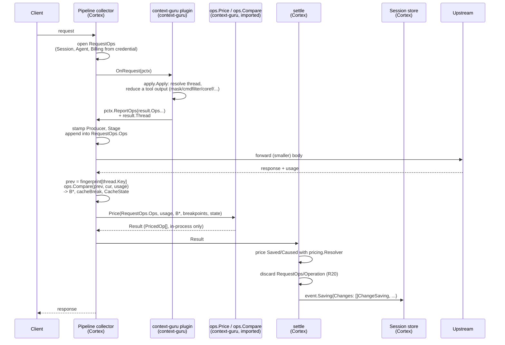
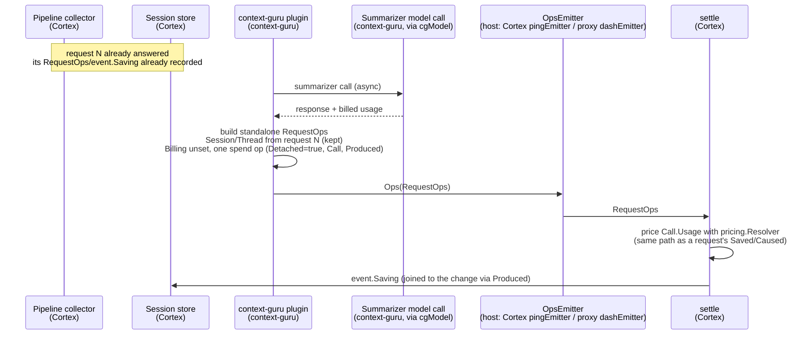
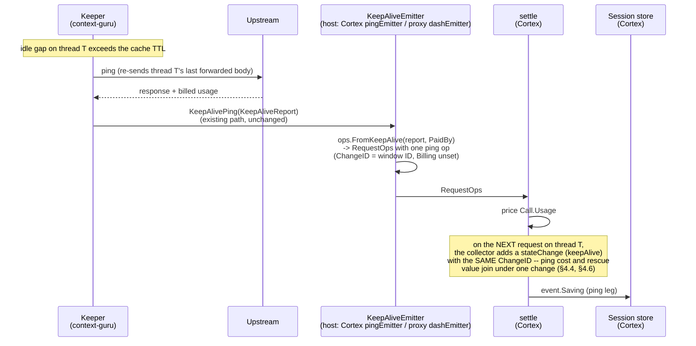

# Context operations: one object model for the changes plugins make, priced in one place

**Status:** proposed.
**Date:** 2026-10-18.
**Repos:** `rossoctl/context-guru` (the `ops` module) and `rossoctl/cortex` (the collector, `settle`,
the plugins).
**Worked example:** [`2026-10-18-context-operations-example.md`](2026-10-18-context-operations-example.md).
Read it first. It shows one session from body to dollars.
**Problem statement:** [rossoctl/cortex#1417](https://github.com/rossoctl/cortex/issues/1417),
"Counting savings from request-rewriting plugins (context-guru, tool-prune): open questions". §0.1
maps each of its questions to this spec.

## 0. Base, and the problem

**Paths.** `core/...`, `cmd/agentop` and `pctx` are in `rossoctl/cortex`. `components/...`,
`apply/...`, `dash` and `ops` are in this repo.

This design starts from the savings code on the Cortex branch `feat/contextguru-keepalive`, which
is not yet on Cortex `main`. That branch adds:

- a `context-guru/event` that the context-guru plugin publishes for each request
  (`core/plugins/contextguru/saving.go`, `unique.go`),
- context-guru's own pricing rules in `core/cost/settle/avoided.go` (`compactionDraft`,
  `compactionUsage`, `repeatUsage`, `rewritePenalty`), beside tool-prune's (`pruneDraft`),
- `event.Saving.PenaltyUSD`,
- the spec `2026-10-14-contextguru-savings-and-spend-design.md`.

Three problems remain with that approach:

1. **Each producer has its own event shape and its own pricing rule.** tool-prune publishes
   `{bytesRemoved, bodyBytesAfter}`. context-guru publishes an aggregate for the whole request.
   Each new producer needs a new rule in `settle`.
2. **The pricing rule exists twice.** The context-guru proxy (`dash.Event.repeatRate`) and Cortex
   (`repeatUsage`) keep copies that must agree, and they are kept in sync by hand.
3. **The facts are too coarse.** One aggregate for each request cannot give the saving of one
   change across requests, or the payback of a change that broke the cache. `PrefixRewritten` is a
   boolean, so the penalty is an upper bound (the whole `cache_write`).

### 0.1 The questions in cortex#1417

[cortex#1417](https://github.com/rossoctl/cortex/issues/1417) lists the open questions from the
Cortex side. This spec answers them as follows.

| # | Question in the issue | Answer in this spec |
|---|---|---|
| 1 | One set of numbers: spend and savings priced from different rate tables | Inside one host, spend and savings use one resolver (D3, D4, §4.6). The tier logic is in one library. The rates stay host-local by design (§1). |
| 2 | A figure operators can trust: how it was computed, and who stands behind it | Each recorded figure names its producer, its component, `Estimated` and `Projected` (§7.1), and the `ops` version that computed it (R46). The rules are reviewed in context-guru through the case list and `differences.json` (§11.4). |
| 3a | Cache effects: a saving priced at the tier the rewritten request landed in | Saved tokens are priced at the tier they would have had without the change: B\* and the breakpoints (§5.2, R36, R37). A break that a change caused is a separate `cacheBreak` cost, linked to that change (R23). |
| 3b | The plugin's own LLM calls through `core/llmclient`, not in the ledger; the `ibac` judge too | `spend` operations with the call's billed usage (D4, §4.6). This applies to every plugin that calls a model, not only context-guru (R47). |
| 3c | Keep-alive: the cost and the benefit land on different requests | `ping` operations, and the rescue rule (§4.6, §6.2). |
| 4 | Content re-sent every turn: overcount for compaction, correct for tool-prune | `ChangeID` and `FirstApplied` (R22, D1); the tier comes from the position, so tool-prune is priced on every turn and a compaction is not counted again at the full rate (§4.7). |
| 5 | Two ways of counting tokens | `Size.Tokenizer`, `bytes-estimate` and `Estimated` (R8); the correction factor is open (§12, Q4). |
| 6 | Credit across several plugins | Each producer is measured against its own input (R29), and R25 for the same content. |
| 7 | Observe mode | `Projected` (R12), never counted in totals. |
| — | Where the baseline lives, and how changes to it are reviewed | In the `ops` library in context-guru (D2). A change to it changes the case list, and every intended difference is in `differences.json` (§11.2, §11.4). |

## 1. Goal

- Each producer reports the **operations** it performed on the context, as **facts**.
- **One library**, owned by context-guru, turns operations into **tokens for each billing tier**.
- **Each host** converts tokens to dollars with its own rates, and records them. There are two
  hosts: **Cortex** (`pricing.Resolver`) and the **context-guru proxy** (`internal/modelinfo`).
  For the same request, both get the same tokens for each tier.
- **What is centralized is the logic, not the rates.** The `ops` library decides which tier every
  token falls in, in one place. The dollar rate for each tier stays in each host's own rate table,
  by design: Cortex has discounts, overrides and long-context tiers that the proxy does not. So the
  two hosts report the same tokens and can report different dollars for the same request, when
  their tables differ. Equal dollars are a property of the test cases, which use one fixed table
  (§11.2), not of production.
- An **exhaustive list of test cases**, made with the current saving computation, validates the
  implementation before any host uses it (§11).
- The model supports savings **across requests**: removing K tokens from message *i* saves on
  every later request that still carries the removal.
- context-guru is **one plugin in a longer pipeline**. Other plugins (tool-prune, cpex,
  inference-router) also change the request. The model covers all of them.
- Every figure uses the **cache state** of the request: hot, cold, or kept hot by a keep-alive.
- The model covers the operations that change the **cache state**, not only the content: keep-alive
  pings, `cachesplit`, and the TTL of a breakpoint.
- A later operation can **end** the effect of earlier ones. Example: a summary replaces messages
  that `mask` had already reduced.
- Every figure can be summed **for each session and for each thread**, so a subagent's saving is
  separate from the main thread's.
- The model serves **API users and subscription users**. An API user pays for each token, so a
  saving is money. A subscription user pays a fixed price and has a usage limit, so a saving is
  usage-limit headroom. The operations and the library are the same for both; only the conversion
  to a value differs (§7.4).

## 2. Decisions

| # | Question | Decision |
|---|---|---|
| D1 | Who knows that a change is applied for the first time? | **The producer, when it keeps state.** context-guru knows it from its frozen state, which is keyed by content hash and survives agent compaction. A stateless producer (tool-prune) does not know it, and leaves `FirstApplied` unset (§4.7). The library stays stateless. |
| D2 | Where is the savings logic? | **In a context-guru library.** Cortex calls it and keeps no producer-specific pricing rules. |
| D3 | What does the library return? | **Tokens for each tier**, not dollars. Cortex prices them with its own rates (discounts, overrides, long-context tiers), so a saving and the request's spend use the same rates. |
| D4 | How is cg's own spend recorded? | **As operations, in the same report as the savings.** A `spend` or `ping` operation carries the provider's billed usage of the call (`Call`). The host prices it with the savings, in one path. There is no second record and no `CostRecorder` (§4.6). `ops.Price` does not price the call; it returns `Call.Usage` for the host to price (D3). |
| D5 | Shape | **One typed operation for each change unit**, in-process only. The recorded summary (`event.Saving`/`ChangeSaving`) has the aggregate fallback above a limit, not the operation list itself (R20, §7.1). |
| D6 | How is a saving across requests counted? | **Realized on each request, not projected.** Each request lists every change in its body, fresh or replayed, and is priced from that request's own cache result. The producer remembers past changes, not the library or the host (§4.7). |
| D7 | Where do the types live? | **A standalone module in the context-guru repo,** `github.com/rossoctl/context-guru/ops`, with no dependency on the engine. Cortex's pipeline and every plugin import it without the engine's dependencies. |
| D8 | Which hosts compute dollars from operations? | **Both: Cortex and the context-guru proxy.** The proxy stops using its own saving rules (`dash/event.go`) when it switches. The comparison of request fingerprints (§5) is a pure function in `ops`, so the proxy does not need Cortex to find B\*. |
| D9 | How is the implementation validated? | **Against an exhaustive list of test cases made with the current computation** (§11), before any host switches. |
| D10 | How is the cache state used? | **As an input to every price.** The tier of a content change depends on the state (§6.2). An operation that changes the state (`stateChange`, §4.4) is priced as the difference between two states. |
| D11 | What happens to a change that a later change ends? | **Its producer stops reporting it.** No link names the change that ended it. The snapshot rule (D6) and the measurement at each producer's own input (R29) give the right price and stop any double count. Each change keeps the total it had until then (§4.5). |
| D12 | Where does the thread ID come from? | **From the engine's `internal/thread`, in both hosts**, copied onto every operation. The host keeps one fingerprint per thread, keyed by `thread.Key`, and compares each request with its own thread's previous request (§5.3). |
| D13 | How does the model serve a subscription user? | **The library does not change.** It already returns tokens for each tier (D3). The request carries a `Billing` fact. The host converts tokens to dollars for an API user, and to usage-limit units for a subscription user, with an API-equivalent dollar figure beside it, marked as such (§7.4). |

## 3. Requirements

The numbers are the order in which the requirements were found, so they are not in sequence.
R35 to R39 were added after the first review, R40 to R43 for subscription plans, R44 and R45 after a
second review that checked the model against the real engine and both hosts (§13), and R46 and R47
from [cortex#1417](https://github.com/rossoctl/cortex/issues/1417) (§0.1).
**R13 is withdrawn** (see D). **R10 is withdrawn.** It asked for a flag that separates a replay from a fresh act. `FirstApplied`
(§4.1) replaces it.

### A. Boundary

- **R1.** Operations are facts. They carry no rates, no dollars and no tier choice.
- **R2.** Operations carry no content: no message text, no clipped before/after strings, no
  credentials. They reach the unauthenticated `:9094` API and the session archive. Content identity
  uses hashes only.
- **R3.** The model and the library are in one module. Both repos import it. A contract test in
  each repo pins it.
- **R26.** The library is a pure function: no state, no I/O. The context-guru proxy and Cortex
  then compute the same figure for the same request.

### B. Coverage

- **R4.** Every operation that changes money is covered, not only reductions: reductions,
  additions, cache breaks, model calls, restores.
- **R5.** Spend that happens outside a request (a keep-alive ping, a detached summarizer call)
  carries its own attribution. It uses the same operations and the same recording path as spend
  inside a request (§4.6).
- **R47.** A model call that any plugin makes outside the listener is a `spend` operation, not
  only context-guru's. Example: the `ibac` judge calls a model through `core/llmclient`, so the call
  is not in the ledger today. It is reported the same way as the summarizer (§4.6). Its cost is not
  joined to a saving, because it produces none: `Produced` is empty.
- **R6.** An operation has an ID that is unique inside its request. Results, check failures and
  `cacheBreak` attribution refer to it. A reference to a change in another request uses `ChangeID`
  (R22), not the operation ID.
- **R27.** The model is not specific to one producer. Each operation names its producer and its
  pipeline stage.
- **R28.** One collector for each request collects the operations of all plugins, in order, and
  calls the library once.
- **R33.** Operations that add tokens are costs: an injected tool declaration, injected text, a
  restore.
- **R34.** A destination change (inference-router) is a separate kind. Its pricing is out of
  scope (§10).

### C. Facts for pricing

- **R7.** Each operation has a position: section and index, in the provider's hash order.
- **R8.** Sizes are in bytes, and in tokens with the tokenizer named. A producer with no tokenizer
  sends a byte estimate and marks it (§4.2 rule 8).
- **R9.** A reduction carries hashes of the content it removed.
- **R11.** Model-call usage is the provider's billed usage, read from the call's own response by
  the model client the host gives the engine. The engine does not count it (§4.6).
- **R22.** A change has an ID that is the same on every request that carries it (`ChangeID`).
- **R23.** A one-time cost (a cache break) is linked to the change that caused it, so payback can
  be computed.
- **R24.** Cache facts are scoped to the conversation the provider cached, not to the session as a
  whole. Subagents share a session but not a cache entry.
- **R29.** Each producer's change is measured against that producer's own input.
- **R30.** Cache facts come from the forwarded body, not from one plugin's output.
- **R31.** A cache break with a cause outside the plugins (client edit, expiry, first turn) is not
  charged to a plugin.
- **R32.** Positions resolve in the forwarded body. A producer that adds or removes messages
  reports that.
- **R36.** Every price uses the request's cache state: hot (the previous entry was read), cold
  (expired, or the first request), or rescued (a keep-alive kept the entry hot). The same change
  has a different value in each state.
- **R37.** Cache breakpoints are an input. The provider writes and reads the cache only at a
  breakpoint, so the tier of a position and the size of a cache-break penalty depend on where the
  breakpoints are, and on their TTL.
- **R38.** Operations that change the cache state are covered: a keep-alive ping, `cachesplit`, and
  a breakpoint TTL change. Each one is priced as the difference between two states.
- **R45.** The cache state distinguishes a proven expiry from an unproven floor. A provider whose
  TTL is only a guaranteed minimum (no documented maximum) never scores `cold` from elapsed time
  alone — that would invent a saving the provider may not have billed. See §5.4.

### D. Status and correctness

- **R12.** An operation is applied or projected. A projected operation comes from a plugin under
  `on_error: observe`: the plugin computed the change, but the original body went upstream. Only
  applied operations count in totals. A change that is not in the forwarded body (reverted by the
  pipeline) is not reported.
- **R44.** A change the producer made but the WRITEBACK silently discarded (bifrost cannot
  round-trip the message, so the splice is dropped — issue #32) is counted, not treated as absent.
  See §5.1a.
- **R13 is withdrawn.** It asked for a reversibility class and a stash key. No pricing rule, check
  or attribution reads them, and the expand loop finds stashed content by its marker in the body.
  cg's component API keeps the safety rule that a lossy offload must stash its original.
- **R14.** Changes are additive. For each section, the applied changes add up to the client body
  minus the forwarded body. The library checks this.
- **R15.** Each request is complete without history.
- **R16.** Operations are in the order they ran.
- **R25.** When two producers change the same content on one request, each one is credited for
  its own change, in pipeline order.
- **R35.** A later change can end earlier ones (a summary of reduced messages). The model shows
  this by the earlier change not being reported, not by a link. Their totals until then do not
  change (§4.5).

### E. Operability

- **R17.** Each operation names its producer and its component. The taxonomy of a component (what
  kind of change it makes, and what made it decide) depends on the component only, so a report maps
  `Component` to it with a table in cg. The operation does not carry it.
- **R18.** Each request carries request ID, session, thread (if known) and agent.
- **R46.** Each recorded saving names the version of the `ops` rules that computed it
  (`Saving.OpsVersion`). An operator can then trace a figure to the rules and the case list that
  define it. A change to the rules changes the version, so figures from two versions are not
  compared as if they were the same.
- **R39.** Each operation carries its session ID and thread ID, so every figure can be summed for
  one session, for one thread, or for one subagent.

### F. Billing plans

- **R40.** Operations and the library are independent of the billing plan. They carry tokens and
  tiers only. The plan is a fact on the request, not a field of any operation's price.
- **R41.** Each request names its billing: `api` (pay for each token) or `subscription` (fixed price
  with a usage limit), and the plan when it is known.
- **R42.** Each `spend` and `ping` operation names **who paid** for it. A subscription user's own
  call uses their usage limit. A call on an operator's API key costs the operator money. One
  session can have both.
- **R43.** A subscription saving is never reported as money saved. It is reported as usage-limit
  headroom, and an API-equivalent dollar figure can be shown beside it, labelled as an equivalent.
- **R19.** The model is versioned. An unknown `Kind` is kept and reported as unpriced, never
  dropped.
- **R20.** `RequestOps`/`Operation` is request-scoped and in-process only: input to `ops.Price`,
  discarded once the request's `event.Saving` is written. It is never recorded (R2's `:9094` and
  archive concern, and the session store's own size history, apply to what IS recorded —
  `event.Saving` and `Saving.Changes`/`ChangeSaving` — not to the raw operation list). That
  recorded summary has a size limit, with aggregation above it (§7.1).
- **R21.** Second-order effects are not operations. Example: the agent compacts later because its
  requests are smaller.

## 4. The object model

### 4.1 Types

```go
package ops // github.com/rossoctl/context-guru/ops

// RequestOps is the operations of one request, or of one keep-alive ping (Ping set).
type RequestOps struct {
    Version   int
    RequestID string
    Session   string
    Thread    Thread
    Agent     string
    At        time.Time
    // Billing applies only when Ops has a priced content change (reduce, add, stateChange,
    // cacheBreak). Zero value otherwise: a Ping report's content is a `ping` operation, priced
    // through its own Call.PaidBy, so nothing here reads RequestOps.Billing (R41, §7.4).
    Billing Billing
    Ping    bool // a request the host sent itself to keep the cache hot
    // Ops is in-process only: input to ops.Price for this request, never recorded (R20).
    Ops []Operation // in pipeline order
}

// Billing is a fact the host reads from the request's credential, not a price.
type Billing struct {
    Mode    BillingMode // api | subscription | unknown
    Plan    string      // the plan name when the host knows it, for example "max-5x"; "" otherwise
    Account string      // a hash of the account the credential belongs to; never the credential
}

// ModelCall is one upstream call a producer or the keeper made. The host's model client fills it
// from the call's own response, so the usage is what the provider billed.
type ModelCall struct {
    Host, Model string
    Usage       Usage         // input, cache read, cache write (and its 1h part), as billed
    Output      int           // output tokens, as billed
    Status      int           // upstream HTTP status
    Duration    time.Duration // 0 when not measured
    Detached    bool          // finished after the request it served was answered
    PaidBy      Payer         // who paid for the call (R42)
}

// Payer is who pays for a call that a producer or the keeper made (R42).
type Payer struct {
    Billing  Billing // the billing of the credential the call used
    Operator bool    // true when the call used the operator's credential, not the user's
}

// Thread identifies one conversation inside a session: the main thread, a subagent, or a fork.
// Each thread has its own provider cache entry.
type Thread struct {
    ID     string       // "main" for the primary thread
    Source ThreadSource // header | prefix | new
    Parent string       // the thread this one was forked from; "" if none
}


type Operation struct {
    ID        string // unique inside the request only; across requests, use ChangeID (R6)
    Kind      Kind   // reduce | add | stateChange | ping | spend | reroute | cacheBreak

    // Session and Thread are copied from RequestOps by the framework. They are on every operation
    // so a store of operations can be summed for one session or one thread with no join.
    Session string
    Thread  string

    Producer  string // set by the framework, not by the producer
    Stage     int    // set by the framework
    Component string // "mask", "dedup"; "" for a one-operation plugin

    Projected bool // set by the framework: the plugin runs under on_error: observe (R12)
    Discarded bool // set by the framework: the writeback could not splice this change (R44, §5.1a)

    At     Position // first position the change touches, in this producer's output
    Spans  []Span   // every touched range, when the change is not contiguous; nil otherwise
    Before Size     // what the producer received over the touched ranges; the sum over Spans
    After  Size     // what it sent on over the same ranges

    // kind = reduce | add | stateChange | ping
    ChangeID     string   // the same on every request that carries this change
    FirstApplied *bool    // true only on the first request that carries it; nil = not known (§4.7)
    ContentKeys  []string // hashes of removed content

    // kind = stateChange (§4.4)
    Mechanism Mechanism // keepAlive | cacheSplit | breakpointTTL
    StateFrom CacheState
    StateTo   CacheState

    // kind = add: set only when this add is a restore
    Reverses string // ChangeID of the removal this restore adds back

    // kind = spend | ping
    Call     *ModelCall // the call, with the provider's billed usage (§4.6)
    Produced []string   // ChangeIDs this call created

    // kind = reroute
    FromModel, ToModel, FromHost, ToHost string

    // kind = cacheBreak (written by the collector only)
    Cause        Cause  // producer | client | expired | unknown
    AttributedTo     string // the cause's operation ID, in this request; "" means nobody

    // a change to the message list, for mapping positions
    Structure *Splice
}

type Position struct {
    Section Section // tools | system | messages
    Index   int     // block or message index in that section
}

// Span is a range of positions in one section: [From, To], both in this producer's output.
// Before and After are the sizes over this range only. The operation's Before and After are the
// sums over its Spans.
type Span struct {
    Section       Section
    From, To      int
    Before, After Size
}

type Size struct {
    Bytes     int    // always set
    Tokens    int    // required on reduce and add; see rule 8
    Tokenizer string // the tokenizer that counted Tokens; "bytes-estimate" when estimated
}

type Splice struct{ At, Removed, Inserted int } // messages only

// CacheState is the state of the thread's provider cache entry when a request arrives.
type CacheState struct {
    Phase    Phase         // hot | cold | unknown
    Extent   *Position     // the last position the entry covers; nil when cold or unknown
    Gap      time.Duration // time since the entry was last written or read
    TTL      time.Duration // lifetime of the entry: 5m or 1h, from its breakpoint
    // Lifetime says whether TTL is a proven expiry (exact) or only a guaranteed floor
    // (minimum): Anthropic's TTL is exact; OpenAI GPT-5.6+ states only a 30-minute minimum
    // with no documented maximum (R45, §5.4). Gap > TTL proves expiry only when exact.
    Lifetime LifetimeKind
}

type Kind string          // reduce | add | stateChange | ping | spend | reroute | cacheBreak
type Mechanism string     // keepAlive | cacheSplit | breakpointTTL
type Phase string         // hot | cold | unknown
type LifetimeKind string  // exact | minimum | unknown — see apply.CacheLifetimeKind
type ThreadSource string  // header | prefix | new
type BillingMode string   // api | subscription | unknown
type Section string       // tools | system | messages
type Cause string         // producer | client | expired | unknown
type Side string          // beforeBoundary | afterBoundary
```

The enums are strings, not integers, so an unknown value from a newer producer survives a decode
and can be reported as unpriced (R19).

### 4.2 Rules

1. **One operation for each change unit.** A change unit is what the producer decides, replays and
   reverses as one. A component that reduces 12 tool outputs with 12 decisions reports 12 `reduce`
   operations, each with its own `ChangeID`. tool-prune removes the declarations of one account
   list in one decision, so it reports one operation for all of them. Its declarations are not
   next to each other, so it lists them in `Spans`. `At` is the first one.
2. **A replay is a new operation with the same `ChangeID` and `FirstApplied = false`.** A replay's
   cost, if any, is a `spend` operation, not part of the reduction.
3. **`FirstApplied` does not choose the tier.** The position does (§6.2). `FirstApplied` counts
   fresh acts and marks where a change's payback starts. It is optional: a producer that keeps no
   state leaves it unset (§4.7).
4. **`Before` and `After` are measured at the producer's own input.** For an `add`, including a
   restore (an `add` with `Reverses` set), `After > Before`.
5. **Only the collector writes `cacheBreak`.**
6. **A keep-alive ping is its own `RequestOps`, with `Ping = true`.** It has one `ping` operation
   whose `Call` carries the ping's billed usage. Its `ChangeID` names the keep-alive window, and the `stateChange` operation on
   the request it rescued has the same `ChangeID`. So the cost and the value of a window add up
   (§4.4).
7. **`ChangeID` is derived from the component and the original content key only — never from the
   replacement bytes.** This matches the engine's own stable key (`frozenKey(session, component,
   contentKey(original))`, `components/offload/state.go`) rather than adding to it. Two
   components that remove the same content in different ways still get different IDs, because
   `component` is part of the key.

   Replacement bytes were in an earlier draft of this rule, and that was a mistake: `mask.go`'s
   own comment states that `readlifecycle` and `skeleton` are **not** pure functions of
   (content, config) — `readlifecycle`'s marker text depends on later transcript events
   (`classify()`), and `skeleton`'s body depends on the paired tool call, not the message. For
   both, the same logical decision can produce different replacement bytes on different turns
   for reasons that have nothing to do with whether the change is new. Keying `ChangeID` on
   replacement bytes would churn the ID every time that happens — breaking the cross-request fold
   (§7.2) and `FirstApplied` for exactly the two components the engine already flags as unusual.
   Keying on content only, as `frozenKey` does, is stable regardless.
8. **The tokens a change saved come from the operation's own `Size`, not from the forwarded body.**
   Removed tokens are not in the forwarded body, so nothing else can count them. A producer with a
   tokenizer (context-guru) counts them and names the tokenizer. A producer with none (tool-prune)
   estimates them from bytes with the ratio of its own input, and sets
   `Tokenizer = "bytes-estimate"`. The library marks every priced result that uses an estimate as
   `Estimated`.
9. **The engine reports a change that `apply` writes, under the component that decided it.**
   `toolschema`, `toolfilter` and `cachesplit` are marker components: their `Reformat()` does
   nothing, and `apply` performs the rewrite (`apply/envelope.go`, `apply/prefixsplit.go`). `apply`
   holds the only exact numbers (`Trace.FilteredDeclTokens`, `Trace.SplitStableTokens`). So `apply`
   builds the operation and sets `Component` to the marker component's name. The mixed-TTL head
   (`apply/headttl.go`) has no component; its operations use `Component = "headttl"`.
10. **A batched decision is one operation.** `coref` plans many cuts across messages that are not
    next to each other, gates them as one batch (`min_batch_frac`, `break_even`), and spends one
    unit of `rewrite_budget` for the whole pass. The batch is the change unit (rule 1): one
    `reduce` operation, one `ChangeID`, one `Span` for each cut, and at most one attributed
    `cacheBreak`. Reporting each cut as its own operation would split one rewrite penalty across N
    changes, and no single cut's payback would then be meaningful.

### 4.3 Why positions are (section, index)

The provider hashes `tools`, then `system`, then `messages`. A comparison of two positions in that
order shows whether a change is before a cache boundary. For a change with `Spans`, each span is
compared on its own and priced with its own `Before − After`. So a change with spans on both sides
of B\* gets the right tier for each part. A producer reports positions in its own output. If a
later producer adds or removes messages, it reports a `Splice`, and the library maps earlier
positions into the forwarded body.

### 4.4 Operations that change the cache state

A `stateChange` operation does not change the content. It changes how the provider bills content
that is already there.

| Mechanism | Producer | What changes | Reported on |
|---|---|---|---|
| `keepAlive` | the keeper, through the host's collector | `StateFrom = cold`, `StateTo = hot`: a ping read the entry, so it did not expire | the first request after the ping window, when it was rescued |
| `cacheSplit` | context-guru (`cachesplit`) | the stable half of the system block is read, not written, when the volatile tail changed | each request where the split applies |
| `breakpointTTL` | context-guru (`apply/headttl.go`, `Component = "headttl"`) | the head of the request is held for 1h, not 5m | **two legs:** a cost on **every request that writes** the head at 1h (the premium), and a saving on each request that reads the 1h entry after a gap longer than 5m (the rescue) |

**When the collector adds a `keepAlive` operation.** All four conditions must be true. They are the
conditions of the current `keepaliveSavedUSD`:

1. The keeper sent at least one ping for this thread during the gap before this request.
2. The gap is longer than the entry's TTL, so without a ping the entry would have expired.
3. The provider read more than it wrote.
4. The tokens are the smaller of what the last ping read and what this request read.

**The ping and the rescue share one `ChangeID`,** the ID of the keep-alive window. A window whose
pings rescued nothing has only `ping` operations, so its total is negative. That is the cost of a
ping that was not needed, and it is visible for each thread.

**`breakpointTTL` is a bet, and both legs are recorded.** The 1h write premium (2.0× input against
1.25× for 5m) is paid on every request that creates the head entry at 1h, whether or not a later
request ever reads it. The benefit appears only on requests that arrive more than 5 and less than
60 minutes later. Measured over 19,805 production requests, a blanket 1h head cost $773.00 extra on
14,499 creating requests to recover $754.66 on 290 — net −$18.34; size-gating turned it positive.
If the model priced only the reading request, every write that never paid off would be missing, and
the figure would overstate the bet. So, like a keep-alive window:

- **On each 1h-writing request,** `apply` reports a `stateChange` with `Mechanism = breakpointTTL`
  and only a cost: `Caused.CacheWrite1h` for the head's tokens, less the 5m write it replaced. Its
  `ChangeID` names the head entry (`"headttl:" + Thread + ":" + head content key`).
- **On each request that reads that entry after the 5m TTL,** `apply` reports a `stateChange` with
  the same `ChangeID` and the saving (write → read, §6.2).

A head entry that is written at 1h and never read again has only the cost leg, so its total is
negative — the same visibility a keep-alive window that rescued nothing has.

### 4.5 Changes that end

A change can remove content that earlier changes had already reduced. Example: on turn 12 a
summary replaces messages 0 to 8, and messages 3 and 5 were reduced by `mask` and `coref`.

**A change ends when its producer stops reporting it.** There is no field that names the change
that ended it. Nothing more is needed:

1. **The price.** Each request is a snapshot (D6). A change that is not reported on a request saves
   nothing on that request. Its total until then does not change, so a change that did not pay back
   before it ended shows a loss.
2. **No double count.** Each producer's change is measured at its own input (R29), and the sum
   check tests the total (§6.5, check 1). So the tokens are counted once, in either pipeline order:

   | Pipeline order | `mask` | `coref` | summary | Total |
   |---|---|---|---|---|
   | Summarizer first (cg's `medium`, `high`, `xhigh` presets) | not reported | not reported | 40,000 → 1,500 = 38,500 | **38,500** |
   | Summarizer after the reducers | 3,940 | 19,950 | 16,110 → 1,500 = 14,610 | **38,500** |

   The order changes **who gets the credit**, not the total. Credit follows pipeline order (R25).
   In cg's presets the summarizer runs first, so it gets all of it: the reducers find their content
   gone, and they report nothing.
3. **A restore.** If the summary is reversed (a restore, or the summary is dropped), the producer
   replays `mask` and `coref` again. They are reported with their old `ChangeID` and
   `FirstApplied = false`.

**Why a change stopped** is not on the operation. A report can find it: the change last appeared at
position P on request N, and request N+1 has a change whose span covers P (`At` and `Structure`).
That is a question for a report, not for a price, so the report answers it.

### 4.6 How operations reach the host

There are three kinds of producer, and each reaches the host through a path that already exists.
The design adds no new reporting interface for the engine or the keeper.

| Producer | When it runs | How its operations reach the host |
|---|---|---|
| **The context-guru engine** (every component, including the ones whose bytes `apply` writes, §4.2 rule 9) | inside a request | **`apply.Result.Ops`**: the engine returns its operations with the rewritten body, in both hosts. In Cortex the context-guru plugin passes them to `pctx.ReportOps(result.Ops...)`. In the proxy there is no other producer, so the proxy reads `result.Ops` directly. |
| **Another Cortex plugin** (tool-prune, cpex) | inside a request | `pctx.ReportOps(ops...)`, during its own pass. Cortex only. |
| **The keeper**, and a **detached** engine model call | between requests, or after the response | the host's `components.Emitter`, through its optional capabilities: `KeepAliveEmitter.KeepAlivePing(KeepAliveReport)` for a ping (exists today), and `OpsEmitter.Ops(RequestOps)` for a detached call (new, same pattern). |

**Why not a new `Sink`.** An earlier draft added a `Sink` interface for pings. The keeper already
has a host-agnostic report path: `components.KeepAliveEmitter`, added so the keeper could be
exported from the proxy without a direct call into `dash` (issue #382, PR #591). The proxy wires
it to its `dashEmitter`; Cortex wires it to `pingEmitter` (`core/plugins/contextguru/spend.go`). A
second interface would make the keeper report each ping twice, or retire `KeepAliveReport` and lose
the fields the dashboard groups by (`Strategy`, `Preset`, `StopReason`, `MaxTokens`,
`FreshInput`). So the keeper keeps reporting `KeepAliveReport`, and **each host converts it** to a
`RequestOps` with one `ping` operation:

| `KeepAliveReport` | `ping` operation |
|---|---|
| `Session`, `Thread` | `RequestOps.Session`, `RequestOps.Thread`, and the same on the operation |
| `Window` (new, additive: the start of the idle gap the ping served) | `ChangeID = "ka:" + Thread + ":" + Window` |
| `Model`, `Provider`, `Route`, `Status`, `DurationMs` | `Call.Model`, `Call.Host`, `Call.Status`, `Call.Duration` |
| `CacheRead`, `CacheWrite`, `CacheWrite1h`, `FreshInput`, `Output` | `Call.Usage`, `Call.Output` |
| `TS` | `RequestOps.At` |
| `Strategy`, `Preset`, `StopReason`, `MaxTokens`, `Agent` | not on the operation; the dashboard keeps reading them from `KeepAliveReport` (§10.1) |
| `CostUSD` | not used: the host prices `Call.Usage` with its own rates, like every other call |

The conversion is a pure function in `ops` (`ops.FromKeepAlive(KeepAliveReport, PaidBy)`), so both
hosts build the same operation. The host supplies `PaidBy`, because only it knows which credential
the ping used.

```go
// OpsEmitter is an optional Emitter capability, the same pattern as KeepAliveEmitter: the engine
// type-asserts for it and does nothing if it is absent. It carries a RequestOps that has no
// request to travel with: today, only a detached model call.
type OpsEmitter interface {
    Ops(RequestOps)
}
```

The contract of both capabilities is the contract `CostRecorder` had: safe for concurrent use; no
blocking I/O; never makes the session active (a ping is not agent activity); may drop a report for
a session that no longer exists.

**Who builds a standalone `RequestOps`.** No collector is open, so the caller fills it from what it
knows about the thread it acts on: `Session` and `Thread`. It leaves `Billing` unset, because its
one operation is priced through its own `Call.PaidBy` (R41, §7.4).

**Where the usage comes from.** The host gives the engine its model client (`components.Model`;
in Cortex, `cgModel`). The client reads the usage from each response, and fills `ModelCall`. The
engine's own usage accounting is not used, because under Cortex it is zero (2026-10-14 spec, §0).

**A detached call.** A summarizer call can finish after its request was answered. Its `spend`
operation then cannot travel in that request's `apply.Result`. The engine sends it through
`OpsEmitter`, as a standalone `RequestOps` with `Detached = true` on the operation, and
`Session`/`Thread` from the request that caused the call. Its `Produced` names the change it made,
so the cost is still joined to that change.

**A prefix ask.** `extract_llm_sweep` asks the request's own model a question, as a separate
upstream call whose body is the previous turn's forwarded bytes plus one trailing user message
(`PrefixAsker`). That is an ordinary `spend` operation: its `Call.Usage` shows the cache read it
was designed for (measured 19,595 read, 0 written). When the sweep falls back to a call without the
cached prefix, the same operation shows fresh input instead. No new kind is needed; the test cases
cover both (§11.3).

**How the host records it.** The host handles operations from `apply.Result`, from `ReportOps`,
and from either Emitter capability the same way. It prices `Saved`, `Caused` and `Call.Usage` with
one resolver. So spend has the same rates, provenance, currency and billing basis (§7.4) as the
savings.

**What it replaces.** `core/cost/spend` (`Charge`, `CostRecorder`, `RecorderConsumer`) is removed.
Today both Cortex wirings inject `spend.LogRecorder{}`, which only logs, and the recorder that would
write the ledger was never built. So no recorded figure changes. Cortex's `pingEmitter` keeps
implementing `KeepAliveEmitter`, and calls `ops.FromKeepAlive` instead of building a `spend.Charge`.

### 4.7 Replays: who remembers past changes

**Each request lists every change in its body, fresh or replayed (D6). The producer remembers past
changes.** The library and the hosts remember nothing except the fingerprints of recent requests
(§5.2). This is a decision, not an oversight, for three reasons:

1. **The producer already re-applies each change on every request.** The client sends its whole
   uncompacted transcript on every turn. To keep the forwarded body the same, context-guru replays
   each frozen decision, and tool-prune removes the same declarations. So the producer already knows
   every change in the body. Reporting it adds no state.
2. **The price changes on every request, even when the change does not.** The same tokens are a
   cache read on a hot turn and a cache write on a cold turn (§6.2). The library needs each change's
   tokens and position **on this request**, and positions move: a summary turns 9 messages into 1.
3. **A register of past changes elsewhere fails in each place it could live:**

   | Where | Why it fails |
   |---|---|
   | The `ops` library | It is no longer a pure function (R26). Two hosts can disagree, and pricing an old request again gives a different figure. |
   | The host's collector | It must move positions after each `Splice`, find which changes a summary ended, and drop changes when the agent compacts its own transcript. It cannot see the content, so it cannot tell whether a change is still in the body, and a wrong guess is silent. |
   | The archive | It has gaps (`droppedEvents`). One lost request makes every later request wrong. |

**The cost is size, not correctness.** A replayed operation repeats about 200 bytes on every
request. If that becomes a problem, a later version can send a compact replay (`changeId`, `at`,
`tokens`) and the full operation only once. That change would not change the model or the price, so
it is not part of this design.

**A stateless producer.** tool-prune keeps no state. It reads its `remove` list from config and
removes the same declarations from every request. It can report every field of a replay except
`FirstApplied`:

| Field | Set by tool-prune? | How |
|---|---|---|
| `ChangeID` | **Yes** | A hash of the removed set and the config. It is the same on every request with the same config, so no state is needed. |
| `At`, `Spans`, `Before`, `After` | **Yes** | From the body it just changed: facts about this request. |
| `FirstApplied` | **No** | It needs to know whether an earlier request of this session carried the same `ChangeID`. tool-prune leaves it unset. |

An unset `FirstApplied` does not change any price, because the tier comes from the position and the
cache state (rule 3). A reader that needs the first application finds it in the session history:
the first event with that `ChangeID`.

**A config change of a stateless producer.** A new `remove` list (for example, a hot reload) gives
a new `ChangeID`. The old change stops and a new one starts. If the new list removes a declaration
that the old list kept, the forwarded body changes inside the cached prefix. The collector then adds
a `cacheBreak` attributed to tool-prune (§5.4). That is the real cost of the config change.

### 4.8 Sequence: three flows, and which repo each step is in

`participant` labels mark which repo owns each piece: Cortex (the pipeline, the collector,
`settle`) or context-guru (a plugin, the keeper, `ops`). `ops` is a library import in both; it
runs in-process in whichever repo calls it, never as its own service.

**A. A normal request.** A plugin reduces a tool output; the collector finds no break; `settle`
prices and records.



**B. A detached call.** The request has already been answered; its `RequestOps` may already be
closed and recorded. The summarizer call finishes afterward and reports through the host's
`OpsEmitter`.



**C. A standalone keep-alive ping.** No request is open at all; the keeper acts between turns.



## 5. The collector

Each host has a collector: Cortex, and the context-guru proxy. The parts are split this way:

| Part | Where | Cortex | Proxy |
|---|---|---|---|
| Resolve the thread | `internal/thread` (engine) | the engine resolves it inside `apply`, as today, and returns it in `apply.Result.Thread` | the same |
| Collect the operations | host | `pctx.ReportOps`, from every plugin, in pipeline order (§5.1) | `apply.Result.Ops`: the engine is the only producer |
| Keep the previous request's fingerprint, per thread | host | a map keyed by `thread.Key(session, thread)` | the same map, beside `dash.Recorder`'s `lastTail` (§5.3) |
| Compare, and find B\*, the break and the cache state | `ops.Compare` (pure) | called after the response | the same call |
| Convert keep-alive reports | `ops.FromKeepAlive` (pure) | in `pingEmitter` | in `dashEmitter` |

```go
func Compare(prev *Fingerprint, cur Fingerprint, usage Usage) (boundary *Position, brk *Operation, state CacheState)
```

`prev` is the fingerprint of **this thread's** previous request, or nil. The host looks it up by
`thread.Key`; `ops.Compare` does no matching of its own.

### 5.1 Collecting

- Each plugin calls `pctx.ReportOps(ops...)` during its pass. The pipeline runs in sequence, so the
  list is in order.
- The framework sets `Producer` and `Stage`. A plugin cannot report under another plugin's name.
- The framework sets `Projected = true` on every operation of a plugin whose `SetBody` returned
  false (`on_error: observe`).
- A producer reports only changes that are in the forwarded body, or that would be there for a
  projected operation. A change the pipeline reverted (an error, a panic, the never-worse guard) is
  not reported. It saves nothing, as a change that ended (§4.5). Its model call, if any, is still a
  `spend` operation, so the money it cost is counted.
- `settle` keeps an explicit allow-list of producers, for the reason `savingComponents` has today:
  a plugin must not add itself to the money record only by reporting operations. Operations from
  a producer that is not on the list are kept on the event and marked unpriced.

### 5.1a Discarded, not reverted (R44)

A **reverted** change never touched the forwarded body: the pipeline undid it before anything else
ran, so "it saves nothing" is simply true. A **discarded** change is a different failure, and
treating it the same way reopens an incident this engine already had.

bifrost cannot round-trip an Anthropic `tool_use` block: it drops `id`, `name` and `input` on
unmarshal (`apply/metawrite.go`). So the writeback compares the pre- and post-pipeline marshal of
each changed message, and if splicing the component's change back in would lose a field the
original had, it throws the change away rather than ship a corrupted block. That rule is correct —
but it is also exactly where `cacheinject`'s breakpoints lived, because its targets are the
messages carrying `tool_use`. The component believed it changed 46 messages; the writeback forwarded
0 of them (issue #32). The component's own counters — `Report.Saved()`, `Report.ChangedIdx` — looked
identical to a working run, because they describe what the component decided, not what reached the
wire. `Report.Discarded` exists so a reader can compare it against `ChangedIdx` and see the gap.

If an `Operation` for a discarded change is simply never reported — the current wording of this
section — the new model reproduces the same blind spot `Report.Discarded` was built to close, with
no equivalent counter to catch it. So:

- **A discarded change IS reported**, with `Discarded = true` and `Projected = false`. Its
  `Before`/`After` describe what the producer attempted, not what shipped.
- **It is not priced as a saving.** The sum check (§6.5, check 1) and conservation (check 6) treat
  it the same as a reverted or projected change: left out, because its content did not change on
  the wire.
- **It is counted.** `settle` keeps a per-(producer, component) count of discarded operations,
  surfaced the way `Report.Discarded` is today — on `/v1/pipeline` or an equivalent metrics path —
  so an operator can tell "this component is declining" from "this component's writes keep being
  thrown away," which is exactly the distinction #32 took two benchmark studies to find without
  this field.
- **Its model call, if any, is still a `spend` operation** and is still priced: the money was
  spent whether or not the change survived to the wire.

```go
// on Operation, alongside Projected:
Discarded bool // the writeback could not splice this change back (R44); never priced as a saving
```

### 5.2 The counterfactual boundary B\*

The provider reports this request's cache boundary as `cache_read`. But a plugin's cache break
moves it: in the coref example, `cache_read` stops at `messages[5]` because of the coref change.
Without it, the cache would have read through `messages[11]`. So the library needs **B\***, the
boundary that would have applied if no plugin had changed anything:

```
B* = min( prevCachedExtent,   // what this thread's previous request left cached
          clientFirstDiff )   // where the client changed its own body
B* = 0 when the cache expired
```

The collector keeps one fingerprint for each thread: the most recent request of that thread (§5.3).

```go
type Fingerprint struct {
    Thread    string
    At        time.Time
    Client    Body     // client body, before any plugin
    Forwarded Body     // body as sent upstream
    Cached    Position // extent cached after its response: cache_read + cache_write
}

// Body lists every position in hash order: tools, then system, then messages. The slice index is
// the position, so PosHash does not repeat it. Start gives the first index of each section.
type Body struct {
    Start [3]int
    Pos   []PosHash
}

type PosHash struct {
    Hash  uint64 // cumulative: equal hashes mean an equal prefix up to this position
    Bytes int32
}
```

`PosHash` is 12 bytes. It holds hashes and sizes only (R2).

### 5.3 The thread, and the previous request

**The thread comes from `internal/thread`, not from the collector.** The engine already resolves
each request's thread (`thread.Result`): the agent's header first, then prefix continuity, then the
session as a last resort. It also returns two signals that a weaker rule would lose:

- `Disagree`: the header named a known thread, but prefix continuity matched a different one. The
  header wins; the host logs the drift.
- `Inherits`: a new thread whose content is mostly an existing thread's — a rewind, an edited
  earlier message, a fork. Its first request is that thread's next turn, not a cold start.

The engine runs inside both hosts, so both get the same `thread.Result` for the same traffic. The
operations copy `Thread.ID` (R39), and `RequestOps.Thread` carries `Source` and `Parent`
(`Parent = Inherits`).

**The previous request is this thread's previous request.** The host keeps one fingerprint per
thread, keyed by `thread.Key(session, thread)` — the key `dash.Recorder` already uses for
`lastTail` and `lastSeen`. A new thread with `Inherits` set starts from the inherited thread's
fingerprint, so a fork reads its parent's cache instead of scoring cold.

An earlier draft matched each request against the last 4 fingerprints of the session by longest
common prefix. That answered a weaker question. After interleaved subagent requests the best prefix
match can be an older request, and a main thread whose previous turn is more than 4 requests back
drops out of the window. `cachesplit`'s saving depends on comparing the volatile tail with **this
thread's immediately previous request** (`cachesplitSavedUSD`, `TailChanged`), so a stale match
would misattribute it. Keying by thread gives the right baseline for every rule that needs one.

### 5.4 Classifying a break

`fwdFirstDiff` is where this thread's previous forwarded body first differs from this request's
forwarded body. `clientFirstDiff` is the same comparison on client bodies.

| Comparison | Result |
|---|---|
| `fwdFirstDiff < clientFirstDiff` | A plugin broke the cache. Add `cacheBreak{cause: producer, at: fwdFirstDiff}`, attributed to the earliest operation at or before `fwdFirstDiff`: its `ID` in `AttributedTo`. |
| `fwdFirstDiff ≥ clientFirstDiff` | The client changed its body. Add `cacheBreak{cause: client}`, attributed to nobody. |
| No diff, but `cache_read` is far below the previous request's cached extent | The cache expired. Add `cacheBreak{cause: expired}`, attributed to nobody. |
| No previous fingerprint for this thread | First turn of the thread with no `Inherits`, or a restart: `cause: unknown`. B\* is unknown (§6.4). |

The same comparison gives the **cache state** for `Input.State` (R36):

| Case | `Phase` | `Extent` |
|---|---|---|
| A previous fingerprint exists, and `Gap` ≤ its TTL | `hot` | the previous request's cached extent |
| A previous fingerprint exists, `Gap` > TTL, and a ping of this thread read the entry inside its TTL | `hot`, and the collector adds a `keepAlive` operation (§4.4) | the extent the ping read |
| A previous fingerprint exists, `Gap` > TTL, no ping, `Lifetime = exact` | `cold` | nil |
| A previous fingerprint exists, `Gap` > TTL, no ping, `Lifetime = minimum` | `unknown` | nil |
| No previous fingerprint for this thread | `unknown` | nil |

`Gap` is measured from the start of the last request or ping that touched the entry, because the
provider measures the TTL from the start of a request.

**Why `minimum` is not `cold` (R45).** `TTL` can be a proven expiry or only a guaranteed floor
(`apply.CacheLifetimeKind`: Anthropic's is `Exact`; OpenAI GPT-5.6+ states only a 30-minute
`Minimum`, with no documented maximum — "a minimum may prove an entry is still eligible, but
cannot prove it has expired"). On an `Exact` provider, `Gap` past `TTL` proves the entry gone, so
`cold` is correct and B\* = 0 is the honest answer. On a `Minimum` provider, the same `Gap` proves
nothing — the entry may still be live — so scoring it `cold` invents a cache-write saving that may
not exist, in the unsafe direction. The host already carries this distinction
(`keepaliveCreditFloorMs`: pre-5.6 OpenAI is never credited, exactly because `Minimum` cannot stand
in for proof of expiry). The collector sets `CacheState.Lifetime` from the same source and the
table above routes a `Minimum`-with-no-proof gap to `unknown`, not `cold` — §6.4 then applies
(`penaltyUnknown`), the safe direction.

### 5.5 Tokens for each position

These are the tokens of content that **was forwarded**: the library needs them for the penalty of a
cache break (§6.2), which counts forwarded content between the break and B\*. The tokens a change
**removed** are not in the forwarded body; they come from the operation's own `Size` (§4.2 rule 8).

Cortex has no tokenizer. The collector sends bytes for each forwarded position, and the library
converts them with the request's own ratio (billed prompt tokens ÷ forwarded body bytes), as
`pricing.EstimateTokensFromBytes` does today. Results that use the ratio are marked `Estimated`.

### 5.6 Limits

- **Memory:** 12 bytes for each position (`PosHash`, §5.2). 2 bodies × 2,000 positions is about
  48 KB for each thread. `internal/thread` caps threads at 64 for each session; a typical session
  has 1 to 5. `session.max_sessions` (100) bounds the total.
- **Restart:** fingerprints are lost. Only the next request of each session gets `penaltyUnknown`.
  They are not persisted (§10).
- context-guru keeps its own `MaxCachedIdx` for its own decisions. For pricing, the collector's B\*
  is the only authority (R30), because it is computed from the forwarded body after every plugin
  ran. In the proxy there is no later plugin, so the two must agree: the proxy checks
  `MaxCachedIdx` against B\* and counts a disagreement (a bug in one of them), at no extra cost.

## 6. The library

### 6.1 Call

```go
func Price(in Input) Result // pure

type Input struct {
    Ops         []Operation  // producers' operations + the collector's cacheBreak
    Usage       Usage        // billed usage of this request
    Forwarded   []PosBytes   // every position of the forwarded body, in hash order
    Breakpoints []Breakpoint // cache_control breakpoints of the forwarded body, in hash order
    Boundary    *Position    // B*; nil = unknown
    State       CacheState   // the thread's cache state on arrival (§5.4)
}

// Usage is the provider's billed prompt usage. CacheWrite1h is the part of CacheWrite billed at
// the one-hour rate, never an addition to it.
type Usage struct {
    Input, CacheRead, CacheWrite, CacheWrite1h int
}

type PosBytes struct {
    Pos   Position
    Bytes int
}

type Breakpoint struct {
    Pos Position
    TTL string // "5m" | "1h"
}
```

### 6.2 Tier rule

**The counterfactual.** The question for each operation is: *if this change had never been made —
on this request or on any earlier request of the same conversation — how would the provider have
billed these tokens on this request?*

That is the question for a change across requests. A different question is possible: *what if the
change was not made on this request only?* For a replayed change, the answer to that question is a
cache break, because the earlier requests cached the body without the content. That figure is the
cost of **stopping** the change, not the value of the change, so the library does not use it.

**The rule.** `L` is the last breakpoint in the forwarded body. The provider writes the cache only
up to a breakpoint, and bills content after `L` as input.

| Position of the tokens | Tier |
|---|---|
| at or before B\* | **cache read** |
| after B\*, at or before `L` | **cache write**, at the TTL of the first breakpoint at or after the position (5m or 1h) |
| after `L` | **input** |
| any position, with no breakpoint in the body | **input** |

On a cache miss, B\* = 0, so the first row matches nothing. A position is compared in hash order:
section first (tools, system, messages), then index. For a change with `Spans`, each span is
compared on its own (§4.3).

**The state.** B\* comes from the state: B\* = `State.Extent` when `Phase = hot`, limited by where
the client changed its own body (§5.2). When `Phase = cold`, B\* = 0, so every position takes the
write or input tier. So the same 8,000 tokens are worth 8,000 × read on a hot turn and 8,000 ×
write on a cold turn.

**A cache break, and the breakpoints.** A `cacheBreak` attributed to an operation moves content
from the read tier to the write tier. The content that moves is:

- **from** the end of what the provider still read on this request (`Usage.CacheRead`, mapped onto
  the forwarded positions),
- **to** B\*, as forwarded on this request.

The start is the read extent, not the position of the break. The provider reads only up to a
breakpoint. If the last breakpoint before the break is the end of `system`, the provider reads only
`tools` and `system`, and every message before the break is written again too. So a break deep in
the messages costs the same as a break at `messages[0]` when there is no breakpoint between them.
The new tail after B\* is written anyway, so it is not counted.

**A state change.** A `stateChange` operation moves its tokens from the tier of `StateFrom` to the
tier of `StateTo`: for `keepAlive` and `cacheSplit`, from write to read. For `breakpointTTL` there
are two legs (§4.4): on a reading request, from write (the 5m entry would have expired) to read; on
every writing request, the premium alone, as `Caused.CacheWrite1h` minus the 5m write it replaced.

**The interaction.** On a rescued request, the content changes are priced in the hot state (rule
above). Without the ping they would have been priced cold, which is worth more. The difference is
neither the ping's nor the content changes' alone. The library reports it as
`Result.Interaction`, attributed to nobody, so the request total still equals the bill without
the operations minus the bill with them.

### 6.3 Output

```go
type Result struct {
    Version     int
    Session     string
    Thread      string
    Ops         []PricedOp     // one for each input operation, same order
    Interaction TierTokens     // §6.2: on a rescued request; attributed to nobody
    Unpriced []Unpriced     // with a machine-stable reason
    Checks   []CheckFailure // §6.5
    Boundary BoundaryInfo   // the B* used, and its source
}

type Unpriced struct {
    OpID   string
    Reason string // "unknown_kind", "negative_size", "producer_not_allowed", ...
}

type CheckFailure struct {
    Check    string // "sum" | "order" | "unique_change" | "spans" | "attribution" |
                    // "conservation" | "thread" (§6.5)
    Producer string // "" when the check is not about one producer
    Detail   string // numbers only, no content
}

type BoundaryInfo struct {
    Pos    *Position // nil when unknown
    Source string    // "collector" | "cacheRead" | "unknown"
}

type PricedOp struct {
    OpID      string
    Session   string
    Thread    string
    Producer  string
    Component string
    ChangeID  string
    Projected bool
    Discarded bool // never priced as a saving (R44, §5.1a); still counted for diagnosis
    Saved     TierTokens // tokens the provider did not bill, by tier; never negative
    Caused    TierTokens // tokens the provider billed because of this operation; never negative
    Call      *ModelCall // spend and ping only: copied from the operation, for the host to price
    Estimated bool
    // Reason explains the tier for a reader: "cached_prefix", "new_tail", "cold", "break_penalty",
    // "rescued", ... It is derived from the other facts, and no pricing rule or host reads it.
    Reason    string
}

type TierTokens struct {
    Input, CacheWrite5m, CacheWrite1h, CacheRead int
}
```

`Saved` and `Caused` are separate and both non-negative, because the money layer rejects negative
values (`pricing.MicrosFromUSD`). Cortex prices each side with the existing code.

A break penalty has both sides: the tokens are written (`Caused.CacheWrite5m`) instead of read
(`Saved.CacheRead`). The net is the rate difference, with no special rule.

A `cacheBreak` is priced as its own operation. On its `PricedOp`, `ChangeID` is the `ChangeID` of
the operation named by `AttributedTo`, so the host adds the penalty to that change's total without
a lookup. The input carries only `AttributedTo`; the library copies the `ChangeID` once.
`spend` and `ping` operations are not priced in tokens. `PricedOp.Call` returns their `Call.Usage`
unchanged, and the host prices it with the same resolver as the savings (§4.6).

**Conservation.** For each request, the priced `Saved − Caused` of all content changes, cache
breaks and state changes, plus `Interaction`, equals the bill of the client body in the state it
would have had without any operation, minus the bill of the forwarded body. The library checks
this in tokens (§6.5, check 6).

### 6.4 Unknown boundary

If `Boundary` is nil, the library uses the extent `cache_read` covers as the boundary, charges no
penalty, and marks the result `penaltyUnknown`. This reports too little, which is the safe
direction.

### 6.5 Checks

The library reports failed checks in `Result.Checks`. A failure does not stop pricing.

1. **Sum:** for each section, the operations that are applied, not projected, and not discarded —
   `Before − After` adds up to the client size minus the forwarded size. The collector sends both.
   A failure means a plugin changed the body and did not report it.
2. **Order:** stages do not decrease.
3. **Unique `ChangeID` inside a request.**
4. **Spans:** for an operation with `Spans`, its `Before` and `After` equal the sums over its spans.
5. **Attribution:** each `cacheBreak` names at most one operation, and that operation is at or
   before the break.
6. **Conservation:** the request total of the applied operations equals the bill difference (§6.3).
   Projected operations are left out, because their content went upstream unchanged.
7. **Thread:** every operation has the request's `Session` and `Thread`.

## 7. Recording the result

§7.1 and §7.2 are Cortex. §7.3 is the context-guru proxy.

### 7.1 From `Result` to `event.Saving`

`settle` calls `ops.Price` once for each request, over the in-process `RequestOps`/`Operation`
list (R20): that list is never recorded. `settle` prices `Saved` and `Caused` with its
`pricing.Resolver`, at the same model and long-context tier as the request itself, then discards
the operations and writes one `event.Saving` for each (producer, component) — the only form that
reaches the session store, `:9094`, and the archive:

| `event.Saving` field | Source |
|---|---|
| `Component` | `producer` or `producer/component`, for example `context-guru/mask` |
| `TokensAvoided` | sum of `Saved` over all tiers |
| `USD` | `Saved`, priced |
| `PenaltyUSD` | `Caused`, priced, plus the attributed `cacheBreak` operations |
| `Tier` | the tier with the largest `Saved` |
| `Projected` | `Projected` |
| `DiscardedCount` (new, additive) | per (producer, component), the count of operations with `Discarded = true` on this request (R44, §5.1a) — never priced, surfaced for diagnosis the way `Report.Discarded` is today |
| `Estimated` | any operation `Estimated` |
| `OpsVersion` (new, additive) | `Result.Version`, the version of the `ops` rules (R46) |

New fields, all additive (the ledger rule is "add, never rename"):

| Field | Where | Why |
|---|---|---|
| `Saving.Producer` | event and ledger | group `context-guru/*` in the per-plugin breakdown |
| `Saving.Changes []ChangeSaving` | event only | `{changeId, savedUSD, causedUSD, firstApplied}`, for totals and payback for each change. Not in the ledger, which keys by minute. |
| `Event.UnattributedBreakUSD` | event | client edits and expired caches. Shown, never charged to a plugin. |
| `Event.InteractionUSD` | event | the interaction on a rescued request (§6.2). Counted in the session total, never charged to a plugin. |
| `Saving.Thread`, `ChangeSaving.Thread` | event and ledger | sum for each thread; a subagent's saving is separate from the main thread's |

`TotalAvoidedUSD` does not change: `max(0, USD − PenaltyUSD)` for each saving, floored at zero.
Signed totals are out of scope (§10).

**Size.** `Saving.Changes` is already small per request — one `ChangeSaving` per change touched,
not per operation — but a request can still touch many changes (a `coref` batch cut, a wide
`mask`/`cmdfilter` pass). So `Saving.Changes` has a size limit, with aggregation above it:

```go
// Aggregate replaces entries past the limit. One bucket per key, so a thread/session total is
// still exact; only each individual change's own cross-request total is lost for entries folded
// in here.
type Aggregate struct {
    Limit   int
    Dropped int // ChangeSaving entries folded into Entries
    Entries []AggregateEntry
}

type AggregateEntry struct {
    Producer, Component string
    FirstApplied         bool
    SavedUSD, CausedUSD  float64 // summed
}
```

### 7.2 Totals for each change across requests

A total for one `changeId` is a fold over the session's events: add `Changes[i]` where the
`changeId` matches. The session archive holds each request's event for the whole session, so agentop
can compute the fold when it opens a session. There is no ledger column for each change.

Without an archive (a cluster sidecar), totals for each change cover only the events in memory. The
per-request savings and the ledger totals are correct either way.

**Totals for a session and for a thread.** `Saving.Thread`/`ChangeSaving.Thread` carry the thread
(§7.1), so the same fold over recorded events gives:

| Total | Sum of |
|---|---|
| A change | `ChangeSaving`s with one `changeId` in one thread |
| A thread | every `Saving` of one `Thread`, plus its spend/ping and `Event.InteractionUSD` |
| A session | every thread of the session |
| A subagent | the threads whose `Parent` chain leads to the main thread, one at a time |

Spend (`spend`, `ping`) is shown beside the savings, never inside them, as today.

### 7.3 The context-guru proxy

The proxy computes its dollar savings from `ops.Price`, as Cortex does:

1. The engine returns the request's operations (migration step 3).
2. The proxy's collector calls `ops.Compare` and adds the `cacheBreak` operation.
3. The proxy calls `ops.Price`.
4. The proxy converts each `PricedOp` to dollars with `internal/modelinfo.Price` for the request's
   model.
5. The proxy stores the dollars in the columns its dashboard reads today: the saving of each
   component (`ComponentSavedUSD`) and the baseline delta (`baselineDeltaUSD`).

The `cachesplit` and keep-alive savings are `stateChange` operations now (§4.4), so the proxy
prices them through `ops.Price` too. Their current rules (`cachesplitSavedUSD`,
`keepaliveSavedUSD`) are the source of their test cases (§11), and are removed at step 10.

**Agreement between hosts.** For the same request, `ops.Price` returns the same tokens for each
tier in both hosts. The dollars are equal only when the two rate tables are equal (§1). The test
cases use one fixed rate table, so they can compare dollars (§11.2). A drift between the tables —
a model priced in one and not the other — shows as a dollar difference on identical tokens, which
the cross-host comparison test (§9 step 8) reports.

### 7.4 Billing plans

`ops.Price` returns the same tokens for each tier for an API user and for a subscription user. The
host converts them to a value by the request's `Billing.Mode`:

| `Billing.Mode` | Value of a saving | Value of a spend or ping | Shown as |
|---|---|---|---|
| `api` | tokens × the provider's rates | `Call.Usage` × the provider's rates | money saved; money spent |
| `subscription` | tokens × the plan's **weights**, in usage-limit units | `Call.Usage` × the same weights, if `Call.PaidBy` is the user's subscription | usage-limit headroom; an API-equivalent dollar figure beside it, labelled "API equivalent" |
| `unknown` | as `api`, with every figure marked `Estimated` | as `api` | money, marked estimated |

**Weights.** A weight says how much one token of a tier counts against the usage limit, compared
with one input token. The provider does not publish weights for each tier. So the default weights
are the ratios of the API rates (input 1, cache write 5m 1.25, cache write 1h 2, cache read 0.1,
output 5), and every subscription figure is marked `Estimated`. A host can set measured weights in
its config (§12, question 3).

**Who paid, when it is mixed.** If `Call.PaidBy.Operator` is true, the call cost the operator money,
whatever the user's plan. That spend is shown in dollars, apart from the user's usage-limit
figures. A subscription user's net figure is then two numbers, not one: usage-limit headroom
gained, and operator dollars spent. They are never added together.

**Keep-alive on a subscription.** A ping on the user's own credential uses the user's usage limit,
not money. The keep-alive window still adds up (§4.4), in usage-limit units.

**Detection.** The host reads `Billing.Mode` from the credential type on the request: an API key
means `api`; an OAuth token from a subscription login means `subscription`. If it cannot tell, it
uses `unknown`. Cortex and the proxy must use one rule, so the rule is a function in `ops`:
`ops.BillingFrom(headers)`. It reads only the credential type and returns no part of the credential
(R2). Both hosts must call it on the **client's** upstream credential header (`x-api-key` or
`Authorization`) before anything rewrites it — not on the proxy's control-plane login
(`proxy/authmode.go`), which is a different credential. A contract test in each host feeds the same
captured headers and expects the same `Billing.Mode`.

**Recording.** `event.Saving` gains `Basis`: `usd` or `subscriptionEquivalent`. `TotalAvoidedUSD`
and the cost ledger count only `Basis = usd`. A subscription saving goes in a new usage-limit
column, so API-equivalent dollars never enter a money total.

## 8. Errors

The rule: an error in savings never changes the request and never invents money. If a fact is
missing, report too little and say why.

| Situation | Result |
|---|---|
| `ops.Price` panics | `settle` recovers, writes no saving for the request, and increments `ops_price_panics`. The request and its spend record are unchanged. |
| A malformed operation (unknown kind, negative size) | Goes to `Unpriced` with a reason. The other operations are priced. |
| Sum check fails | Pricing goes on. The failure is counted for each plugin on `/v1/pipeline`. |
| No previous fingerprint for the thread | `Boundary.source = unknown`, §6.4. |
| Response has no usage | Nothing is priced, as today. |
| No rate for a tier | `Saving.Provenance` is empty, as today. Tokens are on the record. |
| Producer not on the allow-list | Kept on the event, unpriced. |
| `on_error: observe` | `Projected = true`. Priced and shown as "would have saved", never in totals. |
| The writeback cannot splice a change back (bifrost tool_use round-trip) | `Discarded = true`. Not priced as a saving; counted in `DiscardedCount` so the gap is visible, not silent (R44, §5.1a). |
| `Billing.Mode` is `unknown` | Priced as `api`, every figure marked `Estimated`. |

## 9. Migration

Each step merges alone and leaves the totals correct.

| Step | Repo | Change | Verification |
|---|---|---|---|
| 1 | context-guru | **Make the test-case list** (§11), with the current computation. No `ops` code yet. | The list is reviewed. Each `differs` entry cites a spec section. Each `notCovered` entry is in §12. |
| 2 | context-guru | Create the `ops` module: types, `Price`, `Compare`, checks. No callers. | Every case in the list passes (§11.4). |
| 3 | context-guru | The engine builds `[]ops.Operation` from `Trace` and the reports, and returns them in `apply.Result.Ops` with `apply.Result.Thread`. Marker and apply-only changes are built by `apply` (§4.2 rule 9). **This is new work for each change, not a read of existing fields.** The frozen state is keyed by content hash (`components/offload/state.go`), so `ChangeID` can be derived. But replays are counted only for each component today (`Report.Replays`), and `apply.Trace` records no ID or replay flag for each change. Each offloader must record, for each change, whether it replayed a frozen decision or made a new one. | Replay tests: the same `ChangeID` on each turn, `FirstApplied` once. |
| 4 | context-guru | **The proxy's collector.** It reads `apply.Result.Ops`; keeps one fingerprint per `thread.Key` beside `dash.Recorder`; calls `ops.Compare`; sets `Billing` with `ops.BillingFrom`; implements `OpsEmitter` on `dashEmitter`; and converts each `KeepAliveReport` with `ops.FromKeepAlive`. Nothing reads its output yet. This is the largest proxy step, and it uses only engine types: none of it depends on Cortex. | The `Compare` cases pass through the proxy's collector. The `MaxCachedIdx`/B\* agreement counter is zero on captured sessions (§5.6). |
| 5 | context-guru | The proxy computes dollars from `ops` **in shadow** (§7.3): it stores its current figure, and logs the `ops` figure and the difference. | Each logged difference matches a `differs` entry (§11.4). |
| 6 | context-guru | The proxy **switches** to the `ops` figure. `dash.Recorder`'s `TailChanged` and cold-start attribution read `ops.Compare`'s state instead of their own copy, so the proxy has one cache-state rule, not two. | Dashboard totals before and after on the same captured sessions. |
| 7 | Cortex | **The Cortex collector.** `pctx.ReportOps`; the context-guru plugin passes `apply.Result.Ops` through it; one fingerprint per `thread.Key`; `cgModel` fills `ModelCall`; `pingEmitter` calls `ops.FromKeepAlive` and implements `OpsEmitter`. `plugins.Deps.Costs` and `core/cost/spend` are removed. No pricing change. | The `Compare` cases pass through the Cortex collector. |
| 8 | Cortex | tool-prune and context-guru report operations beside their current events. `settle` computes both figures, writes the current one, logs the difference. | Each logged difference matches a `differs` entry; also the Cortex / cg proxy / control comparison test (`62333ee9` on `feat/contextguru-keepalive`). |
| 9 | Cortex | `settle` switches to `ops.Price`. The new event fields. | Ledger totals before and after on the same replay. |
| 10 | both | Remove the current events, `saving.go`, `unique.go`, the per-producer draft functions, and the proxy's rules that `ops` replaced (`uniqueRate`, `repeatRate`, the reduction part of `baselineDeltaUSD`, `cachesplitSavedUSD`, `keepaliveSavedUSD`). **Do not remove a rule that a `notCovered` entry still uses, nor any path §10.1 keeps** (gates, events, tool inventory, holdout replay, `KeepAliveReport`). | `go mod tidy -diff` in every module. All cases pass in both repos. |
| 11 | Cortex | agentop's per-change view. | TUI tests. |

Expected differences at step 9 (and, for the proxy, at step 6). Each one corrects a known error, so none is a regression:

- The penalty is lower. The current one uses the whole `cache_write` as an upper bound.
- The tier for each change comes from its position, not from a unique fraction for the request.
- The `context_guru_expand` declaration becomes a cost. The current figure does not count it.
- A cache-break penalty starts at the read extent, not at the break (§6.2). With few breakpoints it
  is larger than a count from the break.
- A keep-alive window whose pings rescued nothing is a negative figure for its thread. Today the
  ping cost and the saving are in separate columns.

## 10. Out of scope

- Signed totals in the ledger.
- Pricing of `reroute` (inference-router).
- Persisting fingerprints across a restart.

### 10.1 What this design does not replace

`Operation`/`RequestOps` carries money facts only — tokens, tiers, the IDs needed to join and
price them. The engine and the proxy's dashboard also need facts an `Operation` deliberately does
not carry (R2: no content; no names): tool/MCP names, invocation signals, declaration ownership,
replay text for a holdout, per-ping strategy metadata, per-component decline counters. None of
that is rebuilt from `Operation`. This design changes nothing about where it lives:

- **Component `Gate`/`Event` counters** (`Report.Gates`, `Report.Events`) — the operator's answer
  to "is this component declining, or just absent on this traffic" — are unaffected. They are not
  money, carry no `ChangeID`, and have no place in `Operation`; they keep rolling up into `/stats`
  the way they do today. Migration step 10 removes the pricing code this design replaces
  (`saving.go`, `unique.go`, the per-producer draft functions); it removes no gate/event path.
- **Tool/MCP advisory surfaces** (`dash/toolinventory.go`, `toolsuggest.go`, `toolremoval.go`,
  `adapttools.go`, `declcredit.go`) read declaration **names**, per-call invocation signals, and
  the fact that a declaration lives in `tools`. `tp:decl-set-7f3a`'s operation (§4, worked example
  op1) reports "12 declarations, 8,000 tokens," never which ones — these surfaces keep reading the
  engine's own declaration-scan data, not `Operation`.
- **Holdout/control-arm replay** (`dash/kvcachesuggest.go`, `kvcacheholdout.go`,
  `adaptcompaction.go`) needs the pre/post **text** at a message index to re-run a component under
  a different config. `Operation` carries no text (R2). These keep their own stored-text path;
  they are not driven by `ChangeID`/`Size`.
- **Keep-alive strategy attribution** (`dash/campaignsavings.go`) groups by strategy id, preset,
  stop reason — fields `components.KeepAliveReport` already carries (§4.6 keeps it as the keeper's
  report path) but a bare `ping` operation does not. The dashboard columns these feed keep reading
  `KeepAliveReport`, not the `ping` operation's `Call`.
- **The headline money total** (`dash/savings.go`'s `baseline − cost − cgllm + cachesplit + kaNet`)
  IS reconstructable from `event.Saving`/`ChangeSaving`, because §7.1/§7.2 keep the cachesplit,
  keep-alive and spend terms as separate, summable fields. Only the advisory/diagnostic detail
  above is out of this design's reach.

If a later design wants to drive any of the surfaces above from `ops`, that is new scope, not an
extension of this one.

## 11. Test cases

Before the implementation starts, we make an **exhaustive list of test cases** with the current
saving computation. The list is the specification the implementation must meet. It also records
each place where the new figure differs from the current one on purpose.

### 11.1 Where the current figures come from

| Current rule | Repo | Used for |
|---|---|---|
| `dash.Event.Price`: `ComponentSavedUSD`, `uniqueRate`, `repeatRate`, `baselineDeltaUSD`, `cachesplitSavedUSD`, `keepaliveSavedUSD`, `BilledTokenFactor` | context-guru | every context-guru case |
| `settle`: `pruneDraft`, `compactionDraft`, `rewritePenalty` | Cortex (`feat/contextguru-keepalive`) | tool-prune cases, rewrite-penalty cases |

Cortex's `repeatUsage` is a copy of the proxy's `repeatRate`, so the proxy is the source for the
context-guru reductions. context-guru never imports Cortex: the comparison with the Cortex rules
runs in Cortex (§11.4).

### 11.2 One case

Each case is a JSON file in `ops/opscases/`. The package embeds them and exports `All() []Case`,
so a test in Cortex can run the same list. A case holds only what the spec decides: the input and
the expected result. It does not hold the current code's figure, nor a judgement about it.

```json
{
  "id": "reduce/replay/before-bstar/hit/5m",
  "dims": {"kind": "reduce", "firstApplied": false, "position": "beforeBStar",
           "cache": "hit", "ttl": "5m"},
  "input": { "...": "an ops.Input" },
  "rates": "fixture-v1",
  "expected": { "...": "the ops.Result, tokens for each tier" }
}
```

- `expected` is what `ops.Price` must return, by this spec.
- `rates` names a fixed rate table in the package. `fixture-v1` is: input $3.00/M, cache write 5m
  $3.75/M, cache write 1h $6.00/M, cache read $0.30/M. With one table, `expected` and the current
  code's figure can be compared in dollars.

The places where the current code is meant to give a different figure are in one separate file,
`ops/opscases/differences.json`. Each entry has a case ID, a kind, and a reason:

- `differs`: the figures differ on purpose. The reason cites the spec section that causes it.
- `notCovered`: the current code prices something the model does not. The case is listed in §12.

A case that is not in this file must agree with the current code. The current figure is never
stored: the agreement test computes it each time it runs (§11.4).

### 11.3 What makes the list exhaustive

**A. Generated cases.** A generator makes one case for each combination of these dimensions. It
drops the combinations that cannot occur, and states the reason for each drop in its code.

| Dimension | Values |
|---|---|
| Kind | `reduce`, `add`, `add` with `Reverses` (a restore), `stateChange` (each `Mechanism`) |
| `FirstApplied` | true, false |
| Position | before B\*; after B\* and at or before `L`; after `L`; no breakpoint in the body; spans on both sides of B\* |
| Cache state | hot; cold (expired, `Lifetime: exact`); unknown (gap past an unproven `Lifetime: minimum`, R45); cold (first request); rescued by a ping; unknown (restart) |
| Cache result | full hit; partial hit; miss with write ≥ input; miss with write < input |
| Breakpoints | end of `system` + last message (Claude Code); one after `tools` only; none; one inside the messages before a break |
| Billing | `api`; `subscription` with the user paying for spend; `subscription` with the operator paying; `unknown` |
| TTL of the next breakpoint | 5m, 1h |
| Component type | summarizer (`summarize`, `cache_aware_summarizer`); other context-guru component; a marker component whose bytes `apply` writes (`toolschema`, `toolfilter`, `cachesplit`, `headttl`); tool-prune |
| Lifetime | `exact` (Anthropic); `minimum` (OpenAI GPT-5.6+); `unknown` |
| Tokens | counted by a tokenizer; `bytes-estimate`; with and without the proxy's `BilledTokenFactor` |

**B. Hand-written cases.** These test how operations interact, which a cross product cannot do:

1. The worked example: turn 5, the turn-8 expiry and the turn-7 coref break, with every figure in
   the example file.
2. Cache breaks: one for each `Cause`. A producer break attributed to the earliest operation. Two
   producers whose changes are both before the break.
3. Two producers on the same content (R25), and a structure change that moves positions (`Splice`).
4. A projected operation: priced, shown as "would have saved", and not counted. A reverted change
   that still made a model call: no reduction, and its `spend` operation counted. A discarded
   change: reported, not priced as a saving, counted in `DiscardedCount`, and its `spend` operation
   (if any) still priced (R44).
5. Each `Unpriced` reason, and each `CheckFailure`.
6. `Saving.Changes` over the limit, which becomes an `Aggregate` (§7.1).
7. `spend` and `reroute` operations, which pass through unpriced.
8. Keep-alive: a window that rescued its request; a window whose pings did not stop the expiry; a
   gap inside the TTL, where the ping is not credited; two threads with their own windows.
9. `cachesplit` and `breakpointTTL`, with the current `cachesplitSavedUSD` as the source.
10. Changes that end: a summary of reduced messages, in both pipeline orders, with the same total;
    an ended change that is not reported again; a restore of the summary, after which the earlier
    changes are reported again.
11. A subagent thread: its operations, its totals, and a session total that adds both threads.
12. The interaction on a rescued request, and the conservation check on every case.
13. The worked example on a subscription plan: the same tokens, in usage-limit units, with a
    summarizer call paid by the operator.
14. A `coref` batch: three cuts in messages that are not next to each other, as one operation with
    three spans, one `ChangeID` and one attributed `cacheBreak`; its payback across later turns.
15. `extract_llm_sweep`: a prefix ask that reads the previous turn's cache, and a fallback ask that
    pays fresh input. Both are `spend` operations; their `Call.Usage` differs.
16. `breakpointTTL`: a 1h head written and read after 20 minutes (both legs); a 1h head written and
    never read (cost leg only, negative total); the measured blanket-versus-gated case from
    `apply/headttl.go`.
17. A discarded change (R44): a `cacheinject`-shaped change on a `tool_use` message that the
    writeback drops. Reported, not priced as a saving, counted in `DiscardedCount`.
18. `readlifecycle` and `skeleton`: the same decision with different replacement bytes on two turns
    keeps one `ChangeID` (§4.2 rule 7).
19. Interleaved threads: a main thread whose previous request is five requests back, behind four
    subagent requests, still compares with its own previous request (§5.3).
20. `ops.FromKeepAlive`: a `KeepAliveReport` from each host's emitter gives the same `ping`
    operation.

**C. Cases from real traffic.** For each difference that a shadow step (§9 steps 5 and 8) logs and
no case matches, add a case. Then decide: it is a bug in `ops`, or a new `differs` entry with a
reason.

### 11.4 How the list validates the implementation

| Test | Where | Passes when |
|---|---|---|
| `ops` unit test | context-guru | `ops.Price` returns `expected` for every case. `ops.Compare` returns the expected B\* and break for every collector case. |
| Agreement with the current code | context-guru | The test runs `dash.Event.Price` on each case's input. Each case not in `differences.json` equals `expected` within one micro-dollar. Each `differs` entry really differs, so a stale entry fails. |
| Agreement with the Cortex rules | Cortex, until step 10 | The same test with `pruneDraft`, `compactionDraft` and `rewritePenalty`, for the tool-prune and rewrite-penalty cases. It is removed with those rules. |
| Review of the differences | PR review | Every `differs` entry cites a spec section, and a reviewer approves `differences.json`. |
| Cortex contract test | Cortex | Cortex builds the same inputs through its own plugins and collector, and gets `expected`. A type change in context-guru fails the Cortex build on upgrade. |
| Shadow steps | both | Every logged difference matches a `differs` entry. |
| Removal gate | both | No rule is removed while a `notCovered` entry uses it. |

### 11.5 Other tests

1. **Property tests in `ops`:** `Saved` and `Caused` are never negative; an empty list gives an
   empty result; reordering operations of different producers does not change each one's price,
   except for break attribution.
2. **End-to-end:** the LiteLLM integration test (`06c712cb` on `feat/contextguru-keepalive`) checks
   that the reported saving equals the change in billed cost against the control arm, within a
   tolerance.

## 12. Open questions

Each has test cases that are marked `differs` or `notCovered` in `differences.json` until it is decided (§11.3).

1. **The interaction on a rescued request (§6.2).** It is attributed to nobody. An alternative is
   to give it to the keep-alive window, because the window caused the state. That would make the
   keep-alive figure larger on every request with large reductions. A decision is needed before the
   test cases are frozen.
2. **Content shared by two threads — closed.** A fork starts with its parent's content, so the
   provider can read the parent's entry. `internal/thread` marks such a request with `Inherits`,
   and the host starts the fork from the parent's fingerprint (§5.3). So the fork's first request
   is scored against the parent's cache, not as `cold`.
3. **Usage-limit weights.** The provider publishes no weights for each tier, so the defaults (§7.4)
   are the API rate ratios, an estimate. It is not verified whether a subscription response carries
   usage-limit headers that a host could use to measure the weights. If it does, a calibration
   could replace the defaults for each plan.
4. **The tokenizer correction.** The proxy multiplies its counted tokens by `BilledTokenFactor`
   (o200k_base to the provider's tokenizer). Cortex uses a bytes ratio. Option: `Input` takes a
   factor for each tokenizer name, so `ops.Price` applies the correction in one place. The
   generated cases test both, with and without the factor.

## 13. Second review: what changed, and what was checked

A second review checked the model against the real engine (`components/`, `apply/`, `expand/`,
`keepalive/`, `internal/thread/`, `dash/`), Cortex's cost code, and both deployments. It found the
items below. Each is fixed in the section named.

| Finding | Fix |
|---|---|
| A change the writeback discarded was "not reported", so issue #32's blind spot came back | R44, §5.1a: reported with `Discarded`, never priced, counted in `DiscardedCount` |
| A gap past an OpenAI-style minimum TTL scored `cold`, inventing a saving | R45, §5.4: `CacheState.Lifetime`; a `minimum` with no proof scores `unknown` |
| Dashboard and diagnostic surfaces could lose their data at step 10, with no statement | §10.1 lists what keeps its own path; step 10 must not remove it |
| `ChangeID` included replacement bytes, so `readlifecycle` and `skeleton` churned it | §4.2 rule 7: content key only, as `frozenKey` |
| A new `Sink` duplicated the keeper's existing `KeepAliveEmitter` | §4.6: keep `KeepAliveEmitter`; convert with `ops.FromKeepAlive`; `OpsEmitter` for detached calls |
| Thread matching reinvented `internal/thread` and lost `Inherits`/`Disagree` | §5.3: use `thread.Result`; one fingerprint per `thread.Key` |
| The cachesplit baseline could be a stale request | §5.3: compare with this thread's previous request |
| The proxy had no specified place to collect operations | §4.6, §5: `apply.Result.Ops`, the same for both hosts |
| Migration compressed the proxy's collector into one switch step | §9: step 4 builds it, step 6 retires the duplicate cache-state rule |
| `headttl`'s premium was priced only when the entry was read | §4.4: a cost leg on every writing request |
| `coref`'s batch was shown as a single cut | §4.2 rule 10, test case 14 |
| Marker components: the decider is not the writer | §4.2 rule 9 |
| "One central place" read as one rate table | §1: the logic is central; rates stay host-local |
| `AttributedChange` duplicated a fact | removed; the library copies the `ChangeID` onto the priced penalty (§6.3) |

**Checked and found correct, no change:**

- `extract_llm_sweep`'s prefix ask fits a `spend` operation; only test cases were missing (§11.3, 15).
- Withdrawing R13 (reversibility, stash key) holds: `expand` finds stashed content by its marker.
- Two components that produce identical bytes count separately today too (component is in the
  `seenKeys` key), so per-component `ChangeID` is not a regression.
- Session, thread, agent and billing account are four different facts; none can be dropped.
- `Component = ""` for a one-operation plugin costs nothing.

**Kept as it is, with the trade-off stated:**

- `FirstApplied` rides on the priced operation although only reports read it. A side channel would
  add a second structure for one optional field.
- `agentdiet` reduces a step only after `delay_steps`, so its `FirstApplied` marks when the decision
  was made, not when the content entered the context. A report that dates payback must use the
  first event with the `ChangeID`, not the content's first turn.
- The collector computes B\* from the forwarded body instead of trusting the engine's
  `MaxCachedIdx`, because in Cortex later plugins change the body after the engine. In the proxy
  the two must agree, and a counter checks it (§5.6).

