# Context operations: examples

**Status:** draft, for the context-operations design. Not yet approved.

The examples are a sequence, from the simplest to the most complex. Each one adds one idea to the
ones before it. Examples 1 to 5 are small and self-contained. Examples 6 to 8 follow one session
from turn 5 to turn 13.

**Index**

- [Setup](#setup): rates, cache state, breakpoints, session and pipeline
1. [The idea in one change](#1-the-idea-in-one-change): one change, priced on one request
2. [The same change on hot and cold requests](#2-the-same-change-on-hot-and-cold-requests): one operation, three requests, three prices
3. [A rewrite of the tools](#3-a-rewrite-of-the-tools): a change to the tools section; `spans`
4. [A change that costs money first: summarization](#4-a-change-that-costs-money-first-summarization): a model call that costs money first; `spend` and `rewrite`
5. [A change of settings](#5-a-change-of-settings): a model and an effort change; the cache break
6. [One request in detail](#6-one-request-in-detail): the full flow: context, cache state, operations, tiers, price
7. [A change inside the cached prefix](#7-a-change-inside-the-cached-prefix): a cache break and why the breakpoints matter
8. [A keep-alive ping](#8-a-keep-alive-ping): a ping and the request it rescues

---

## Setup

Every example uses these values. The numbers are made up for the examples.

**Rates** (per million tokens):

| Tier | Agent model | Summarizer model |
|---|---|---|
| input | $3.00 | $1.00 |
| cache write (5m) | $3.75 | $1.25 |
| cache read | $0.30 | $0.10 |
| output | $15.00 | $5.00 |

The agent model prices the savings, because the removed tokens would have been billed to the agent's
requests. The summarizer model prices the summarizer call.

**Cache state.** A request is **hot** if the previous request of the same thread was less than 5
minutes ago. It is **cold** if not. A hot request reads the cached prefix. A cold request writes it
again.

**Breakpoints.** The client is Claude Code. It sets a 5m breakpoint at the end of `system`, and one
on the **last message**. So the provider can read or write the cache at two points only: the end of
`system`, and the end of the body.

**Session and thread.** Examples 6 to 8 follow session `s1`, thread `main`. Every operation carries
both IDs. To keep the JSON short, the examples show them once, in `RequestOps`.

**Pipeline** of examples 6 to 8, in order:

| Stage | Operator | What it does |
|---|---|---|
| 0 | `tool-prune` | Removes 3 tool declarations the account does not use |
| 1 | `context-guru` | `mask`, `cmdfilter`, `coref`, `summarize`; adds the `context_guru_expand` tool |
| — | keeper | Sends keep-alive pings between turns (not in the pipeline) |

---

## 1. The idea in one change

A context operator shortens one tool output. We want to know how much money that saved. The answer is
not one number, because the provider bills the same tokens at different rates on different requests.

The rates are in the [setup](#setup): input $3.00, cache write $3.75, cache read $0.30, per million
tokens.

**The prompt.** The agent has a conversation of 30,000 tokens (messages 0 to 8). The previous
request, request 0, sent it and the provider cached it. On request 1, a **new message** arrives at the
end: message 9, the output of a test run, 8,000 tokens. The client puts its cache breakpoint at the
end of the body.

```
request 0 (already cached by the provider)
  messages[0..8]   the conversation so far                 [30,000]

request 1 (10 seconds later; the new part)
  messages[9]      tool_result: test-run output            [ 8,000]   ← breakpoint

                                                  total    [38,000]
```

**The change.** The `cmdfilter` operator shortens message 9 from 8,000 tokens to 1,000, so the
request has 31,000 tokens, not 38,000. It saves **7,000 tokens**.

**How the saving is calculated.** The saving is the bill we would have paid without the change,
minus the bill we paid. This is the counterfactual. On request 1 the cache is hot: the provider
holds the first 30,000 tokens, and message 9 is new.

| | Without the change | With the change |
|---|---|---|
| Messages 0 to 8 (cached) | 30,000 × $0.30 (cache read) = $0.00900 | 30,000 × $0.30 = $0.00900 |
| Message 9 (new, written to the cache) | 8,000 × $3.75 (cache write) = $0.03000 | 1,000 × $3.75 = $0.00375 |
| **Bill for the prompt** | **$0.03900** | **$0.01275** |

**Saving = $0.03900 − $0.01275 = $0.02625**, which is the 7,000 tokens that did not need to be
written: 7,000 × $3.75.

**The operations.** One operation describes the change. The operator reports it as a `rewrite`:

```json
{"kind": "rewrite", "operator": "context-guru.cmdfilter",
 "at": {"section": "messages", "index": 9},
 "before": {"tokens": 8000}, "after": {"tokens": 1000},
 "changeId": "cg:cmdfilter:c40e"}
```

- `at` is the message that changed. `before` and `after` are its tokens.
- `changeId` names the change, so the same change can be added up across requests.
- There is no money in it. The library works out the money from the cache state.

---

## 2. The same change on hot and cold requests

Two more requests follow. Each adds new messages at the end, and the operator reports the same
`rewrite` again. Each request is priced from its own cache state: **hot** if the previous request
was less than 5 minutes ago, **cold** if not.


The hatched block is the 7,000 removed tokens. Orange means they would have been written, blue
means they would have been read.

- **Request 1** (hot): message 9 is new, so the 7,000 tokens would have been written.
  Saving: 7,000 × $3.75 = **$0.02625**.
- **Request 2** (hot): without the change, request 1 would have cached them, so they would have
  been read. Saving: 7,000 × $0.30 = **$0.00210**.
- **Request 3** (cold): the cache expired, so they would have been written again.
  Saving: 7,000 × $3.75 = **$0.02625**.

New messages are billed the same with and without the change, so they cancel out.
The total for the change is **$0.05460**.

**The operations.** One operation, **reported 3 times**. It is the `rewrite` from the operations
of [example 1](#1-the-idea-in-one-change), with no change in the JSON. The operator reports it on
requests 1, 2 and 3. The position, the tokens and the `changeId` are the same each time, so the
host adds the three savings together. The operation is a fact about tokens. Only the cache state
changes the saving.

### What to take from it

1. The operation is a **fact** about tokens. It has no price.
2. The **same change** is worth $0.02625 on request 1, $0.00210 on request 2, and $0.02625 on
   request 3. The cache state decides.
3. The total for a change is the **sum over the requests** that carry it.

---

## 3. A rewrite of the tools

An operator can rewrite the `tools` section, not only the messages. Here the `tool-prune` operator removes 3
tool declarations that the account does not use. The client declares 30 tools (20,000 tokens). The
operator forwards 27 (12,000 tokens). It removes the same 3 declarations on every request.
The tokens removed are the sum of the 3 declarations: 3,500 + 2,000 + 2,500 = **8,000 tokens**.

```
tools      30 declarations, 20,000 tokens
             tool 2   3,500    ← removed
             tool 9   2,000    ← removed
             tool 15  2,500    ← removed
system     3,000 tokens                              ← breakpoint
messages   ...
```

**The price.** The provider hashes `tools` first, then `system`, then `messages`. So the tools are
always at the start of the cached prefix. **B\*** is the position where the provider's cache would
have ended on this request, if no operator had changed anything. On a hot request the tools are
before B\*, and the 8,000 tokens would have been read. On a cold request B\* is 0, and they would have been
written.

| Request | Cache state | Tier for the 8,000 tokens | Saving |
|---|---|---|---|
| hot | the prefix is cached | cache read | 8,000 × $0.30 = **+$0.00240** |
| cold | the cache expired | cache write | 8,000 × $3.75 = **+$0.03000** |

The operator removes the same tools on every request, so the forwarded prefix does not change and
there is no cache break. The saving is small on a hot request, and 12.5 times larger on a cold one.

**The operations.** One operation, reported on every request.

The 3 tools are not next to each other, so the operator reports one `rewrite` with one span for
each tool. It is one operation, because it is one decision:

```json
{"kind": "rewrite", "operator": "tool-prune",
 "at": {"section": "tools", "index": 2},
 "spans": [
   {"section": "tools", "from": 2,  "to": 2,  "before": {"tokens": 3500}, "after": {"tokens": 0}},
   {"section": "tools", "from": 9,  "to": 9,  "before": {"tokens": 2000}, "after": {"tokens": 0}},
   {"section": "tools", "from": 15, "to": 15, "before": {"tokens": 2500}, "after": {"tokens": 0}}],
 "before": {"tokens": 8000}, "after": {"tokens": 0},
 "changeId": "tp:decl-set-7f3a"}
```

- `spans` lists each touched range with its own `before` and `after`. The operation's `before` and
  `after` are the sums: 3,500 + 2,000 + 2,500 = 8,000.
- There is no `messageSplice`. The message list does not change.
- The library prices each span on its own, because two spans can sit on different sides of the
  cache boundary. Here they do not.

---

## 4. A change that costs money first: summarization

A summarizer replaces messages 0 to 2 (10,000 tokens) with one 500-token summary. Messages 3 and 4
(3,000 tokens) follow it: the **tail**. It removes
**9,500 tokens** from every later request, but the call that writes the summary costs money first.

The savings use the agent model's rates, because the removed tokens would have been billed to the
agent's requests. The call uses the summarizer model's rates (see the [setup](#setup)).


- **Summarizer call:** costs $0.01250 (reported; or 10,000 × $1.00 + 500 × $5.00), so the balance starts below zero.
- **Request A** (hot): the summary changes the start of the prompt, so nothing in the cache
  matches. The summary and the tail are written (orange). The saving is small: 10,000 × $0.30 −
  500 × $3.75 = +$0.00113. The break costs more: the tail would have been read, and is written.
  3,000 × ($3.75 − $0.30) = −$0.01035. Request A is a net **−$0.00922**.
- **Request B** (hot): the summary is cached now, so the 9,500 tokens would have been read.
  Saving: 9,500 × $0.30 = +$0.00285.
- **Request C** (cold, 15 minutes after B): the cache expired, so the 9,500 tokens would have been
  written. Saving: 9,500 × $3.75 = +$0.03563. One cold request saves 12.5 times more than a hot one,
  and the balance goes above zero. The total after three requests is **+$0.01676**.

**The operations.** Three operations describe the change. The `spend` and the `rewrite` carry the
same `changeId`, so the host can add the cost and the saving together.

1. **`spend`, reported once.** The operator reports it with the summarizer call.

   ```json
   {"id": "op1", "kind": "spend", "operator": "context-guru.summarize",
    "call": {"model": "small-model", "params": {"effort": "low"},
             "usage": {"input": 10000, "cacheRead": 0, "cacheWrite": 0, "output": 500,
                       "costUSD": 0.0125}},
    "produced": ["cg:summarize:5d21"]}
   ```

2. **`rewrite`, reported 3 times.** The client sends messages 0 to 2 again on every request. The
   operator re-emits the stored summary, with no new call, and reports the same `rewrite` on
   requests A, B and C.

   ```json
   {"id": "op2", "kind": "rewrite", "operator": "context-guru.summarize",
    "at": {"section": "messages", "index": 0},
    "before": {"tokens": 10000}, "after": {"tokens": 500},
    "changeId": "cg:summarize:5d21",
    "messageSplice": {"at": 0, "removed": 3, "inserted": 1}}
   ```

3. **`cacheChange`, a break, on request A only, not reported by the operators.** The summary is at the start of
   the prompt, so nothing in the cache matches. A break is added, attributed to the `rewrite` (for
   example, by the host's collector; where it is added is an implementation decision). B and C
   have no break: on B the summary is already cached, and on C the cache expired.

   ```json
   {"id": "op3", "kind": "cacheChange", "cause": "operator",
    "stateFrom": {"phase": "hot"}, "stateTo": {"phase": "cold"},
    "at": {"section": "messages", "index": 0}, "attributedTo": "op2"}
   ```

- `spend` is the call. It names its model, because the summarizer can use a cheaper model than the
  agent. `costUSD` is the cost that the response reported. If a response reports no cost, the host
  prices the tokens.
- `produced` lists the changes that the call created. A call that created nothing, such as a
  keep-alive ping, leaves it empty.
- `rewrite` is the summary. `messageSplice` says 3 messages became 1, so later messages move up by 2.
  The library needs this because an operator reports positions in its own output. An operator that
  ran before the summary reported a position that has since moved. The library maps it to the
  forwarded body, and compares it with the cache boundary to choose the tier. This example has no
  earlier operator, so no figure here depends on it.
  The `spend` and the `rewrite` are the same on A, B and C. Only the cache state changes the saving.
- A break (`cacheChange`) moves tokens that follow the break from cache read to cache write. This is the
  **penalty**: tail tokens × ($3.75 − $0.30). Here the tail is 3,000 tokens, so the penalty is
  −$0.01035. It is larger than the saving on A, so the first request with a summary costs money.
  Requests B and C have no break, so they pay no penalty.

---

## 5. A change of settings

An operator can change the settings of a request, not only its content. Here a router moves request 5
to a smaller model at a lower effort. The numbers are made up for this case.

| Request | Model | Effort | Cache before the request |
|---|---|---|---|
| 4 | `large-model` | high | 40,000 tokens cached |
| 5 | `small-model` | low | the router changed both settings |

The router changes two settings in one decision. The library does not price a settings change
(design R50), for two reasons. We do not know what the large model would have written at high
effort. And the effect depends on the task.

**The cache break.** The provider keeps its cache for a model, so the new model starts cold. Request
5 reads 0 tokens from the cache, where request 4 left 40,000 cached. Both settings changed together,
so the break is attributed to the decision. It does not say which setting caused it.

**The operations.** Two operations describe the change.

1. **`setting`, reported by the router.** It holds both changes in a map, because they are one
   decision. The key is the setting name. It has no tokens and no price.

   ```json
   { "id": "op1", "kind": "setting", "operator": "inference-router",
     "settings": {"model":  {"from": "large-model", "to": "small-model"},
                  "effort": {"from": "high",        "to": "low"}} }
   ```

2. **`cacheChange`, a break, not reported by the operators.** A break is added, attributed to `op1`. A
   component that sees the whole request adds it (for example, the host's collector; where it is
   added is an implementation decision).

   ```json
   { "id": "op2", "kind": "cacheChange", "cause": "setting",
     "stateFrom": {"phase": "hot"}, "stateTo": {"phase": "cold"}, "attributedTo": "op1" }
   ```

**What the library returns** (tokens, no dollars):

| Item | Tokens | Tier change |
|---|---|---|
| `op1` (settings) | none | not priced |
| `op2` (break) | 40,000 | from cache read to cache write |

**What a report can show.** The output tokens of request 4 and request 5, labelled as an
observation, and the cache break with its cause. It shows **no saving** for the move to a smaller
model, because the design does not compute one.

**An open point.** The 40,000 tokens move from read to write. The rates for that move could be the
large model's or the small model's. The host prices a request at that request's model, which is the
small model. The counterfactual request would have used the large model. The design does not decide
this, so this case gives no dollars.

---

## 6. One request in detail

Examples 6 to 8 follow one session from turn 5 to turn 13, with the [setup](#setup) above. This
example prices one request. A script computed every figure. For each request, the operations add up to the bill
without the operations minus the bill with them (design §6.3, "Conservation").

### The context

The body the **client** sends is 71,000 tokens. The diagram shows it, section by section, in the
top row. The bottom row is the body the operators forward.


Hatched blocks are what the operators removed. Blue is billed at the cache-read rate, and orange at
the cache-write rate. The block with a dark outline is the tool that `expand` added.

State from earlier turns:

- `tool-prune` removed the same 3 declarations (8,000 tokens, as in example 3) on every turn since turn 1.
- On turn 3, `mask` reduced 4,000 tokens (message 3) to a 60-token marker. cg replays it on every later turn.
- cg added the `context_guru_expand` tool (300 tokens) on every turn since turn 1.
- Turn 4 forwarded messages 0 to 8, and the provider cached them.

The new message on turn 5:

- Message 9 is new. It is the output of a `pytest` run: 8,000 tokens.
- `cmdfilter` reduces it to 900 tokens, so it removes 7,100 tokens.
- Message 9 is after B\*, so the provider has not cached it. It is written, not read.

### The cache state

The cache state is found from turn 4's fingerprint. The gap is 1 minute, inside the 5m TTL:

```json
"state": {"phase": "hot", "extent": {"section": "messages", "index": 8}, "gap": "1m", "ttl": "5m"}
```

So B\* = `messages[8]`.

### The operations

Earlier examples showed single operations. This time the JSON is the whole report for one request, the
**envelope**. The envelope names the request (`requestId`), the session and the thread. It holds all
the operations of the request in `ops`, in pipeline order (`stage`). The library reads the envelope
and prices each operation in it.

```json
{
  "version": 1, "requestId": "req-5", "session": "s1",
  "thread": {"id": "main", "source": "header"},
  "ops": [
    {
      "id": "op1", "kind": "rewrite",
      "operator": "tool-prune", "stage": 0,
      "at": {"section": "tools", "index": 2},
      "spans": [
        {"section": "tools", "from": 2,  "to": 2,
         "before": {"tokens": 3500}, "after": {"tokens": 0}},
        {"section": "tools", "from": 9,  "to": 9,
         "before": {"tokens": 2000}, "after": {"tokens": 0}},
        {"section": "tools", "from": 15, "to": 15,
         "before": {"tokens": 2500}, "after": {"tokens": 0}}
      ],
      "before": {"tokens": 8000}, "after": {"tokens": 0},
      "changeId": "tp:decl-set-7f3a"
    },
    {
      "id": "op2", "kind": "rewrite",
      "operator": "context-guru.expand", "stage": 1,
      "at": {"section": "tools", "index": 18},
      "before": {"tokens": 0}, "after": {"tokens": 300},
      "changeId": "cg:expand-tool:v3"
    },
    {
      "id": "op3", "kind": "rewrite",
      "operator": "context-guru.mask", "stage": 1,
      "at": {"section": "messages", "index": 3},
      "before": {"tokens": 4000}, "after": {"tokens": 60},
      "changeId": "cg:mask:91ab"
    },
    {
      "id": "op4", "kind": "rewrite",
      "operator": "context-guru.cmdfilter", "stage": 1,
      "at": {"section": "messages", "index": 9},
      "before": {"tokens": 8000}, "after": {"tokens": 900},
      "changeId": "cg:cmdfilter:c40e"
    }
  ]
}
```

op1 is the same operation as in example 3: **one** operation for 3 declarations, because tool-prune
removes one account list in one decision (design §4.2 rule 1). To keep the example short, bytes and
the cg tokenizer name are left out.

The `tools` section sizes are not on any operation. They are given to the sum check
(design §6.5): 20,000 − 8,000 (op1) + 300 (op2) = 12,300 forwarded.

### The price

The diagram shows the bill and the saving of each operation. The question for each operation
(design §6.2): *if this change had never been made, how would the provider have billed these tokens
on this request?* The answer depends on the position of the tokens: read at or before B\*, written
after B\* up to `L`, input after `L`. The total for turn 5 is **+$0.03012**.

---

## 7. A change inside the cached prefix

### The context

On turn 7, `coref` reduces message 5 (the 20,000-token grep output) to 50 tokens. This looks like a
good change. It is not, because message 5 is inside the cached prefix.

- Turn 6 cached through `messages[11]`, so B\* = `messages[11]`.
- The client did not change. The forwarded body first differs from turn 6's at `messages[5]`.
- So the change itself breaks the cache. The collector adds a `cacheChange`, attributed to the
  `coref` operation.


The provider reads the cache only up to a breakpoint. The last breakpoint before `messages[5]` is
the end of `system`. So the provider reads `tools` and `system` (15,300 tokens). It writes
**everything** after them again, including messages 0 to 4, which `coref` did not touch.

If the client had a breakpoint on `messages[4]`, the penalty would start at message 5. It would be
7,950 tokens, and the net −$0.02743. The breakpoints, not the size of the change, decide most of the
cost.

On each later hot turn, `coref` saves +$0.00599 again. A summary on turn 12 ends it.

### The operations

Two operations describe the change.

1. **`rewrite`, reported by `coref`.**

   ```json
   {
     "id": "op12", "kind": "rewrite",
     "operator": "context-guru.coref", "stage": 1,
     "at": {"section": "messages", "index": 5},
     "before": {"tokens": 20000}, "after": {"tokens": 50},
     "changeId": "cg:coref:5e2d"
   }
   ```

2. **`cacheChange`, a break, not reported by the operators.** It is added, attributed to op12.

   ```json
   { "id": "op13", "kind": "cacheChange", "cause": "operator",
     "stateFrom": {"phase": "hot"}, "stateTo": {"phase": "cold"},
     "at": {"section": "messages", "index": 5},
     "attributedTo": "op12" }
   ```

   `at` is the first position where the forwarded body differs from turn 6's. It is not the start of
   the penalty. The provider reads only up to the last breakpoint before `at`, the end of `system`.

---

## 8. A keep-alive ping

### The context

Turn 9 ends at minute 20. The user is idle after it. The 5m cache entry expires at minute 25.
Turn 10 arrives at minute 28.

The diagram shows two cases. Across is the prompt, in tokens. Down is time, in minutes.

- **Without a ping**, the entry expires at minute 25. Turn 10 arrives at minute 28 and writes
  the complete context.
- **With a ping**, the keeper sends it at minute 24. It re-sends turn 9's forwarded body
  (10,000 tokens) and gets a 1-token reply. The entry is renewed and is valid until minute 29.
  Turn 10 reads the context of turn 9 and writes only its new message.



### The operations

Two operations describe the keep-alive window `ka:main:w1`. Both carry the same `changeId`. It links
the ping (the cost) to the request it rescued (the saving). So a report can show the cost and the
value of the window together. A window whose ping rescued nothing has only the `spend`, and its
total is negative.

1. **`spend`, reported once, by the keeper.** A ping is an ordinary `spend` operation (design §4.2
   rule 6). **It is not related to any real request.** The agent did not send it, and no turn
   carries it. It is its own `RequestOps`, with its own `requestId` (`ping-p1`). It only costs money:
   it has no saving of its own.

   ```json
   {
     "version": 1, "requestId": "ping-p1", "session": "s1",
     "thread": {"id": "main", "source": "header"},
     "billing": {"mode": "api"},
     "ops": [
       { "id": "op1", "kind": "spend", "operator": "keeper",
         "changeId": "ka:main:w1",
         "call": {
           "host": "api.anthropic.com", "model": "agent-model",
           "usage": {"input": 10, "cacheRead": 10000, "cacheWrite": 0, "output": 1},
           "status": 200
         } }
     ]
   }
   ```

2. **`cacheChange`, a rescue, on turn 10.** It is added after the four conditions of design §4.4 are checked.
   Turn 9 forwarded messages 0 to 5, so the extent is `messages[5]`.

   ```json
   {
     "id": "op20", "kind": "cacheChange",
     "operator": "keeper",
     "stateFrom": {"phase": "cold"},
     "stateTo": {"phase": "hot", "extent": {"section": "messages", "index": 5}},
     "before": {"tokens": 10000}, "after": {"tokens": 10000},
     "changeId": "ka:main:w1"
   }
   ```

### The price

| Operation | Calculation | Result |
|---|---|---|
| Ping (`spend`) | 10,000 read + 10 input + 1 output | −$0.00305 |
| Rescue (`cacheChange`, cold to hot) | 10,000 × ($3.75 − $0.30) | +$0.03450 |
| **Total added to session `s1`** | | **+$0.03145** |

The ping re-sends the 10,000 cached tokens, so they are billed as a read. The 10 input tokens are
the small part of the ping that is not cached. The 1 output token is the reply.

The ping has no request of its own, so the totals add up operations, not requests. The ping and
the rescue both carry session `s1` and thread `main`. The host adds both to the totals of that
session and that thread: −$0.00305 + $0.03450 = **+$0.03145**.
